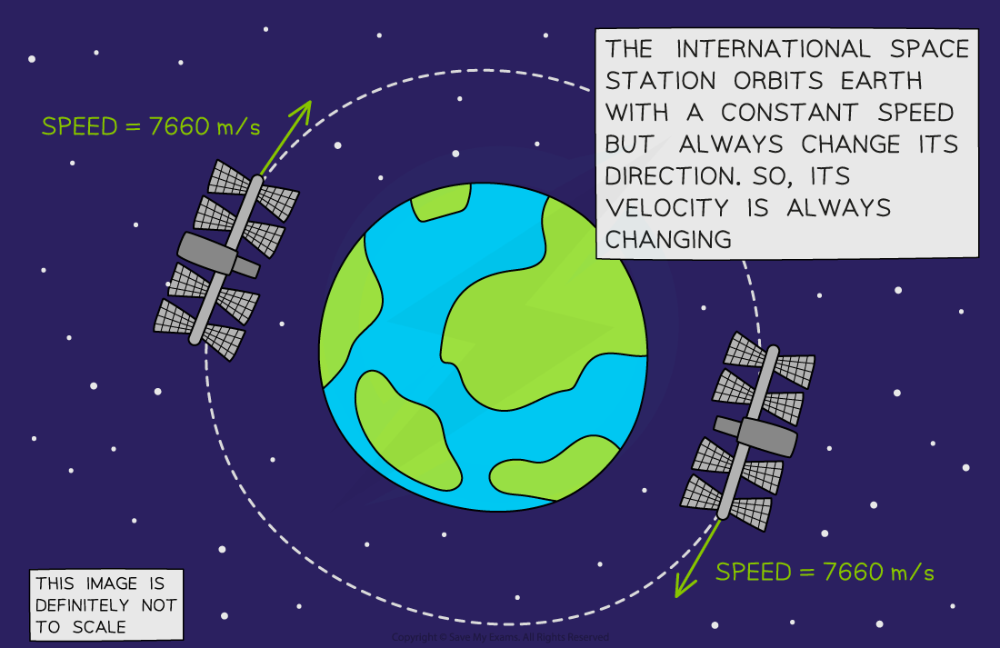
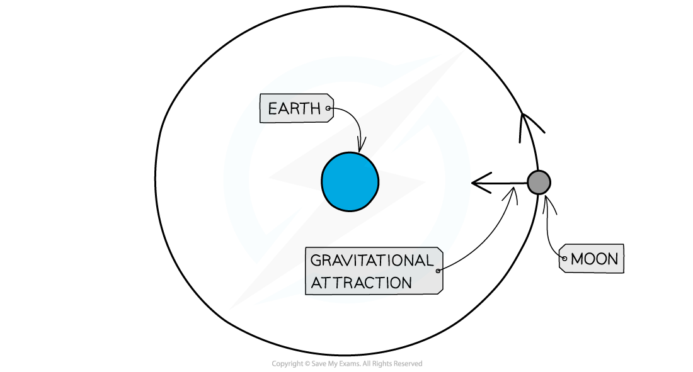

# Circular Motion

## Circular motion

> **Spec point** — `spcpt_8rbkPfJ2FjjScT5T` · Describe, qualitatively, motion in a circular path due to a force perpendicular to the motion as:
   (a) speed increases if force increases, with mass and radius constant
   (b) radius decreases if force increases, with mass and speed constant
   (c) an increased mass requires an increased force to keep speed and radius constant (F = mv ^2/r is not required)

## Circular motion

### Extended Tier Only

- Velocity is a ***vector*** quantity with both **magnitude **and **direction**
- Therefore, the velocity of an object is its **speed** in a given **direction**

- When an object travels in **circular motion**, its **direction **is always **changing**

  - Therefore, the **velocity **of an object in circular motion is always **changing, **even if its** speed** is constant
- This means that an object in **circular motion** is **always accelerating** because acceleration is a [change in velocity](https://www.savemyexams.com/igcse/physics/cie/23/revision-notes/1-motion-forces-and-energy/1-2-motion/1-2-2-acceleration/?_ai=internal-linking)

*The International Space Station’s velocity is always changing. It orbits the Earth at a constant speed of about 7660 m/s, but its direction is constantly changing *

### Force in circular motion

- When a resultant force acts** perpendicularly** to an object’s direction of travel, the resultant force will cause that object to change direction

- If the resultant force continues to act at 90 degrees to the motion, the object will keep changing its direction (whilst remaining at a constant speed) and travel in a circle

- This is what happens when a ball tied to a string is swung in a circle, or when a planet orbits a starfor example

#### Circular motion of the Moon around the Earth

*The Moon is pulled towards the Earth by the gravitational force acting on it, at 90 degrees to its direction of travel. This causes it to travel in a circular path*

- Therefore, for an object in circular motion, the **resultant force **is always directed **towards **the **centre **of the circle (or **towards** the **inside** of the bend)
- The **resultant force **needed to make something follow a circular path depends on a number of factors:

  - **The mass of the object**
  
    - A greater mass requires a greater resultant force when the speed and radius are constant
  - **The speed of the object**
  
    - A faster-moving object requires a greater resultant force when the mass and radius are constant
  - **The radius of the circle**
  
    - A smaller radius requires a greater resultant force when the mass and speed are constant

> **Exam Hint**
> Remember that the resultant force in circular motion is directed **inwards**, not outwards.
