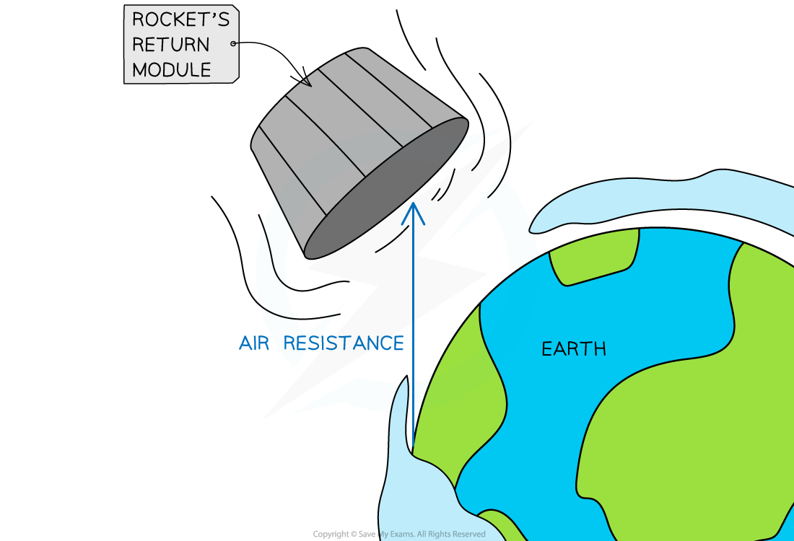

# Friction

## Friction in solids

> **Spec point** — `spcpt_SY2ZgYCPpHhYjxk2` · Describe solid friction as the force between two surfaces that may impede motion and produce heating

## Friction in solids

- Solid friction is the force between two surfaces that may **impede** motion and cause heating

  - Frictional forces oppose the motion of an object and can slow down the motion of the object
- When friction occurs, energy is transferred by **heating**

  - Friction causes an increase in **temperature** of the object and its surroundings
  - The work done against frictional forces transfers energy from the kinetic store of the object to the internal (thermal) stores of the object and its surroundings, causing the rise in temperature

- **Friction in solids **is caused by **imperfections** in the surfaces of the objects moving over one another

*The interface between the ground and the sledge is bumpy, causing the frictional force*

- Friction between solids can be reduced by:

  - lubricating the surfaces
  - smoothing the surfaces

## Friction in fluids

> **Spec point** — `spcpt_cxHQNqr2qkwkjzrq` · Know that friction (drag) acts on an object moving through a liquid
Know that friction (drag) acts on an object moving through a gas (e.g. air resistance)

## Friction in fluids

- **Gases** and **liquids** are known as **fluids**

  - Fluids are different to solids because the **particles** in fluids are **free to move** around
- Friction acts on objects moving through gases and liquids as the particles collide with the object

  - This type of friction is called **drag**

### Drag in liquids

- When objects fall through a **liquid** due to the force of weight, the liquid exerts an upwards **frictional (drag) force** on the object as it falls

- Drag forces** oppose the motion **of an object

  - They act to slow it down
- Drag **increases **as the** speed **of the object **increases**

- When the **drag force** becomes **equal **to the force of weight, the object **stops accelerating** and reaches a **terminal velocity**

### Drag in gases

- Air resistance is a **type of friction** that slows the motion of an object moving through **air**
- Air particles collide with the object as it moves through the air
- As a result, air resistance increases the temperature of the object and the air particles due to heating

*The return module of a rocket heats up due to the work done against air resistance as it travels a distance through the atmosphere*

- Air resistance is covered in greater depth in the revision note [Free fall](https://www.savemyexams.com/igcse/physics/cie/23/revision-notes/1-motion-forces--energy/1-2-motion/1-2-6-freefall/)

- Friction in fluids can be reduced by:

  - streamlining the shape of the object moving through the fluid

> **Exam Hint**
> Ensure that you name the frictional force acting on an object moving through a fluid as **drag** or **air resistance** depending on the fluid. Simply stating "upward force" or "resistance" will not gain the mark.
> 
> In addition, note that drag forces increase with velocity, rather than with time.
