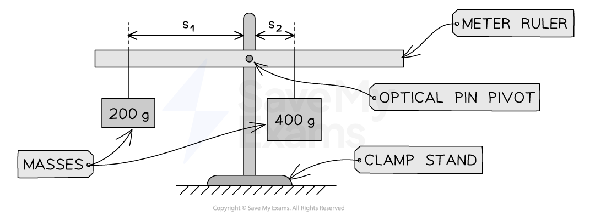

# Equilibrium

## Equilibrium

> **Spec point** — `spcpt_sgbcG7QDVyvJ7yz9` · State that, when there is no resultant force and no resultant moment, an object is in equilibrium

## Equilibrium

- In physics, an object is in **equilibrium** when there is no resultant force **and** no resultant moment acting on the object

### Conditions for equilibrium

- For objects in equilibrium:

  - The **forces **on the object must be **balanced**
  
    - There must be no [resultant force](https://www.savemyexams.com/igcse/physics/cie/23/revision-notes/1-motion-forces-and-energy/1-4-effects-of-forces/1-4-1-resultant-forces/?_ai=internal-linking)
  - The **sum of clockwise moments **on the object must **equal **the **sum of anticlockwise moments**
  
    - There must be no **resultant moment**

#### Examples of systems in equilibrium

*When the forces and moments on an object are balanced, the object will remain in equilibrium*

> **Exam Hint**
> A very common mistake is to only state that the forces are balanced while completely forgetting to mention that the moments must also be balanced. To secure full marks when asked for the conditions of equilibrium, you must explicitly state that **both** the resultant force and the resultant moment acting on an object are zero.

## Demonstrating equilibrium

> **Spec point** — `spcpt_pfCFb2CTWCBJrjQC` · Describe an experiment to demonstrate that there is no resultant moment on an object in equilibrium

## Demonstrating equilibrium

### Extended Tier Only

### Aim of the experiment

- This experiment aims to demonstrate that there is no resultant moment for an object in equilibrium

### Variables

- ***Independent variable*** = mass,* *$m$*,* * *and distance, $s$
- ***Dependent variable*** = moment, $M$
- Control variables:

  - The length of the cotton loops should be equal on each side of the beam
  - The position of the pivot relative to the ruler's centre of mass should stay the same during the experiment

### Equipment

#### Equipment list

| **Equipment** | **Purpose** |
|---|---|
| Metre ruler with a small hole at the centre | To provide the beam on which to add masses |
| 2 × 100 g mass hangers | To attach the masses to the ruler |
| 8 × 100 g masses | To add the mass at different points along the ruler |
| Clamp stand, boss and clamp | To secure the pivot in place |
| Optical pin and cork | To act as the pivot |
| Small piece of modelling clay | To ensure the ruler is balanced at the start |
| 2 loops of cotton | To attach the mass hangers to the metre ruler |

#### Example set-up of equipment to demonstrate equilibrium

*The ruler acts as the beam with the pin as the pivot. Unequal masses are added at different distances until the beam is balanced and equilibrium is reached*

### Method

1. Secure the optical pin to the clamp stand
2. Mount the unloaded ruler on the pin pivot, adding modelling clay if needed, so that it sits horizontal before any masses go on
3. Hang unequal loads on either side of the pivot; one person holds the beam while the other person hangs the loads
4. Adjust the distances of mass 1, $m_{1}$, and mass 2, $m_{2}$, until the beam is balanced and to ensure the beam is perfectly horizontal with no resultant moment
5. Record the masses $m_{1}$ and $m_{2}$ and their distances from the pivot
6. Repeat the process for different sized loads

#### Example results table

| m1 / g | m1 / kg | F1 / N | d1 / cm | d1 / m | m2 / g | m2 / kg | F2 / N | d2 / cm | d2 / m | Anticlockwise moment M1 / N m | Clockwise moment M2 / N m |
|---|---|---|---|---|---|---|---|---|---|---|---|
|   |   |   |   |   |   |   |   |   |   |   |   |
|   |   |   |   |   |   |   |   |   |   |   |   |
|   |   |   |   |   |   |   |   |   |   |   |   |
|   |   |   |   |   |   |   |   |   |   |   |   |
|   |   |   |   |   |   |   |   |   |   |   |   |

***A results table should contain spaces for all the measurements taken and any calculations required***

### Analysis of results

- Force 1, $F_{1}$, is providing the anticlockwise moment, $M_{1}$

  - Where:
  
    - $F_{1}=m_{1}g$
    - $M_{1}=F_{1}s_{1}$
- Force 2, $F_{2}$, is providing the clockwise moment, $M_{2}$

  - Where:
  
    - $F_{2}=m_{2}g$
    - $M_{2}=F_{2}s_{2}$
- Remember to convert **g to kg** and **cm to m** for the calculations to give units of **N m** for the moments
- The results should show that for all the systems tested, the anticlockwise moment is equal to the clockwise moment

  - Therefore, there is no resultant moment when the system is in equilibrium
- The experiment works because the pivot sits at the ruler's centre of mass, so the ruler's own weight produces no moment about it.

### Evaluating the experiment

- ***Systematic errors:***

  - The cotton loops should be added to the ruler when viewed straight on to avoid a **parallax error**
  - The cotton loops should be measured to ensure they are equal in length
  - The experiment should be checked to ensure there is no friction between the metre ruler and the optical pin pivot so the ruler is balanced, only because of the added masses
- ***Random errors:***

  - The **precision** of the experiment is improved by:
  
    - ensuring the experiment is done in a space with **no draft** or breeze, as this could affect the motion or position of the hanging masses
    - using an **electronic system **or a spirit level that identifies the angle of the beam would improve the experiment, or using a flat rod with masses placed on top
    - taking **several** readings for each mass and position and then calculating the **mean**

- It is assumed that the mass of the cotton loops is negligible (zero)
- It is assumed that the mass of each mass and hanger is 100 g; this should be verified in advance using an electronic balance

### Safety considerations

- Safety **goggles** should be worn because the cotton loops could snap and hit someone in the eye
- Use a **G clamp** to secure the clamp stand to the bench so it does not topple over and cause injury
- The experiment should be carried out while **standing**, so the beam can be viewed at eye level without leaning
- Place a **mat** or a soft material below the metre ruler to cushion any masses that may fall to the ground and to keep the area clear of feet and hands
