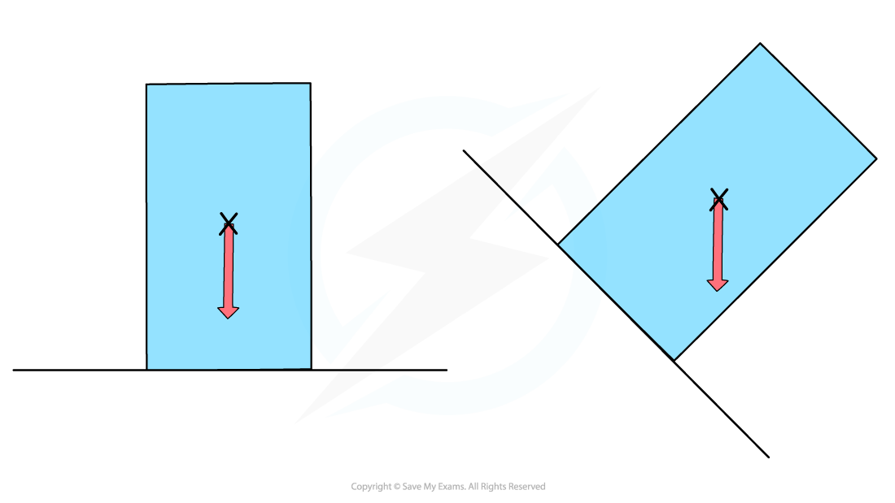

# Centre of Gravity

## Centre of gravity

> **Spec point** — `spcpt_XdRBnzgv7gtTFhty` · State what is meant by centre of gravity

## Centre of gravity

- The **centre of gravity** of an object is defined as:

**The point through which the weight of an object acts**

- For a symmetrical object of uniform density, the **centre of gravity is located at the point of symmetry**

  - For example, the centre of gravity of a sphere is at the centre

*The centre of gravity of a regularly shaped object can be found using symmetry*

> **Exam Hint**
> Since the centre of gravity is a hypothetical point, it can lie inside or outside a body. The centre of gravity will constantly shift depending on the shape of a body. For example, a human body’s centre of gravity is lower when leaning forward than when standing upright
> 
> However, when you are drawing force diagrams, always draw the weight force as if it were acting from the centre of gravity of the object.

## Stability

> **Spec point** — `spcpt_xKwDPcfXgDGR2JJc` · Describe, qualitatively, the effect of the position of the centre of gravity on the stability of simple objects

## Stability

- The **position **of the centre of gravity affects the **stability **of an object
- An object is **stable **when its centre of gravity lies above its **base**
- If the centre of gravity does not lie above its base, it produces a moment that causes the object to **topple **over

*The object will topple when its centre of gravity is no longer over its base*

- The most stable objects have a **low **centre of gravity and a **wide **base

  - Cars are stable because they have a low centre of gravity and a wide base

- Taller objects with a narrow base have a higher centre of gravity and are less stable

  - This is why high-sided vehicles such as lorries are sometimes advised to avoid exposed bridges on very windy days

*When the object is positioned on its narrow base, it is less stable because its centre of gravity is higher*

### Moments and stability

- If the line of action of the **weight **force lies outside the base of the object, there will be a **resultant moment,** and the body will topple

#### Car and bus on varying inclines

*The car can be tilted to 60° without toppling, but the bus will topple at 45°*

- Tall objects with a narrow base will topple easily

  - Ten-pin bowling pins are designed specifically to topple easily
- The stability of objects can be increased by widening the base

  - High chairs are designed with a wide base so that they do not topple
  - Bunsen burners have a wide base to ensure they do not topple

> **Exam Hint**
> You must explicitly link the design choices of objects to the physics principles involved when explaining the stability of objects. For example, increasing the base area will lower the centre of gravity or increase the tipping angle required to knock the object over.
