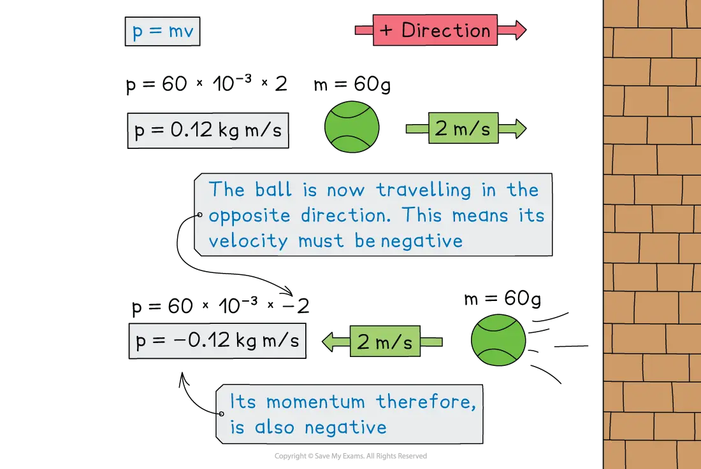
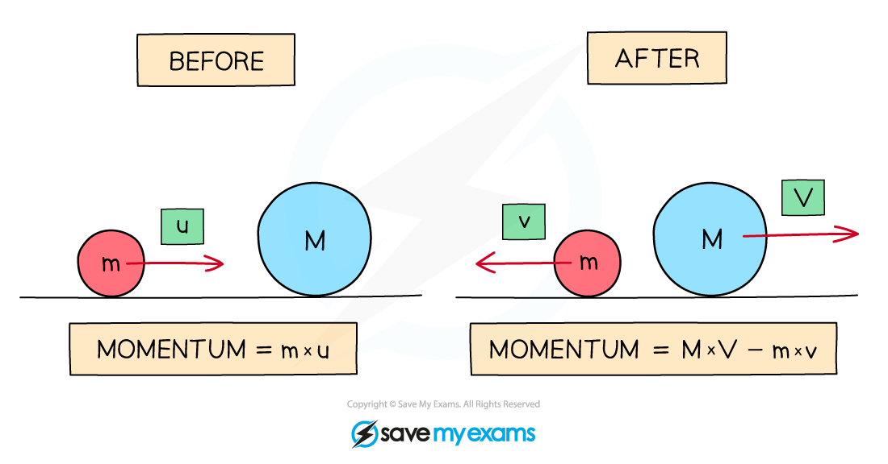

# Momentum

## Momentum

> **Spec point** — `spcpt_25xP3JfxF4n53QPk` · Define momentum as mass × velocity; recall and use the equation p = mv

## Momentum

### Extended Tier Only

- An object with **mass **that is in **motion **has **momentum **

### The momentum equation

- Momentum is defined by the equation:

$\mathrm{momentum}=\mathrm{mass}\times\mathrm{velocity}$

$p=mv$

- Where:

  - $p$ = momentum, measured in kilogram metres per second (kg m/s)
  - $m$ = mass in kilograms (kg)
  - $v$ = velocity in metres per second (m/s)

- This means that an object at rest (i.e. *v* = 0) has **no** momentum

- The greater an object's momentum, the harder it is to stop it or change its direction

- Velocity is a ***vector*** with both magnitude and direction

  - This means that the momentum of an object also depends on its **direction **of travel
  - Therefore, momentum can be either **positive** or **negative**
- If an object has positive momentum, then an object travelling in the opposite direction will have negative momentum

#### Momentum of a ball before and after a collision

*The momentum of the tennis ball is positive as it approaches the wall and negative after the collision, as it moves in the opposite direction*

> **Worked Example**
> Determine whether the tennis ball or the brick has the greater momentum.
> 
> 
> 
> [3]
> 
> **Answer:**
> 
> **Step 1: Determine the momentum of the tennis ball using the momentum equation**
> 
> $p=mv$
> 
> $p=0.06\times75$
> 
> $p=4.5\mathrm{kg}m/s$ **[1 mark]**
> 
> **Step 2: Determine the momentum of the brick using the momentum equation**
> 
> $p=mv$
> 
> $p=3\times1.5$
> 
> $p=4.5\mathrm{kg}m/s$ **[1 mark]**
> 
> **Step 3: Compare the momentum of each object**
> 
> - Both the tennis ball and the brick have the same momentum **[1 mark]**
> - Even though the brick is much heavier than the ball, the ball is travelling much faster than the brick

> **Worked Example**
> A 0.20 kg ball falls downwards and strikes the ground with a speed of 15 m/s. The ball then rebounds off the ground at a speed of 12 m/s. Calculate the change in momentum of the ball.
> 
> [3]
> 
> **Answer:**
> 
> **Step 1: State the directions that are taken as positive and negative**
> 
> - Momentum is a vector so direction needs to be taken into account. Upwards will be taken as positive, and downwards will be taken as negative.
> 
> **Step 2: Calculate the initial momentum of the ball**
> 
> - The ball falls downwards, so the initial velocity, $u$, of the ball is $u=-15m/s$
> - Therefore, the initial momentum is:
> 
> $p_{\mathrm{initial}}=mu$
> 
> $p_{\mathrm{initial}}=0.20\times-15$
> 
> $p_{\mathrm{initial}}=-3\mathrm{kg}m/s$ **[1 mark]**
> 
> **Step 3: Calculate the final momentum of the ball**
> 
> - The ball rebounds upwards, so the final velocity, $v$, of the ball is $v=12m/s$
> - Therefore, the final momentum is:
> 
> $p_{\mathrm{final}}=mv$
> 
> $p_{\mathrm{final}}=0.20\times12$
> 
> $p_{\mathrm{final}}=2.4\mathrm{kg}m/s$ **[1 mark]**
> 
> **Step 4: Calculate the change in momentum of the ball**
> 
> $\Deltap=p_{\mathrm{final}}-p_{\mathrm{initial}}$
> 
> `increment p space equals space 2.4 space minus space open parentheses negative 3 close parentheses`
> 
> $\Deltap=5\mathrm{kg}m/s$ **[1 mark]**

> **Exam Hint**
> You can remember momentum as mass in motion. The units of momentum are **kg m/s **which is the product of the units of mass (kg) and velocity (m/s). Units of **N s** are also acceptable for momentum.
> 
> Which direction is taken as positive is completely up to you in the exam, as long as you are consistent throughout a question. In general, the right and upwards are taken as positive, and down or to the left as negative.

## Conservation of momentum

> **Spec point** — `spcpt_2YBjgfm4yFkwPMGs` · Apply the principle of the conservation of momentum to solve simple problems in one dimension

## Conservation of momentum

### Extended Tier Only

- The principle of conservation of momentum states that:

**In a closed system, the total momentum before an event is equal to the total momentum after the event**

- A **system**, in physics, is an object or group of objects
- A **closed system** is one on which no external resultant force acts.

- The principle of conservation of momentum can also be written as:

**The total momentum before a collision = The total momentum after a collision**

- Since momentum is a ***vector*** quantity, two objects of equal mass moving towards each other at the same speed have a total momentum of zero, because their momenta are equal in size and opposite in direction and so cancel

- Momentum is conserved **only** when no external resultant force acts on the system

- The diagram below shows two masses *m *with velocity *u* and *M *at rest (i.e. zero velocity)

*The momentum of a system before and after a collision is constant*

- Before the collision:

  - The momentum is only of mass *m* which is moving
  - If the right is taken as the positive direction, the total momentum of the system is ***m***** ×***** u***
- After the collision:

  - Mass *M* also now has momentum
  - The velocity of *m* is now -*v *(since it is now travelling to the left) and the velocity of *M* is *V*
  - The total momentum is now the momentum of *M* + momentum of *m*
  - This is (*M* × *V*) + (*m* × -*v*) or **(*****M***** × *****V*****) – (*****m***** × *****v*****)**
- Since momentum is conserved, this means that:

$mu=MV-mv$

- The principle of conservation of momentum also applies to objects that are **pushed apart** as well as to collisions

  - In such scenarios, a system starting at rest has zero total momentum **both** before and after the objects are pushed apart

> **Worked Example**
> The diagram shows a toy car and a toy van, just before and after the toy car collides with the toy van, which is initially at rest.
> 
> 
> 
> The toy car initially moves at a speed of 0.8 m/s, but this reduces to 0.1 m/s after the collision.
> 
> The mass of the toy car is 0.035 kg and the mass of the toy van is 0.085 kg.
> 
> Calculate the velocity of the toy van when it is pushed forward by the collision.
> 
> [4]
> 
> **Answer:**
> 
> **Step 1: State the principle of the conservation of momentum**
> 
> Total momentum before a collision = total momentum after a collision
> 
> **Step 2: Calculate the total momentum of the car and van before the collision**
> 
> Momentum: * *$p=mv$
> 
> - Initial momentum of the toy car:
> 
> $p_{\mathrm{car}}=0.035\times0.8=0.028\mathrm{kg}m/s$
> 
> - Initial momentum of the toy van:
> 
> $p_{\mathrm{van}}=0$ (the van is at rest, so p = v = 0)
> 
> - Total momentum before collision:
> 
> $p_{\mathrm{before}}=p_{\mathrm{car}}+p_{\mathrm{van}}$
> 
> $p_{\mathrm{before}}=0.028+0=0.028\mathrm{kg}m/s$ **[1 mark]**
> 
> **Step 3: Calculate the total momentum of the car and van after the collision**
> 
> - Final momentum of the toy car:
> 
> $p_{\mathrm{car}}=0.035\times0.1=0.0035\mathrm{kg}m/s$
> 
> - Final momentum of the toy van:
> 
> * *$p_{\mathrm{van}}=0.085\timesv$
> 
> - Total momentum after collision:
> 
> $p_{\mathrm{after}}=0.0035+0.085v$* ***[1 mark]**
> 
> **Step 4: Rearrange the conservation of momentum equation for the velocity of the van**
> 
> $p_{\mathrm{before}}=p_{\mathrm{after}}$
> 
> $0.028=0.0035+0.085v$* ***[1 mark]**
> 
> $0.028-0.0035=0.085v$
> 
> $v=\frac{0.028-0.0035}{0.085}$
> 
> $v=0.29m/s$ **[1 mark]**

> **Exam Hint**
> If it is not given in the question already, drawing a diagram of before and after helps keep track of all the masses and velocities (and directions) in the conservation of momentum questions.

## The conservation of momentum

> **Spec point** — `spcpt_QSbqXRhK5rry4H7q` · nan

##
