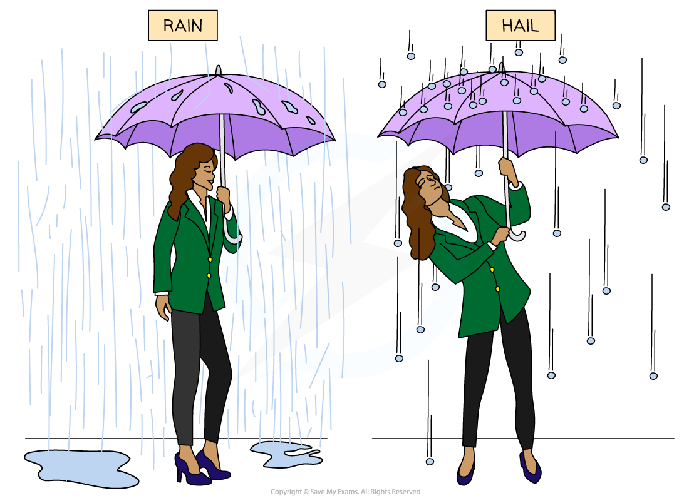

# Impulse

## Impulse

> **Spec point** — `spcpt_JTCHPgmqQhpjk3WW` · Define impulse as force × time for which force acts; recall and use the equation impulse = F∆t = ∆(mv)

## Impulse

### Extended Tier Only

- The impulse of a force is the **product** of the **force **applied and the **time** for which it acts

$\mathrm{impulse}=F\Deltat$

- Where:

  - $F$ = resultant force, measured in newtons (N)
  - $\Deltat$ = the time for which the force acts, measured in seconds (s)
- Therefore, the **units **of impulse are **newton seconds **(N s)

- The impulse of a force acting on an object can change the object's motion

  - For example:
  
    - Kicking a ball
    - Catching a ball
    - A collision between two objects
- The **impulse **of the resultant force is **equal to **the **change in momentum** of the object

$\mathrm{impulse}=F\Deltat=\Deltap$

- [Change in momentum](https://www.savemyexams.com/igcse/physics/cie/23/revision-notes/1-motion-forces-and-energy/1-6-momentum/1-6-1-momentum/?_ai=internal-linking) can also be described as:

$\Delta p = \Delta ( m v )$

$\Deltap=mv-\mu$

- Where:

  - $\Deltap$ *=* change in momentum, measured in kilogram metres per second (kg m/s)
  - $m$ = mass, measured in kilograms (kg)
  - $v$ = final velocity, measured in metres per second (m/s)
  - $u$ = initial velocity, measured in metres per second (m/s)
- Therefore:

$\mathrm{impulse}=F\Deltat=\Deltap=mv-\mu$

- Since impulse is equal to the change in momentum, **kilogram metres per second** (kg m/s) is also accepted as the **units** of impulse

> **Exam Hint**
> Make sure to provide one precise definition for impulse in the exam. Stating either "the product of a force and the time for which that force acts" or "the change in momentum of the object" is an acceptable definition for impulse.
> 
> Note that N/s are **not** the correct units for impulse.

### Examples of impulse

- When rain and hail (frozen water droplets) hit an umbrella, they feel very different due to the **impulse **of the force

- Water droplets tend to splatter and roll off the umbrella, so their velocity is reduced to near zero — a relatively **small** change in momentum
- Hailstones have a **larger mass** and tend to bounce back off the umbrella, so their velocity reverses — a **greater** change in momentum than simply stopping
- Therefore, the impulse that the umbrella applies on the hail stones is **greater** than the impulse the umbrella applies on the raindrops
- This means that **more force** is required to hold an umbrella upright in hail compared to rain

*The impulse exerted by the umbrella on the hailstones is greater than the impulse exerted on the raindrops*

> **Worked Example**
> A 58 g tennis ball moving horizontally to the left at a speed of 30 m s–1 is struck by a tennis racket which returns the ball back to the right at 20 m s–1.
> 
> (i) Calculate the impulse of the force exerted by the racket on the ball. [3]
> (ii) State which direction the impulse is in. [1]
> 
> **Answer:**
> 
> **Part (i)**
> 
> **Step 1**: **Write the known quantities**
> 
> - The left is taken as positive because the ball is initially travelling left; (either direction choice works, provided this stays consistent in the calculation)
> - Initial velocity, $u=30m/s$
> - Final velocity, $v=-20m/s$
> - Mass, $m=58g=58\times10^{-3}\mathrm{kg}$
> 
> **Step 2: Write down the impulse equation**
> 
> $\mathrm{impulse}=F\Deltat=\Deltap=mv-\mu$ **[1 mark]**
> 
> **Step 3: Substitute in the values**
> 
> $\text{impulse} = m ( v - u )$
> 
> $\text{impulse} = 58 \times 10^{ - } 3 ( - 20 - 30 )$ **[1 mark]**
> 
> $\mathrm{impulse}=-2.9Ns$ **[1 mark]**
> 
> **Part (ii)**
> 
> **State the direction of the impulse**
> 
> - Since the impulse is negative, it must be in the opposite direction to which the tennis ball was initially travelling
> - Therefore, the direction of the impulse is to the right **[1 mark]**

> **Exam Hint**
> Remember that if an object changes direction, then this must be reflected by the change in sign of the velocity. For example, if the left is taken as positive and therefore the right as negative, an impulse of 20 N s to the right is equal to -20 N s

## Force and momentum

> **Spec point** — `spcpt_rH2m5FBPjsHf6cbN` · Define resultant force as the change in momentum per unit time; recall and use the equation F = ∆p / ∆t

## Force & momentum

### Extended Tier Only

- Newton's second law is defined by the equation:

$F=ma$

- Momentum is given by the equation:

$p=mv$

- Since $a=\frac{\Deltav}{\Deltat}$, this can be substituted into Newton's second law:

$F=\frac{m\Deltav}{\Deltat}$

- Since $\Deltap=m\Deltav$, combining these equations gives Newton's second law in terms of momentum:

$F=\frac{\Deltap}{\Deltat}$

- Therefore, the resultant force on an object is defined as the** change in momentum per unit time**

  - This is also described as the rate of change of momentum

> **Worked Example**
> A tennis ball hits a racket twice, with a change in momentum of 0.5 kg m/s both times.
> 
> During the first hit, the contact time is 0.05 s and during the second hit, the contact time is 0.005 s.
> 
> Determine during which hit the racket experiences the greater force from the ball.
> 
> 
> 
> [3]
> 
> **Answer:**
> 
> **Step 1: Calculate the force during the first hit**
> 
> $F=\frac{\Deltap}{\Deltat}$
> 
> $F=\frac{0.5}{0.05}$
> 
> $F=10N$ **[1 mark]**
> 
> **Step 2: Calculate the force during the second hit**
> 
> $F=\frac{\Deltap}{\Deltat}$
> 
> $F=\frac{0.5}{0.005}$
> 
> $F=100N$ **[1 mark]**
> 
> **Step 3: State your answer**
> 
> - The tennis racket experiences the greater force from the ball during the **second hit ****[1 mark]**

### Impulse and safety features

- This result has important implications when it comes to **safety**
- A large force acting for a short time can have the same impulse and **same change in momentum** as a smaller force acting for a longer time
- Safety features such as air bags and crumple zones **increase** the time taken for a driver to stop

  - This would **reduce** the force on the driver in a collision and the risk of injury, since the change in momentum is fixed

> **Exam Hint**
> You should use $F=\frac{\Deltap}{\Deltat}$ rather than $F=ma$ primarily in collision, impact, and rebound questions.  $F=ma$ is primarily used when the question explicitly provides the mass and the acceleration.
