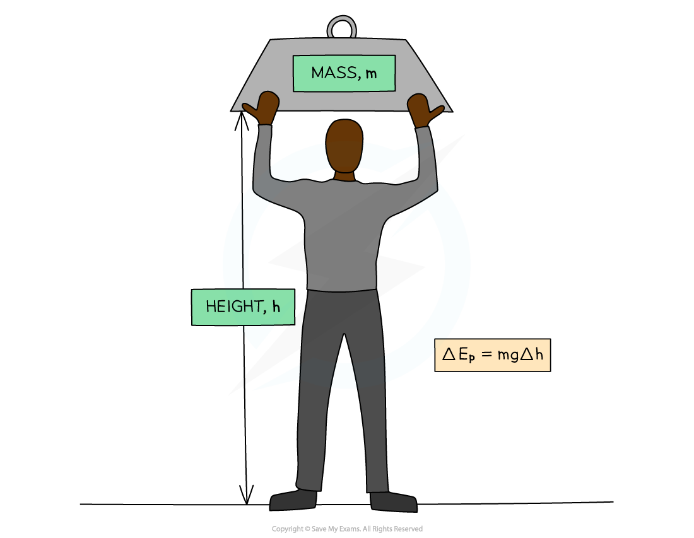

# Gravitational Potential Energy

## Gravitational potential energy

> **Spec point** — `spcpt_9GnWRpcCnJ2nVN5x` · Recall and use the equation for the change in gravitational potential energy ∆Ep = mg∆h

## Gravitational potential energy

### Extended Tier Only

- Energy in an object's gravitational potential energy store is defined as:

**The energy an object has due to its height in a gravitational field**

- [Work is done against the weight force](https://www.savemyexams.com/igcse/physics/cie/23/revision-notes/1-motion-forces-and-energy/1-7-energy-work-and-power/1-7-5-work-done/?_ai=internal-linking) exerted on the object; therefore, energy is transferred
- This means that:

  - if an object is **lifted **up, energy will be transferred **to** its gravitational potential energy store
  - if an object is **lowered**, energy will be transferred **away from** its gravitational potential energy store

*Energy is transferred to the mass's gravitational potential energy store as it is lifted through the gravitational field*

### Gravitational potential energy equation

- The change in energy in an object's gravitational potential energy store can be calculated using the equation:

$\DeltaE_{p}=mg\Deltah$

- Where:

  - $\DeltaE_{p}$ = change in gravitational potential energy, measured in joules (J)
  - $m$ = mass, measured in kilograms (kg)
  - $g$ = gravitational field strength, measured in newtons per kilogram (N/kg)
  - $\Deltah$ = change in height, measured in metres (m)
- When two heights are given, the difference between the heights must be used since $\Deltah$ is the change in height

- When an object is moved vertically a gravitational field, the work done on the object is **equal** to the increase in its gravitational potential energy store

> **Exam Hint**
> Note that $\Deltah$ is always the change in **vertical** height, not the distance travelled along a slope or ramp.
> 
> Remember that the change in gravitational potential energy has units of joules (J). Any mass given in grams must be converted into kilograms before substituting.

> **Worked Example**
> A man climbs a flight of stairs that is, in total, 3.0 m higher than the floor. The man has a mass of 72 kg, and the gravitational field strength on Earth is approximately 9.8 N/kg.
> 
> Calculate the energy transferred to the man's gravitational potential energy store.
> 
> **Answer:**
> 
> **Step 1: List the known quantities**
> 
> - Mass of the man, $m=72\mathrm{kg}$
> - Gravitational field strength, $g=9.8N/\mathrm{kg}$
> - Change in height, $\Deltah=3.0m$
> 
> **Step 2: Write down the equation for gravitational potential energy**
> 
> $\DeltaE_{p}=mg\Deltah$
> 
> **Step 3: Calculate the gravitational potential energy**
> 
> $\DeltaE_{p}=72\times9.8\times3.0$
> 
> $\DeltaE_{p}=2116.8J$
> 
> **Step 4: Round to an appropriate number of significant figures**
> 
> - The input values are to 2 s.f. so the answer is also given to 2 s.f.
> 
> `increment E subscript p space equals space 2100 space straight J space open parentheses 2 space straight s. straight f. close parentheses`

> **Exam Hint**
> In your IGCSE exam, you will generally be expected to round your answers to an appropriate number of significant figures. In theory papers, any answer given to two or more significant figures is accepted unless the question says otherwise.
> 
> Your answer can only be as precise as your least precise input value. Therefore, your final answer should round to the lowest number of significant figures of all your input values.
