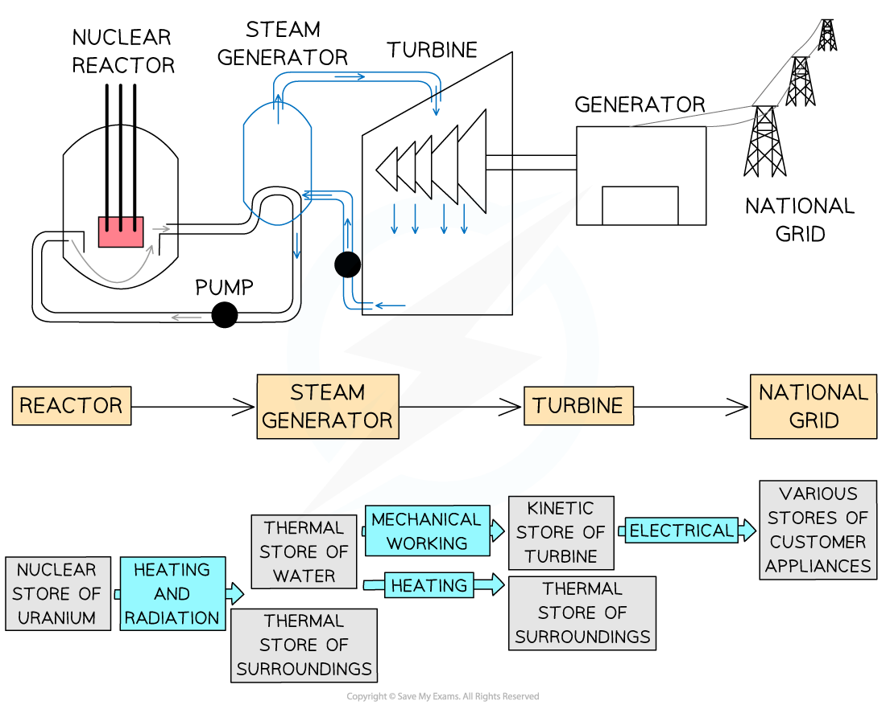
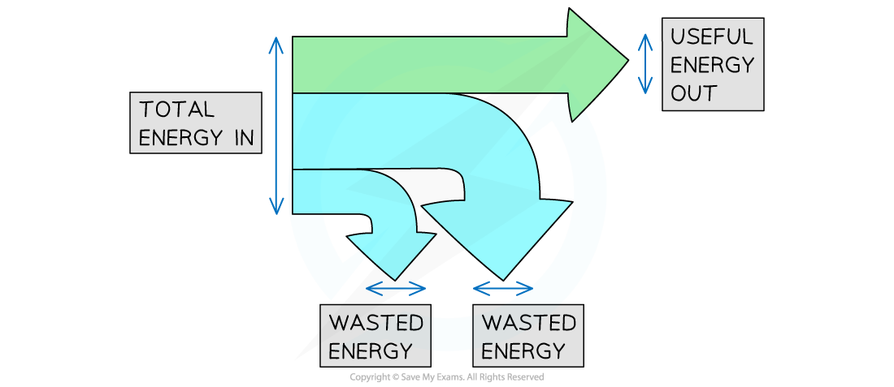
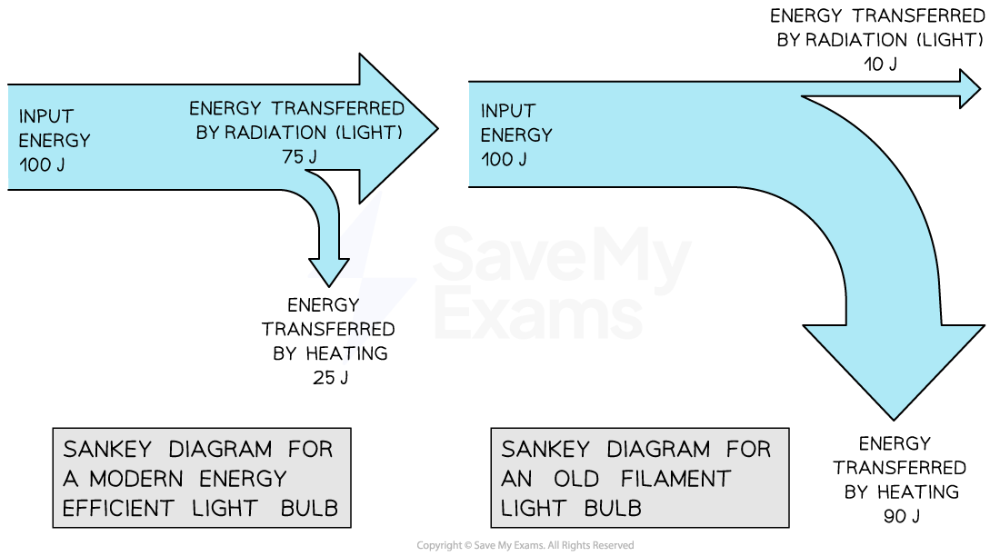

# Conservation of Energy

## Conservation of energy

> **Spec point** — `spcpt_TshxSpJ9wHZMgY8T` · Know the principle of the conservation of energy and apply this principle to simple examples including the interpretation of simple flow diagrams

## Conservation of energy

- The **principle of conservation of energy** states that:

**Energy cannot be created or destroyed; it can only be transferred from one store to another**

- The principle of conservation of energy means that for a closed system, the total amount of energy is **constant**
- The **total **amount of energy transferred **into **the system must be **equal **to the **total **amount of energy transferred **away **from the system

- Therefore, energy cannot be ‘lost’, but it can be transferred to the surroundings

  - Energy can be **dissipated** (spread out) to the surroundings by heating and radiation
  - Dissipated energy transfers are often not **useful**, in which case they can be described as [wasted energy](https://www.savemyexams.com/igcse/physics/cie/23/revision-notes/1-motion-forces-and-energy/1-7-energy-work-and-power/1-7-7-efficiency/?_ai=internal-linking)

### Examples of the principle of conservation of energy

#### Example 1: a bat hitting a ball

- The moving bat has energy in its **kinetic **store
- Some of that energy is transferred **usefully** to the **kinetic** store of the ball
- Some of that energy is transferred from the **kinetic **store of the bat to the **thermal **store of the ball **mechanically **due to the impact of the bat on the ball

  - This energy transfer is not useful; the energy is **wasted**
- Some of that energy is **dissipated** by **heating** to the **thermal **store of the bat, the ball, and the surroundings

  - This energy transfer is not useful; the energy is **wasted**
- The total amount of energy transferred into the system is equal to the total amount of energy transferred away from the system

#### Conservation of energy: a bat hitting a ball

*Energy flow diagram showing energy transfers when a bat hits a ball*

*The principle of conservation of energy applied to a bat hitting a ball*

#### Example 2: boiling water in a kettle

- When an electric kettle boils water, **energy** is transferred **electrically** from the mains supply to the **thermal store** of the heating element inside the kettle
- As the heating element gets hotter, **energy** is transferred **by heating** to the **thermal store** of the water

- Some of the energy is transferred to the **thermal** store of the plastic kettle

  - This energy transfer is not useful; the energy is **wasted**
- And some energy is **dissipated **to the **thermal store** of the surroundings due to the air around the kettle being heated

  - This energy transfer is not useful; the energy is wasted
- The total amount of energy transferred into the system is equal to the total amount of energy transferred away from the system

#### Conservation of energy: a kettle boiling water

*The principle of conservation of energy applied to a kettle boiling water*

> **Exam Hint**
> When describing wasted energy, always say which store it ends up in.*** ***

### Energy flow diagrams

- Energy stores and transfers can be represented using a flow diagram

  - This shows both the stores and the transfers taking place within a system

*Energy flow diagram for a nuclear power plant. Stores are shown in labelled boxes and transfer pathways as arrows between them*

- In an energy flow diagram, energy is always **conserved**

**total energy in = total energy out**

> **Exam Hint**
> This is a useful way to do calculations, but it is **not** a statement of the principle of conservation of energy — if a question asks you to state the principle, you must say that energy cannot be created or destroyed; it can only be transferred from one store to another.
> 
> Note that you may be asked to fill in missing labels in energy flow diagrams.

> **Worked Example**
> The diagram shows a rollercoaster going down a track.
> 
> The rollercoaster takes the path A → B → C → D.
> 
> 
> 
> Which statement is true about the energy changes that occur for the rollercoaster down this track?
> 
> **A.**     *E*K → Δ*E*P → Δ*E*P → *E*K
> 
> **B.**     *E*K → Δ*E*P → *E*K → Δ*E*P
> 
> **C.**     Δ*E*P → *E*K → *E*K → Δ*E*P
> 
> **D.**     Δ*E*P → *E*K → Δ*E*P → *E*K
> 
> [1]
> 
> **Answer: **
> 
> - **At point A:**
> 
>   - The rollercoaster is raised above the ground, therefore it has energy in its **gravitational potential store**
> 
> - **At point B:**
> 
>   - As it travels down the track towards B, energy is transferred **mechanically** to its **kinetic store **
> 
> - **At point C:**
> 
>   - Energy is transferred **mechanically **from the** **kinetic store** **to the** gravitational potential store**
>   - As the kinetic energy store **empties**, the gravitational potential energy store **fills**
> 
> - **At point D:**
> 
>   - Energy is transferred **mechanically **from the gravitational potential store to the **kinetic store**
>   - The flat terrain means there is no change in the amount of energy in its gravitational potential store, the rollercoaster only has** **energy in its** kinetic store**
>   - The kinetic energy store is full
> - Therefore, the energy changes that occur for the rollercoaster down this track is given by **D**: Δ*E*P → *E*K → Δ*E*P → *E*K **[1 mark]**
> 
> - In reality, some energy will also be transferred to the thermal energy store of the tracks due to **friction**, and away from the system by **sound**
> - This energy is described as **dissipated to the surroundings**
> 
>   - The total amount of energy in the system will be constant
>   - Total energy in = total energy out

> **Exam Hint**
> It is helpful to think of energy stores as beakers and the total energy in the system as water. The water can be poured from one beaker into another, back and forth, as energy is transferred between stores.
> 
> You may not always be given the energy transfers happening in the system in your IGCSE exam questions.
> 
> By familiarising yourself with the energy stores and transfer pathways, you should be able to relate these to the situation presented in the question. For example, a ball rolling down a hill transfers energy from the ball's gravitational potential energy store to its kinetic energy store mechanically, while a spring transfers energy from its elastic potential energy store to its kinetic energy store mechanically.

## Sankey diagrams

> **Spec point** — `spcpt_Z6cJw4vBdjmzvSbJ` · Know the principle of the conservation of energy and apply this principle to complex examples involving multiple stages, including the interpretation of Sankey diagrams

## Sankey diagrams

### Extended Tier Only

- **Sankey diagrams** can be used to represent energy transfers

- Sankey diagrams are characterised by arrows that split to show the proportions of the energy transfers taking place

- The different parts of the arrow in a Sankey diagram represent the different energy transfers:

  - The left-hand side of the arrow (the flat end) represents the energy transferred **into **the system
  - The straight arrow pointing to the right represents the energy that ends up in the desired store; this is the **useful energy output**
  - The arrows that bend away represent the **wasted energy**

*Total energy in, wasted energy and useful energy out shown on a Sankey diagram *

- The width of each arrow is **proportional **to the amount of energy being transferred
- As a result of the conservation of energy:

**total energy in = total energy out**

**total energy in = useful energy out + wasted energy**

- A Sankey diagram for a modern efficient light bulb will look very different from that for an old filament light bulb
- A more efficient light bulb has **less** wasted energy

  - This is shown by the smaller arrow downwards representing the energy transferred to the thermal store of the surroundings

*Sankey diagrams showing filament bulbs have a much greater proportion of wasted energy than modern energy efficient bulbs*

> **Worked Example**
> An electric motor is used to lift a weight. The diagram represents the energy transfers in the system.
> 
> 
> 
> Calculate the amount of wasted energy.
> 
> [2]
> 
> **Answer: **
> 
> **Step 1: State the conservation of energy**
> 
> - Energy cannot be created or destroyed, it can only be transferred from one store to another
> 
> $\mathrm{total} \mathrm{energy} \mathrm{in}=\mathrm{useful} \mathrm{energy} \mathrm{out}+\mathrm{wasted} \mathrm{energy}$
> 
> **Step 2: Rearrange the equation for the wasted energy**
> 
> $\mathrm{wasted} \mathrm{energy}=\mathrm{total} \mathrm{energy} \mathrm{in}-\mathrm{useful} \mathrm{energy} \mathrm{out}$ **[1 mark]**
> 
> **Step 3: Substitute the values from the diagram**
> 
> $\mathrm{wasted} \mathrm{energy}=500-120$
> 
> $\mathrm{wasted} \mathrm{energy}=380J$ **[1 mark]**

> **Exam Hint**
> Since arrow width is proportional to the amount of energy being transferred, scaled diagrams and grid lines can be used to measure the amount of energy represented by an arrow.
> 
> When energy is wasted in more than one way on a Sankey diagram, remember to add each wasted arrow to get the total wasted energy.
