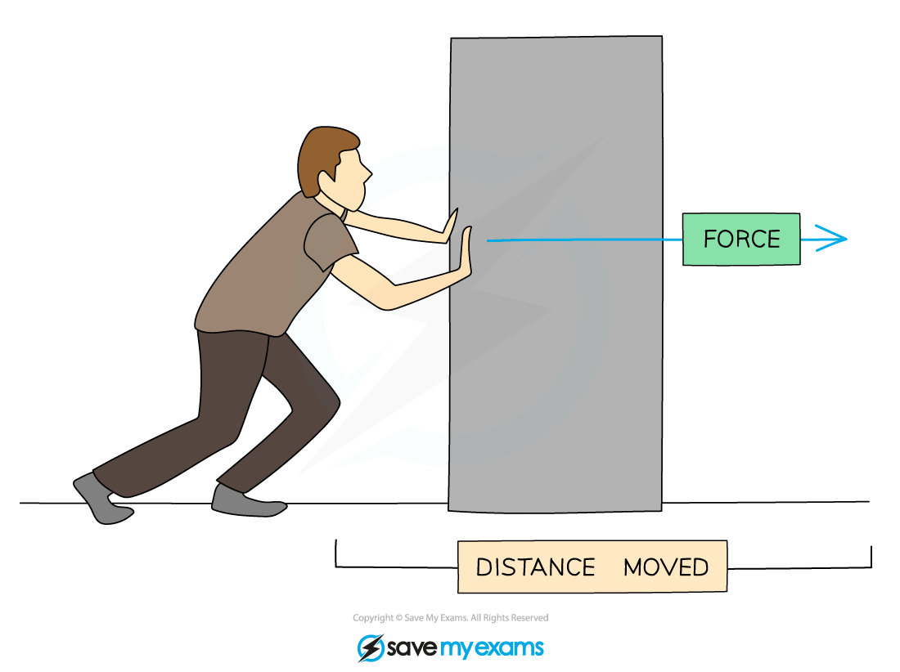
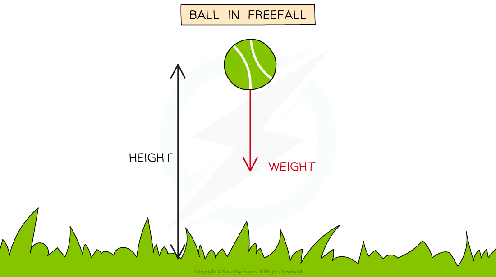

# Work Done

## Work done & energy transfers

> **Spec point** — `spcpt_GDdFwPtB8DJrfddJ` · Understand that mechanical or electrical work done is equal to the energy transferred
Recall and use the equation for mechanical working W = Fd = ∆E

## Work done & energy transfers

- **Mechanical work** is done when an object is moved over a **distance** by a **force** applied in the **direction** of its displacement

  - It is said that the **force does work** on the object
  - If a force is applied to an object but does not result in any movement, no work is done
- When **work **is done, **energy **is transferred
- Work done and energy transferred are **equivalent **quantities

*Work is done when a force is used to move an object over a distance, and energy is transferred from the person to the box*

### Work done equation

- The formula for work done is:

$W=Fd=\DeltaE$

- Where:

  - $W$ = work done, measured in joules (J)
  - $F$ = force applied, measured in newtons (N)
  - $d$ = distance moved in the direction of the force, measured in metres (m)
  - $\DeltaE$ = energy transferred, measured in joules (J)

- Mechanical work done and electrical work done are equivalent to energy transferred

$\mathrm{work} \mathrm{done}=\mathrm{energy} \mathrm{transferred}$

- Work done can also have units of newton-metres since:

$1Nm=1J$

### Examples of work done

- Work is done on a ball when it is lifted to a height:

  - A force is required to lift the ball
  - Work is done against the weight force to lift the ball through the gravitational field
  - Energy is transferred as work done

#### Work done lifting a ball

*Work is done against the ball's weight as it is lifted, transferring energy to its gravitational potential store *

- Work is done when a bird flies through the air

  - A force is required to overcome the drag force
  - Work is done against the drag force as the bird flies over a distance
  - Energy is transferred as work is done

#### Work done by a bird

*The bird does work against air resistance (drag) as it flies through the air*

> **Worked Example**
> A car moving at speed begins to apply the brakes. The brakes of the car apply a force of 500 N, which brings it to a stop after 23 m.
> 
> 
> 
> Calculate the work done by the brakes in stopping the car.
> 
> [2]
> 
> **Answer:**
> 
> **Step 1: List the known quantities**
> 
> - Distance, $d=23m$
> - Force, $F=500N$
> 
> **Step 2: Write out the work done equation**
> 
> $W=Fd$
> 
> **Step 3: Calculate the work done on the car by the brakes**
> 
> $W=500\times23$* ***[1 mark]**
> 
> $W=11500J$* ***[1 mark]**

> **Exam Hint**
> Remember to always convert the distance into **metres** and force into **newtons** so that the work done, which is equal to force **multiplied** by the distance moved in the direction of the force, is in **joules**.
> 
> In addition, remember that work done is **equivalent** to energy transferred. For example, the work done by a force will usually describe a change in kinetic energy or gravitational potential energy of an object.

## Energy, Work & Power Video

> **Spec point** — `spcpt_ZR5QDR2fJxpDPmFG` · nan

##
