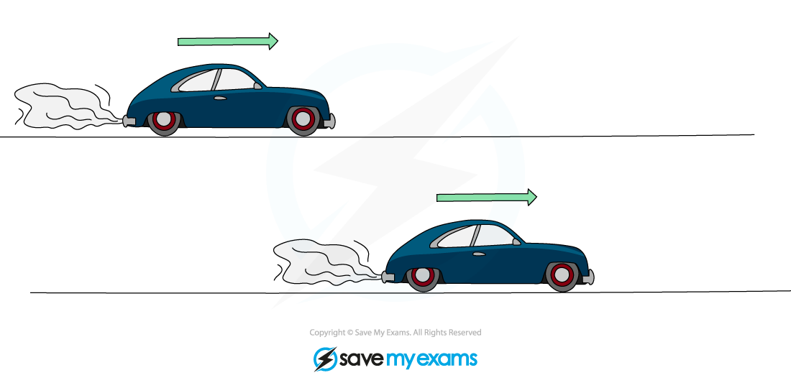

# Power

## Power

> **Spec point** — `spcpt_8W7CrBd4psNCQyDJ` · Define power as work done per unit time and also as energy transferred per unit time; recall the equations
   (a) P = W/t
   (b) P = ∆E/t

## Power

- Power is defined as:

**Work done** **per unit time**

- Since [work done is equal to energy transferred](https://www.savemyexams.com/igcse/physics/cie/23/revision-notes/1-motion-forces-and-energy/1-7-energy-work-and-power/1-7-5-work-done/?_ai=internal-linking), **power **is also defined as:

**Energy transferred** **per unit time**

- Machines, such as car engines, transfer energy from one energy store to another constantly over a period of **time**

  - The **rate **of this energy transfer, or the rate of work done, is **power**
- **Time **is an important consideration when it comes to **power**

### Two cars with different power ratings doing the same amount of work

- Two cars transfer the **same amount of energy **or do the **same amount of work **to accelerate over a distance
- If one car has **more power**, it will transfer that energy, or do that work, in a **shorter amount of time**

*Two cars accelerate to the same final speed, but the one with more power will reach that speed sooner*

### Two motors with different power ratings doing the same amount of work

- Two electric motors:

  - lift the same weight
  - by the same height
  - but one motor lifts it **faster** than the other
- The motor that lifts the weight faster has more **power**

*Two motors with different powers*

### Power ratings

- **Power ratings** are given to appliances to show the amount of energy transferred per unit time
- Common power ratings are shown in the table below:

#### Power ratings table

| **Appliance** | **Power rating** |
|---|---|
| A torch | 1 W |
| An electric light bulb | 100 W |
| An electric oven | 10 000 W = 10 kW |
| A train | 1 000 000 W = 1 MW |
| Large power station | 1$\times$109 W |
| Global power demand | 1$\times$1013 W |
| A star like the Sun | 1$\times$1026 W |

- 1 kW = 1000 W = 1$\times$103 W (1 kilowatt = 1000 watts)
- 1 MW = 1 000 000 W = 1$\times$106 W (1 megawatt = 1 million watts)

## Calculating power

> **Spec point** — `spcpt_MHvrczCNQV7CT4KG` · use the equations
   (a) P = W/t
   (b) P = ∆E/t

## Calculating power

### The power equations

- There are two equivalent forms of the power equation
- Power can be expressed in terms of work done $W$:

$P=\frac{W}{t}$

- Or, power can be expressed in terms of energy transferred $\DeltaE$:

$P=\frac{\DeltaE}{t}$

- Where:

  - $P$* *= power measured in watts (W)
  - $W$* = *work done, measured in joules (J)
  - $t$ = time measured in seconds (s)
  - $\DeltaE$ = energy transferred, measured in joules (J)

- Note that these two equations may be written slightly differently, but they represent the same thing

  - A transfer of energy (work done) over time
- From this equation, 1 W is equivalent to 1 J/s

> **Worked Example**
> Calculate the energy transferred when an iron with a power rating of 2000 W is used for 5 minutes.
> 
> **Answer:**
> 
> **Step 1: List the known values**
> 
> - Power, $P=2000W$
> - Time, $t=5\mathrm{minutes}$
> 
> **Step 2: Convert minutes into seconds**
> 
> - $1\mathrm{min}=60s$
> 
> $5\mathrm{min}=5\times60=300s$
> 
> **Step 3: Write down the power equation in terms of energy**
> 
> $P=\frac{\DeltaE}{t}$
> 
> **Step 4: Rearrange to make energy transferred, Δ*****E, the subject***
> 
> $\DeltaE=Pt$
> 
> **Step 5: Substitute in the known values**
> 
> $\DeltaE=2000\times300$
> 
> $\DeltaE=600000J$

> **Exam Hint**
> Remember to convert time into **seconds** when calculating a power in watts.
> 
> Think of power as “energy per second”. Thinking of it this way will help you to remember the relationship between power and energy and which two quantities are needed to calculate power.
> 
> In your IGCSE exam, you will be expected to use both equations and to be able to rearrange them. You may be required to calculate the energy transferred in a previous question part, so always check back through the question if you seem to be missing a value.
