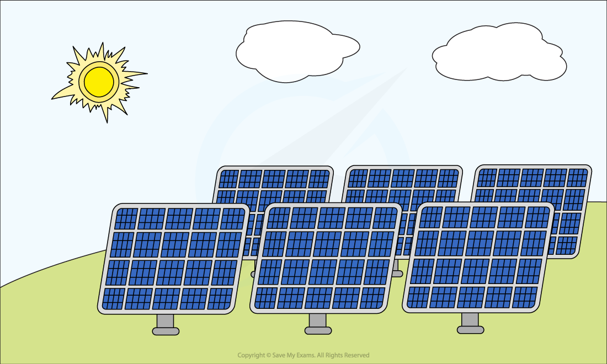

# Energy from the Sun

## The Sun

> **Spec point** — `spcpt_t8hntfJ3m8TqbPCp` · •  Know that radiation from the Sun is the main source of energy for all our energy resources except geothermal, nuclear and tidal

## The Sun

### Extended Tier Only

- The Sun transfers energy to Earth by **electromagnetic radiation**
- Most of our energy resources on Earth come indirectly from the **Sun**

  - The Sun heats up the atmosphere, creating **wind** and producing **waves**
  - Water evaporated by the Sun falls as rain, filling up **reservoirs**
  - Plants grown using sunlight form the basis for fuels – both biofuels and fossil fuels

- Some energy resources, however, do not come from the Sun
- These include:

  - **Geothermal **– this comes from thermal energy produced in the Earth’s core
  - **Nuclear **– this comes from elements which make up a small proportion of the Earth’s crust
  - **Tidal **– this comes (mainly) from the gravitational attraction of the Moon

*Energy from the Sun is the source of the energy stored in many of Earth's energy resources*

## Solar cells

> **Spec point** — `spcpt_dK57C8DTFV6qMYZ3` · Describe how useful energy may be obtained, or electrical power generated, from: 
   *  light from the Sun to generate electrical power (solar cells)
Describe advantages and disadvantages in terms of renewability, availability, reliability, scale and environmental impact:

## Solar cells

- The energy from the Sun that falls on the Earth is transferred by radiation

  - Mostly **visible light** and **infrared radiation**
- The amount of energy transferred from the Sun to the Earth **each hour** is equal to the energy use of the world for **one year!**
- Therefore, scientists are working hard to find methods of harnessing this energy

  - Solar energy has a **low energy density**, which means large collecting devices are required
  - Collecting solar energy has been **expensive** (due to the equipment required) and **inefficient**
  - **Improved technology** and large-scale manufacturing have made solar cells much cheaper and more efficient than they used to be

- **Solar cells** transfer energy from sunlight and produce a current, therefore generating **electricity **

  - Solar cells, sometimes called photovoltaic cells, are made of semiconducting materials
  - A number of cells connected together can supply electricity to homes, small-scale businesses, communication devices and satellites
  - Energy generated from solar cells can be stored in batteries for later use

*Solar cells use energy from sunlight to produce electricity*

### Advantages of solar cells

- Solar energy is a **renewable** resource since it relies on light from the Sun which will not run out

**A renewable resource is one which can be replenished at the same rate as it is used**

- Solar farms do not emit **carbon dioxide** or other greenhouse gases while operating, so they do not contribute to global warming
- Solar energy can be generated in **remote places** that are not connected to an electricity grid

  - For example, to power solar street signs in rural areas

- Solar farms have low running costs because there is no fuel to buy

### Disadvantages of solar cells

- Solar cells provide an **intermittent or unreliable** supply of electricity because they depend entirely on the availability of sunlight

  - They cannot generate electrical power at night, and their power output is heavily **dependent** on weather conditions
- Solar farms need to be large-scale and contain vast numbers of solar cells to produce large amounts of electricity
- Each solar cell generally has a **lower** power output than a standard mains electrical supply

## Solar panels

> **Spec point** — `spcpt_QsDHvcMP7d9yjpc3` · Describe how useful energy may be obtained, or electrical power generated, from:  
 * infrared and other electromagnetic waves from the Sun to heat water (solar panels) and be the source of wind energy 
 including references to a boiler, turbine and generator where they are used
Describe advantages and disadvantages in terms of renewability, availability, reliability, scale and environmental impact

## Solar panels

- Useful energy may be obtained from infrared and other electromagnetic waves from the Sun using **solar panels**

- **Solar panels** transfer energy from sunlight to the thermal store of the solar panels, which is used to **heat water** in the pipes

  - Solar panels can be used to warm domestic water supplies
  - This can reduce the cost of producing hot water since it is heated partially by the solar panels
- **Solar furnaces** consist of large curved mirrors that focus the Sun's rays onto a small area

  - These can be used to boil water, generating enough steam to turn turbines and generate electricity in a power station

*Solar panels use energy from sunlight to heat water *

### How solar panels work

- Water is **stored **in a water **tank **and pumped through small **pipes **running through the solar panel
- I**nfrared radiation** from the Sun heats the water in the pipes as it flows through them
- The water returns to the tank at a** higher temperature**
- Water may still need to be heated further to reach the desired temperature (e.g. for a shower)

### Advantages of solar panels

- Solar energy is a **renewable** resource since it relies on light from the Sun which will not run out
- Solar panels do not emit **carbon dioxide** or other greenhouse gases while operating, so they do not contribute to global warming
- While they may have an initial installation cost, they are **cheap to run** and require **low maintenance**
- Solar panels can be placed on the roofs of buildings, saving ground space

### Disadvantages of solar panels

- Solar panels provide an **intermittent or unreliable** supply of electricity because they depend entirely on the availability of sunlight
- Solar furnaces need to be large-scale to produce high temperatures
- Solar panels have a much lower power output compared to a standard mains electrical supply

  - A solar panel will take **longer to recharge a battery** than a mains supply would

## Wind energy

> **Spec point** — `spcpt_FBDghY6Y53HSQYHC` · Describe how useful energy may be obtained, or electrical power generated, from:  
 * infrared and other electromagnetic waves from the Sun to heat water (solar panels) and be the source of wind energy 
 including references to a boiler, turbine and generator where they are used
Describe advantages and disadvantages in terms of renewability, availability, reliability, scale and environmental impact

## Wind energy

- Energy from the **wind **can be used to generate **electricity**
- The wind turns a **turbine**, which turns a **generator**, which generates electricity
- Energy from the kinetic store of the wind is transferred

  - mechanically to the kinetic store of the turbine
  - which is transferred mechanically to the kinetic store of the generator
  - which is transferred electrically to the electricity grid

*Wind turbines use energy from the wind to generate electricity*

### Advantages of wind power

- Wind is a **renewable **resource
- Wind turbines do not emit **carbon dioxide** or other greenhouse gases while operating, so they do not contribute to global warming
- Wind turbines do not produce **sulfur dioxide** or other acidic gases during operation, so they do not contribute to acid rain
- **Offshore** wind farms can be built in coastal areas
- Wind turbines do not use fuel, so there are no fuel costs

### Disadvantages of wind power

- Wind power is **not reliable** because the wind does not blow constantly, and they cannot generate power if the wind is too weak or too strong
- Each turbine only produces a **small** amount of electricity, so wind farms are needed for large-scale electricity generation
- Wind turbines are often **difficult to maintain**, particularly if they are built offshore
- Offshore wind farms can **disrupt shipping** routes

> **Exam Hint**
> In your IGCSE exam, you will **not** be awarded marks for giving vague advantages or disadvantages without further explanation. Make sure you can justify your answers.
