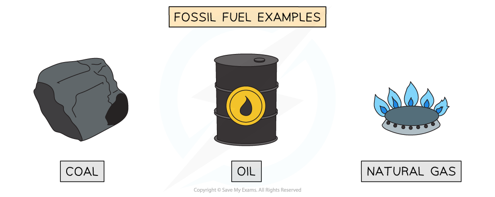
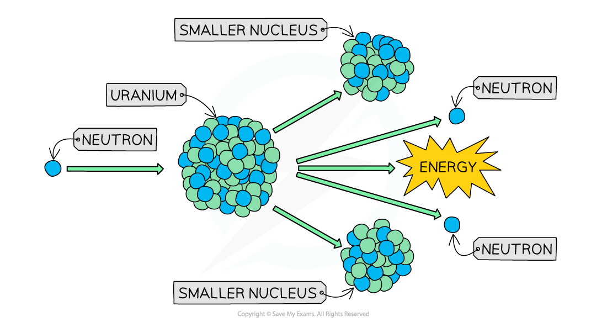

# Energy from Fuels

## Fossil fuels

> **Spec point** — `spcpt_M8whzMWtT8QfKQ9d` · Describe how useful energy may be obtained, or electrical power generated, from:  
 * chemical energy stored in fossil fuels 
 including references to a boiler, turbine and generator where they are used
Describe advantages and disadvantages in terms of renewability, availability, reliability, scale and environmental impact

## Fossil fuels

- Fossil fuels are:

  - **Coal**
  - **Natural gas** (mostly methane)
  - Crude **oil** which is refined into petrol, diesel and other fuels

*Fossil fuels: coal, oil and natural gas*

- Fossil fuels are formed from the **remains of plants and animals **
- **Chemical energy** stored in fossil fuels originally came from **sunlight**

  - Energy from the Sun was transferred to the chemical energy store of plants by photosynthesis (plants use energy from sunlight to make food)
  - Animals ate the plants and the energy was transferred to their chemical store

### Advantages of fossil fuels

- Fossil fuel power stations are **extremely reliable** since they can burn fossil fuels on demand and the infrastructure is well established in most countries

  - Energy output is **not dependent** on weather conditions
- Fossil fuel power stations are **extremely responsive** (they can be turned on and off easily), which means they can meet the changing demands of a nation
- Fossil fuels are relatively **safe **to store and use

### Disadvantages of fossil fuels

- It takes **millions of years** for fossil fuels to form

  - This is why they are considered to be a **non-renewable** energy resource
  - The increasing demand for a **decreasing supply** causes prices to increase
  - Fossil fuels are being used far faster than they form, so supplies are **finite** and will become increasingly difficult and expensive to extract.
- Burning fossil fuels pollutes the atmosphere with harmful gases such as:

  - **Carbon dioxide** which contributes to the **greenhouse effect**
  - **Sulfur dioxide** which produces **acid rain**
  - Both carbon dioxide and sulfur dioxide can be captured upon burning, preventing them from being released into the atmosphere but this is expensive to do
- Extraction of fossil fuels causes **damage **to the **environment**

### Uses of fossil fuels

- Fossil fuels are used for:

  - Transport
  - Generating electricity
  - Heating

#### Transport

- The majority of vehicles in the world are powered by **petroleum** products such as petrol, diesel and kerosene

  - These resources all originate from crude oil, which is a **fossil fuel**
- A growing number of vehicles are now being powered by **electricity**

- The advantage of this is that while the vehicle is being driven, it produces **zero carbon emissions**
- The disadvantage is that when the vehicle is being charged, it is connected to the electricity grid, which currently uses a **combination** of renewable and non-renewable energy sources

#### Electricity generation

- Fossil fuels, such as **gas **and **coal**, are used to produce energy **on-demand** when energy is needed

  - The fossil fuel is burned (combusted) and used to heat water to produce **steam**
  - The steam turns a **turbine**
  - The turbine turns a **generator**, which generates electricity
  - The current produced is transmitted via the **electricity grid**
  - The steam is condensed into water to be used again

#### Electricity generation in a coal-fired power station

*Fossil fuels are burned to heat water to produce steam. The steam turns the turbine, which turns the generator, which produces electricity*

- Electricity plays a bigger role in people's lives than ever before

  - With almost 8 billion people in the world, this means the **demand** for electricity is **extremely high**
  - To keep up with this demand, a combination of **all** the energy resources available is needed

#### Global energy consumption

*In 2019, fossil fuels supplied around 80% of the world's primary energy. Burning them raises the level of carbon dioxide in the atmosphere, which contributes to global warming*

#### Heating

- The majority of heating systems run on **fossil fuels**

  - **Gas **central heating systems are the most common, with a gas boiler that heats water through a system of pipes and radiators throughout the building
  - Boilers can also be powered by **oil **or biofuels
  - Open fireplaces burn wood or **coal**
- Electric heaters run on electricity
- Bottled gas can also be used in portable heaters

  - Bottled gas is either **propane **or **butane **which are also produced from fossil fuels

## Biofuels

> **Spec point** — `spcpt_hdrf6BQRb3sMdtss` · Describe how useful energy may be obtained, or electrical power generated, from:  
 * chemical energy stored in biofuels
 including references to a boiler, turbine and generator where they are used
Describe advantages and disadvantages in terms of renewability, availability, reliability, scale and environmental impact

## Biofuels

- Biofuels are made from plant matter

  - Energy from sunlight is transferred to the **chemical store** of plants
- **Ethanol** or **methane** can be produced and used in place of fossil fuels

  - However, they have only half the **energy density** of fossil fuels

*Plants take in carbon dioxide during photosynthesis, but carbon dioxide is released back into the atmosphere when biofuels are burned*

### Advantages of biofuel

- Biofuel is a **renewable resource** since new plants can always be grown
- Biofuels provide a **reliable** and consistent supply of energy because the fuel can be stored and burned in a boiler whenever the electricity is needed
- Biofuel is generally considered to be **carbon neutral**

  - Although burning biofuels releases carbon dioxide into the atmosphere, the plants used to make the fuel take in carbon dioxide when they photosynthesise
- No **sulfur dioxide** is produced, so biofuels do not contribute to acid rain
- Some vehicles can be powered by **biofuel **rather than using fossil fuels
- Biofuel is added to petrol and diesel products in many countries to **reduce **the volume of **pollutants **released in combustion

### Disadvantages of biofuel

- Crops of biofuel-producing plants must be grown, which takes **time**

  - Growing the crops takes a lot of **land**, and takes **resources **needed for food production

- Burning biofuels releases **carbon dioxide** into the atmosphere

  - If the land had been used to grow crops for food, the same amount of carbon would have been taken out of the atmosphere, and much less carbon would have been returned
- Biofuels have only half the energy density of fossil fuels, which means twice as much fuel needs to be used to release the same amount of energy
- Not many vehicles can run on biofuel alone

## Nuclear fuel

> **Spec point** — `spcpt_HC3CFrd5XjtNSnKW` · Describe how useful energy may be obtained, or electrical power generated, from:  
 * nuclear fuel
 including references to a boiler, turbine and generator where they are used
Describe advantages and disadvantages in terms of renewability, availability, reliability, scale and environmental impact

## Nuclear fuel

- Energy stored in the **nucleus** of atoms can be released when the nucleus is broken in two

  - This is known as [nuclear fission](https://www.savemyexams.com/igcse/physics/cie/23/revision-notes/5-nuclear-physics/5-1-the-nuclear-model-of-the-atom/5-1-4-fission-and-fusion/?_ai=internal-linking)

*Nuclear Fission: when a large nucleus is broken into two smaller nuclei, energy is released*

- Nuclear power stations use fission reactions to **heat water** to produce steam, to turn turbines that turn generators which** generate electricity**

### Advantages of nuclear power

- Nuclear power stations do **not** emit carbon dioxide or sulfur dioxide during operation, so they do not contribute to global warming or acid rain
- Nuclear power stations are** extremely reliable** since nuclear fuel can be used on demand and stations are **well established** in some countries
- Nuclear power stations are **responsive **as the output is easily controlled
- Nuclear fuel has a **high energy density**

  - A small amount of fuel releases **massive amounts** of energy

### Disadvantages of nuclear power

- Nuclear power is a **non-renewable** resource

  - Uranium ore is mined from rocks so there is a **finite supply**
- Nuclear fuels produce **radioactive waste**

  - Radioactive waste is packaged and buried underground to be stored for **thousands **of years
  - Burial sites must remain undisturbed and uninhabited
- There are severe environmental consequences and risks of mutations or cancer if there is a radioactive leak, meaning **heavy containment** is necessary
- Nuclear power stations are **extremely expensive to build **and to decommission (close down)
- There is a high cost associated with maintaining **safe storage** facilities for the radioactive waste

> **Exam Hint**
> In your IGCSE exam, you may be required to discuss the advantages and disadvantages of various energy resources. Advantages and disadvantages must be specific and have an explanation. You may also need to apply your understanding of energy resources to unfamiliar scenarios, for example, by suggesting which type of energy resource would be best for a particular community. Make sure you can justify your choices.
