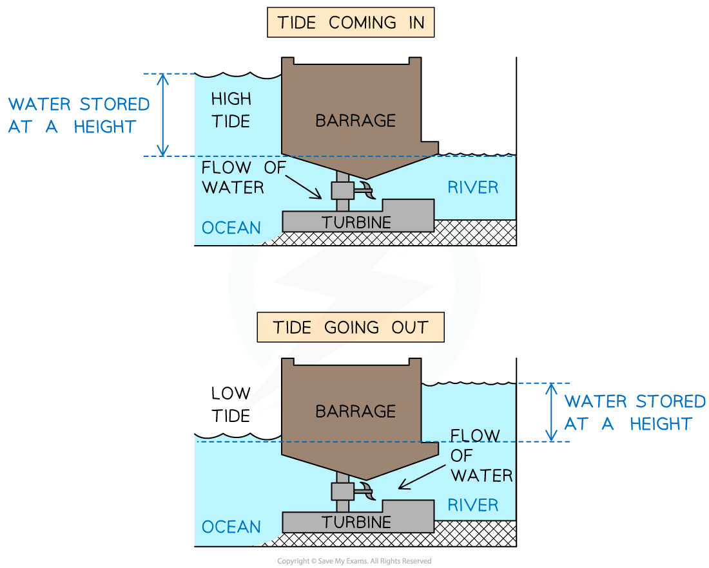
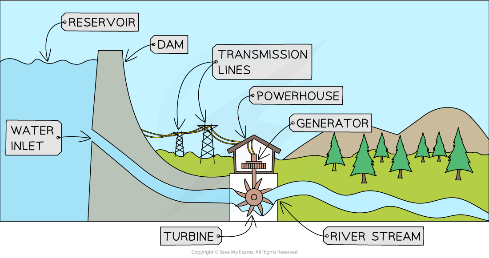

# Energy from Water

## Wave and tide power

> **Spec point** — `spcpt_pHfT59JJw6sCyWPp` · Describe how useful energy may be obtained, or electrical power generated, from:  
 * energy stored in waves and tides
 including references to a boiler, turbine and generator where they are used
Describe advantages and disadvantages in terms of renewability, availability, reliability, scale and environmental impact 

## Wave & tide power

- Energy can be obtained from the kinetic store of the waves and tides
- The motion of the water is used to turn a turbine, which turns a generator, which generates electricity

### Wave power

- Wave power uses devices that float on or near the surface
- The up-and-down motion of the waves drives a generator, either directly or by forcing air through a turbine

#### Turbines using wave power

*Underwater turbines generate electricity*

### Tidal power

- Tidal power uses tidal barrages to store water at a height as the tide comes in and goes out
- When the barrage is opened, water flows through a channel over a turbine

#### Tidal barrage

*A tidal barrage stores water at a height and then opens a gate allowing water to flow over a turbine*

### Advantages of wave and tidal power

- Wave and tidal power are **renewable **energy resources
- Wave and tide power produce **no carbon dioxide** or greenhouse gases as no fuel is needed
- Tides are regular, so **tidal power** is **reliable **and predictable
- There are no fuel costs involved in wave and tidal power stations so running costs are **low**

### Disadvantages of wave and tidal power

- Wave power is **not available at all times **as the waves are not always large enough to turn the turbines
- Tidal barrages are built in **estuaries **so there are not many suitable locations around the world that are suitable for tidal power generation
- Because the equipment is submerged in the sea, underwater **maintenance** is more difficult
- The underwater turbines and tidal barrages can **interfere **with shipping routes and cause **damage **to habitats
- Wave and tidal power stations have a **long construction time** compared to some other power station types

> **Exam Hint**
> Tidal power is reliable **and** predictable because low and high tide cycles are easy to forecast. Wave power is less predictable due to changing wave speeds.

## Hydroelectric dams

> **Spec point** — `spcpt_CtKkYKM6zb9PbB5G` · Describe how useful energy may be obtained, or electrical power generated, from:  
 * water behind hydroelectric dams
 including references to a boiler, turbine and generator where they are used
Describe advantages and disadvantages in terms of renewability, availability, reliability, scale and environmental impact

## Hydroelectric dams

- When water is stored above ground level, it has energy in its **gravitational potential energy store**
- This energy can be transferred to the **kinetic energy store** if the water is allowed to flow down the slope
- Flowing water turns the turbine to **generate electricity**

*A hydroelectric dam transfers energy mechanically from the gravitational potential energy store of the water to its kinetic energy store. The moving water turns the turbine*

### Advantages of hydroelectric power

- Hydroelectric power is **renewable** because the reservoir is refilled by rainfall
- Hyrdoelectric power does not contribute to **global warming** and does not produce **acid rain**
- Hydroelectric dams are **reliable **since water can be released on demand and dams are well established in most countries
- Hydroelectric power stations are **responsive **because they can be turned on and off easily to meet changing demand
- Hydroelectric power stations are **cheap to run** because there is no fuel to buy
- Hydroelectric power stations can produce **large **amounts of electricity

### Disadvantages of hydroelectric power

- Valleys are flooded to create the reservoir used to store the water, which **destroys habitats**, towns and villages
- There are **limited suitable sites** available for construction, as hydroelectric dams require both a steady water supply and the necessary vertical height
- Hydroelectric power stations are **expensive to build **because the land and properties need to be acquired in order to build the reservoir
- **Drought** can affect the supply of water
- **Pumping systems** are sometimes used to return the water to the reservoir

  - Pumped storage uses electricity from the grid to pump water back up to the reservoir, so its environmental impact depends on how that electricity was generated
