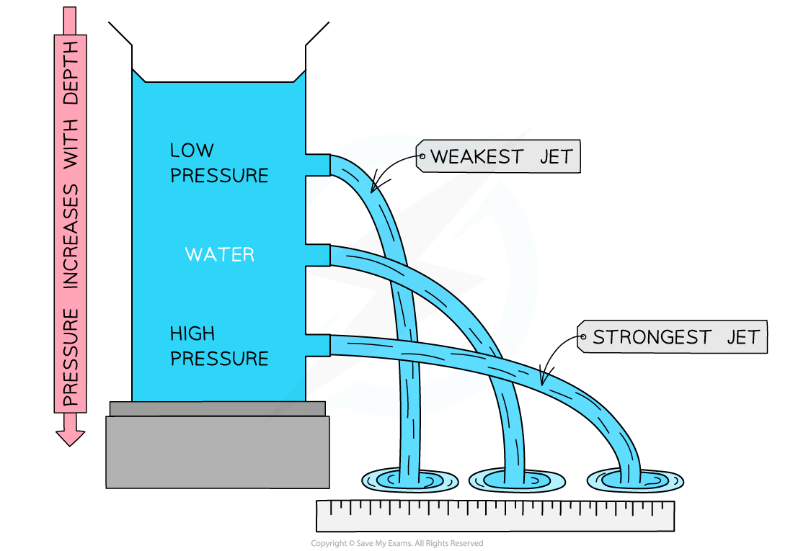
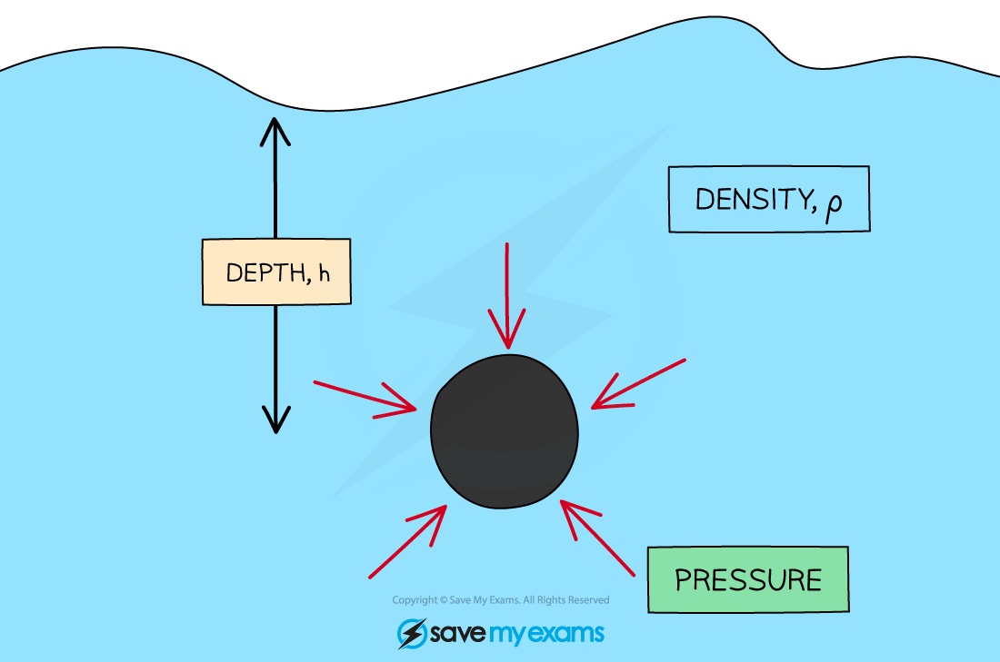

# Pressure in a Liquid

## Liquid pressure

> **Spec point** — `spcpt_DNKynYD9FWRvbfCg` · Describe, qualitatively, how the pressure beneath the surface of a liquid changes with depth and density of the liquid

## Liquid pressure

### Factors affecting pressure in a liquid

- The **pressure **beneath the surface of a liquid will **increase **with the **depth **of the liquid

  - This is because the pressure in a liquid is caused by the force of the **weight** of the liquid above it
  - As the depth increases, there is more liquid above which causes the pressure to increase
- Pressure in a liquid also depends on the **density **of the liquid

  - The more dense the liquid, the greater the pressure it exerts
  - Sea water is more dense than fresh water, so the pressure exerted on a object will be greater in sea water than in fresh water at the exact same depth

### Pressure in a column of water

- In a column of water, the **highest pressure** would be at the **bottom**

  - If a hole is made at the bottom of the column, the water will pour out with a **large** force
  - If a hole is made at the top of the column, the water will pour out with a **small** force
  - This is because of the **difference in pressure** in the column caused by the weight of the water

*Pressure in a column of water increases with depth, shown by the strong and weak jet of water*

- If several holes are made at the same height, the water would spurt out the same distance from each hole

  - This is because pressure at the **same **depth acts **equally **in all directions

> **Exam Hint**
> Remember, a fluid can be either a **liquid **or a **gas**. In all fluids, pressure is affected by depth and density.

## Calculating liquid pressure

> **Spec point** — `spcpt_R4SWMQjm4qFW2SSn` · Recall and use the equation for the change in pressure beneath the surface of a liquid ∆p = ρg∆h

## Calculating liquid pressure

### Extended Tier Only

- The pressure acting on an object in a liquid changes with **depth**

  - The **deeper **the object, the higher the pressure exerted upon it and vice versa
- The change in pressure with depth is given by:

$Δp=ρgΔh$

- Where:

  - Δ*p* = change in pressure, measured in pascals (Pa)
  
    - Where 1 Pa = 1 N/m2
  - *ρ *= density of the liquid, measured in kilograms per metre cubed (kg/m3)
  - *g* = gravitational field strength, measured in newtons per kilogram (N/kg)
  - Δ*h* = change in height of the column, measured in metres (m)

*A liquid exerts pressure on every surface of a submerged object, acting at right angles to each surface*

> **Worked Example**
> Calculate the depth of water in a swimming pool at which the pressure due to the water alone is 20 kPa. The density of water is 1000 kg/m3 and the gravitational field strength on Earth is 9.8 N/kg.
> 
> [3]
> 
> **Answer:**
> 
> **Step 1: List the known quantities**
> 
> - Pressure, $Δp=20\mathrm{kPa}$
> - Density of water, $ρ=1000\mathrm{kg}/m^{3}$
> - Gravitational field strength, $g=9.8N/\mathrm{kg}$
> 
> **Step 2: List the relevant equation**
> 
> $Δp=ρgΔh$ **[1 mark]**
> 
> **Step 3: Rearrange for height, Δ*****h***
> 
> $Δh=\frac{Δp}{ρg}$
> 
> **Step 4: Convert any units**
> 
> $20\mathrm{kPa}=20000\mathrm{Pa}$
> 
> **Step 5: Substitute in the values**
> 
> $Δh=\frac{20000}{1000\times9.8}$ **[1 mark]**
> 
> `straight capital delta h space equals space 2.0408 space straight m space equals space 2.0 space straight m space open parentheses 2 space straight s. straight f. close parentheses` **[1 mark]**

> **Exam Hint**
> You need to be able to recall the equation for the change in pressure and make sure you are comfortable rearranging it for the variable required in the question. With pressure in pascals, make sure the change in depth is measured in metres.
> 
> Some exam questions may ask about the **total** pressure exerted on an object or surface within the liquid; in this case, you need to account for the **atmospheric pressure** as well. Atmospheric pressure is approximately 100 kPa.
> 
> Make sure you **add** the atmospheric pressure when you are asked for total pressure, and **subtract** the atmospheric pressure when you are given the total and asked for depth or for the pressure due to the liquid alone.
