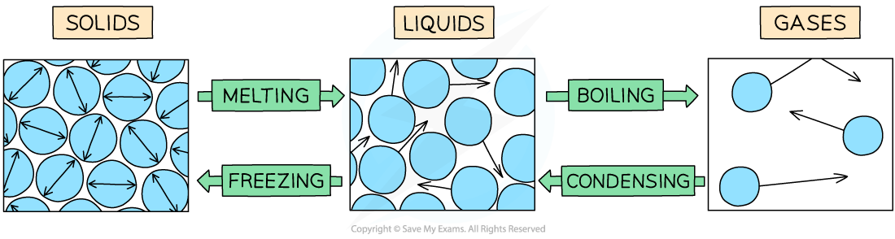

# States of Matter

## Properties of solids, liquids & gases

> **Spec point** — `spcpt_G8Mmjw4ynTppXRVV` · Know the distinguishing properties of solids, liquids and gases

## Properties of solids, liquids & gases

### The three states of matter

*Only a gas has neither a fixed shape nor a fixed volume*

#### Solids

- Solids have a definite shape and a definite volume

  - Solids cannot flow and are not compressible

#### Liquids

- Liquids have no definite shape but do have a definite volume

  - Liquids are able to flow to take the shape of a container but they are not compressible

#### Gases

- Gases have no definite shape and no definite volume

  - Gases can flow to take the shape of their container and are highly compressible

## Changes of state

> **Spec point** — `spcpt_PhGhPNYpHbYPjJ5j` · Know the terms for the changes in state between solids, liquids and gases (gas to solid and solid to gas transfers are not required)

## Changes of state

- When a substance changes state, the number of molecules in that substance does not change and so neither does its mass
- The only thing that changes is its **energy**
- Changes of state are physical changes and so they are **reversible**

### Melting and freezing

- Melting occurs when a solid turns into a liquid (e.g. ice to water)
- Freezing (also called solidification) occurs when a liquid turns into a solid

### Boiling and condensing

- Boiling (sometimes called vaporising) occurs when a liquid turns into a gas
- Condensing occurs when a gas turns into a liquid

*You need to know these four processes only, and the states at which they start and end.*

> **Exam Hint**
> It is very useful to think about water when learning the changes of state, because you are used to the idea that solid water (ice) melts to become liquid water (water) and boils to become gaseous water (water vapour).
> 
> However, do remember that **all **substances undergo the same changes between the three states, but at different temperatures. So while water will help you to remember the names, don't refer to water in your answers unless it has been specified.
