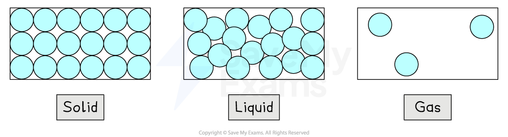

# Molecular Matter

## Arrangement & motion of particles

> **Spec point** — `spcpt_TjcSfx6VN4j6scgF` · Describe the particle structure of solids, liquids and gases in terms of the arrangement, separation and motion of the particles, and represent these states using simple particle diagrams

## Arrangement & motion of particles

- All particles are in constant motion at any temperature

  - The motion and arrangement of particles are different for each state of matter
- In a **solid**:

  - The particles are very **close** together and arranged in a **regular** pattern
  - The particles **vibrate** about fixed positions
- In a **liquid**:

  - The particles are still **close** together (no gaps) but are no longer arranged in a regular pattern
  - The particles are able to **slide past each other**
- In a **gas**:

  - The particles are **widely separated**, about 10 times further apart in each direction
  - The particles move about **randomly at high speeds**

*Particles are closely packed in solids and liquids, but widely separated in gases*

| **Property** | **Solid** | **Liquid** | **Gas** |
|---|---|---|---|
| Density | High | Medium | Low |
| Arrangement of particles | Regular pattern | Randomly arranged | Randomly arranged |
| Separation of particles | Very close together | Close together but loosely packed | Widely spaced |
| Movement of particles | Vibrate around a fixed position | Move around each other | Move quickly in all directions |
| Energy of particles | Low energy | Higher energy | Highest energy |

> **Worked Example**
> Two states of matter are described below. Identify each of the states of matter.
> 
> **Substance 1**
> 
> - particles are spaced very far apart
> - particles move very quickly at random
> - particles move in a straight line
> 
> **Substance 2**
> 
> - particles are quite closely packed together
> - particles move about at random
> - particles do not have fixed positions
> 
> [2]
> 
> **Answer:**
> 
> **Substance 1 **
> 
> **Step 1: Identify the distances between the particles**
> 
> - The particles are spaced far apart
> 
>   - This can only describe a gas
> 
> **Step 2: Identify the motion of the particles**
> 
> - The particles move quickly, at random and in a straight line
> 
>   - This confirms that substance 1 is a gas **[1 mark]**
> 
> **Substance 2**
> 
> **Step 1: Identify the distances between the particles**
> 
> - The particles are closely packed
> 
>   - This could describe either a solid or a liquid
> 
> **Step 2: Identify the motion of the particles**
> 
> - The particles move at random and do not have fixed positions
> 
>   - This confirms that substance 2 is a liquid **[1 mark]**

> **Exam Hint**
> The properties of particles must be known for each state of matter.
> 
> In comparison questions, you should name the property and give descriptions that compare the states of matter. Note that particles do not expand, only the average separation changes.

## Forces & distances between particles

> **Spec point** — `spcpt_8kD6GRSYXgqkRbB7` · Know that the forces and distances between particles (atoms, molecules, ions and electrons) and the motion of the particles affects the properties of solids, liquids and gases

## The forces & distances between particles

### Extended Tier Only

### Intermolecular forces and motion of particles

- The **forces between particles** affect the state of matter
- This is because the magnitude of the forces affects the **relative distances** and **motion** of the particles
- This affects the ability of the substance to

  - Change shape
  - Change volume
  - Flow
- The word **particles** can refer to:

  - Atoms
  - Molecules
  - Ions
  - Electrons

#### Solids

- The particles in a solid are held in place by **strong intermolecular** forces

  - They only **vibrate in position**
  - The **distance** between them is **fixed **and is very small
  - This gives the solid its **rigid shape** and **fixed volume**

#### Liquids

- The particles in a liquid have enough **energy** to move past one another, but not enough to escape the forces holding them together
- They are still held **close together**

  - The liquid has a fixed volume, similar to that of the solid
- Particles can **move around** (by sliding past each other)

  - This allows the liquid to **change shape** and **flow**
- Liquids are difficult to compress because particles are close together **and** the repulsive forces between them are large

#### Gases

- The particles in a gas have **more energy** and move **randomly** at **high speeds**

  - The particles have **overcome** the forces holding them close together
- Because of the **large spaces** between the molecules

  - The gas can easily be **compressed** and is also able to **expand**
  - Gases** flow** freely

## Temperature & energy of particles

> **Spec point** — `spcpt_wKChjs9vtmgvvyBW` · Describe the relationship between the motion of particles and temperature, including the idea that there is a lowest possible temperature (−273°C), known as absolute zero, where the particles have least kinetic energy

## Temperature & energy of particles

- As the **temperature **of a gas increases, so does the **average speed** of particles in the gas

  - At higher temperatures, the particles have more **kinetic energy**
- Therefore, there must be a temperature at which the particles have the **least kinetic energy**

- The temperature at which particles have the least kinetic energy is called **absolute zero**

  - This is the **lowest possible temperature,** and absolute zero has a value of −273 °C
