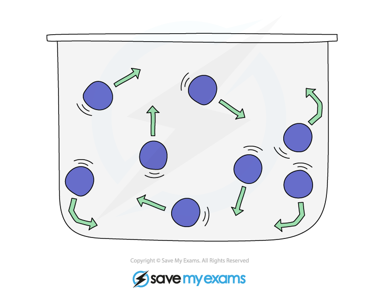
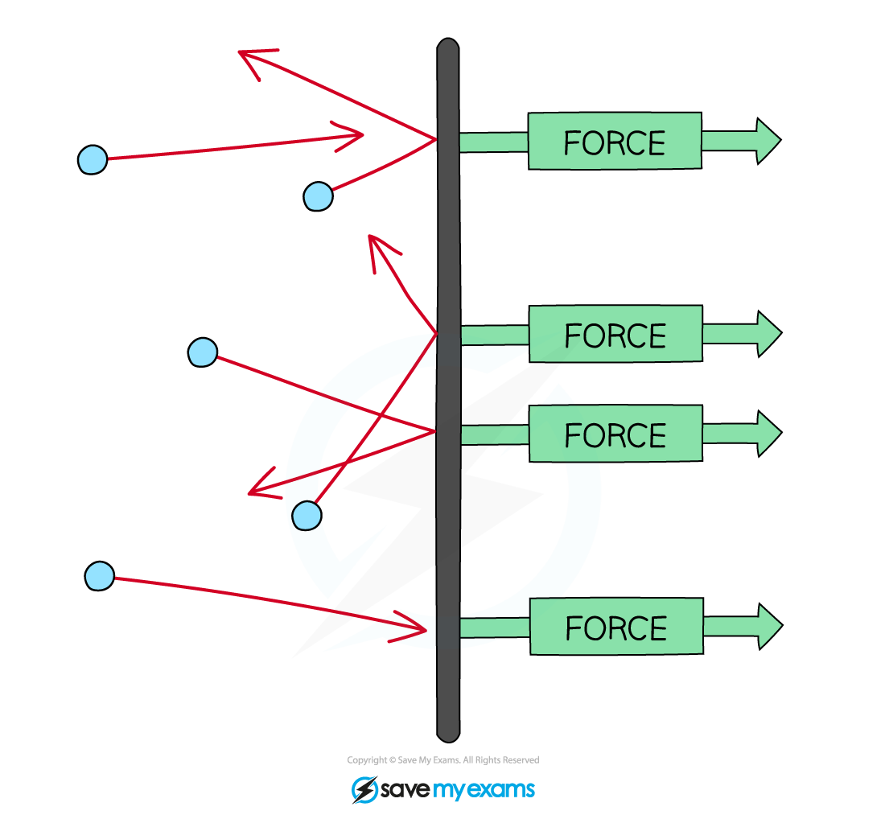

# Particle Model of Gases

## Motion of particles in a gas

> **Spec point** — `spcpt_Tg2PpFVqffN68wCC` · Describe the pressure and the changes in pressure of a gas in terms of the motion of its particles and their collisions with a surface

## Motion of particles in a gas

- In the particle model, molecules in a gas are in constant **random** motion at high speeds
- Random motion means that the molecules are travelling in no specific path and undergo sudden changes in their motion when they collide:

  - With the walls of its container
  - With other molecules
- Pressure in a gas is caused by the collisions of particles with the **walls** of the container
- When the particles travel **faster **(e.g. at a higher temperature), they collide with walls **more frequently**

  - They also hit the walls with a greater force, because they are moving faster
  - This means the gas exerts a **greater pressure**

*Random motion of gas molecules in a container. Collisions with container walls create pressure in the particle model*

> **Exam Hint**
> Always say that the particles collide with the **walls** of the container. Answers that only mention 'particles colliding' will not gain marks.

## Pressure & force of particles in a gas

> **Spec point** — `spcpt_9nwnT8Mv88RvSvMx` · Describe the pressure and the changes in pressure of a gas in terms of the forces exerted by particles colliding with surfaces, creating a force per unit area

## Pressure & force of particles in a gas

### Extended Tier Only

- When a molecule bounces off a wall, its momentum changes direction
- This change of momentum over time produces a force on the wall

- The pressure is defined as the **force per unit area**

$p=\frac{F}{A}$

- Where:

  - $p$ = pressure, measured in pascals (Pa)
  - $F$ = force, measured in newtons (N)
  - $A$ = area, measured in metres squared (m2)
- This equation and the particle model can be used to explain how particles exert pressure
- As the gas particles move about randomly they collide with the walls of their containers
- These collisions produce **force **at right angles to the wall of the gas container (or any surface)

  - Pressure is [force per unit area](https://www.savemyexams.com/igcse/physics/cie/23/revision-notes/1-motion-forces-and-energy/1-9-pressure/1-9-1-pressure-and-forces/?_ai=internal-linking), so the force of these collisions exerts a **pressure**
- When the particles move faster, they have **more frequent collisions** with the container walls, and these exert a **greater force**

  - If the **force** exerted per unit area is greater and more frequent, the **pressure **exerted is also greater

*Gas molecules bouncing off the walls of a container exert a force perpendicular to the surface*

> **Exam Hint**
> When a gas is compressed at constant temperature, only the **frequency** of collisions changes. The molecules move at the same average speed, so their average kinetic energy stays the same — only the force per unit area increases.
