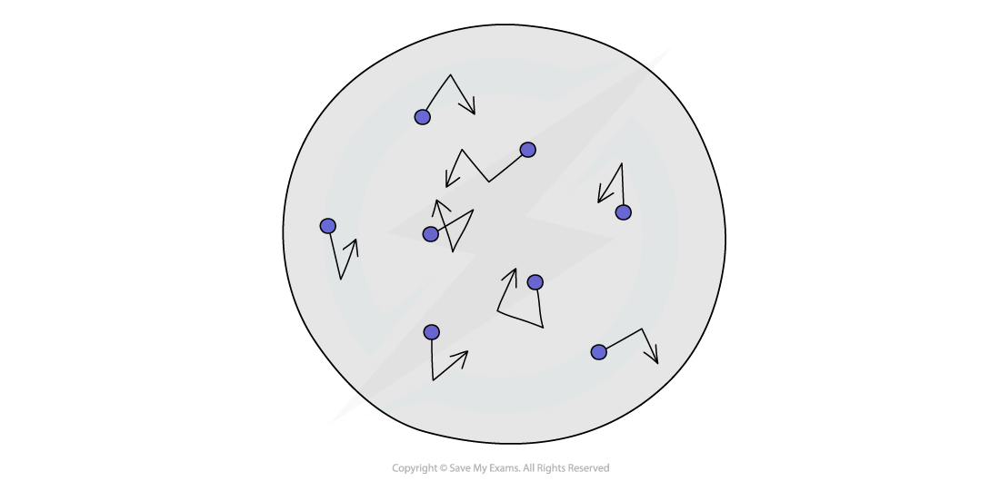
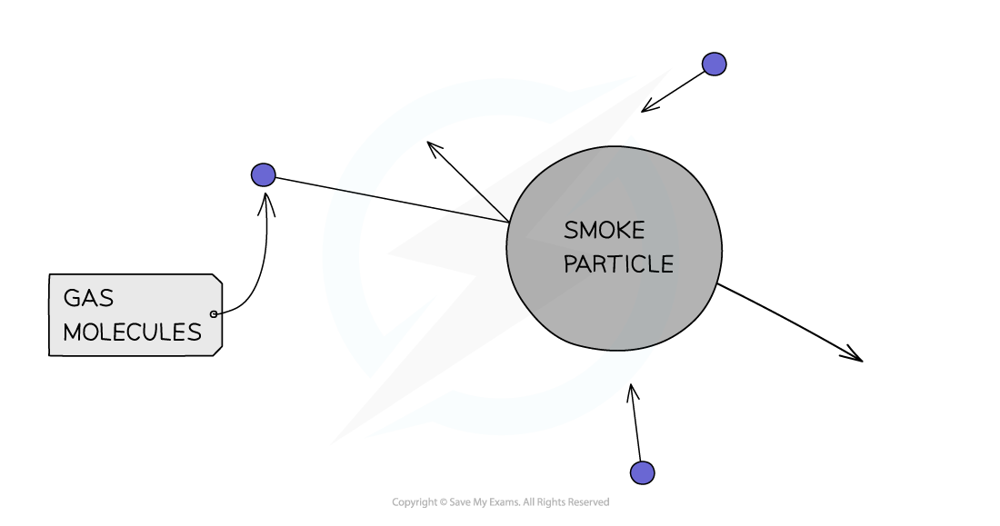
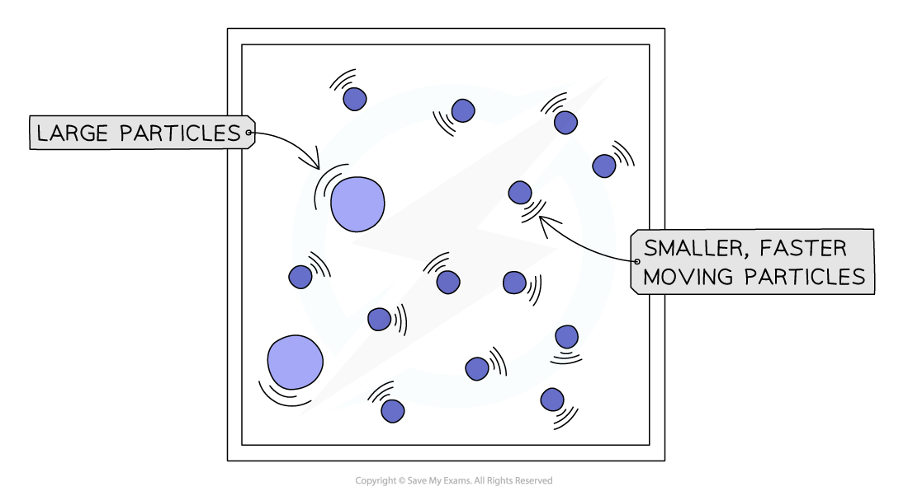

# Brownian Motion

## Brownian motion

> **Spec point** — `spcpt_FMdgWC52PMSykDfS` · - Know that the random motion of microscopic particles in a suspension is evidence for the kinetic particle model of matter
- Describe and explain this motion (sometimes known as Brownian motion) in terms of random collisions between the microscopic particles in a suspension and the particles of the gas or liquid

## What is Brownian motion?

- The **kinetic particle model of matter** — the idea that **all matter is made up of tiny particles** in constant motion — was first supported by an accidental observation

  - The Scottish scientist Robert Brown first described the random motion of pollen grains in water, which he saw under a microscope
  - This observation could not be explained at the time, but later it was realised that it shows that substances are made of particles which are in **constant motion** (hence 'kinetic')

*Brownian motion: the random motion of microscopic particles in a suspension when observed through a microscope*

- **Brownian motion** is the random movement of microscopic particles suspended in a liquid or a gas, caused by large numbers of **collisions** with the much smaller, lighter, faster-moving molecules of that liquid or gas

- When small particles (such as pollen or smoke) are suspended in a liquid or gas, they can be observed through a microscope moving around in a random, erratic fashion

> **Exam Hint**
> If you are asked to draw the path of a smoke particle, use **short straight lines** of different lengths joined by **sudden changes** of direction. Curved paths score no marks, and neither does a path that only changes direction when it hits the edge of the container. If you are asked to name the motion, the answer is Brownian motion — not diffusion.

## Explaining Brownian motion

> **Spec point** — `spcpt_T6tdjcWgqpm9cpXq` · - Know that microscopic particles may be moved by collisions with light fast-moving molecules and correctly use the terms atoms or molecules as distinct from microscopic particles (E)

## Explaining Brownian motion

### Extended Tier Only

### What is Brownian motion caused by?

- When observing Brownian motion, even with a microscope, only the **microscopic particles** can be seen

  - The pollen or smoke particles are seen to move
  - Smaller **atoms and molecules**, of water or air, are still too small to be seen

- These **light, fast-moving atoms and molecules** collide with the larger microscopic particles

  - The collisions give the particles a little nudge, causing them to change their speed and directions randomly, each time they are struck by a molecule
  - At any moment, more molecules happen to strike one side of the microscopic particle than the other
  - This uneven bombardment produces a resultant force that pushes the particle in a random direction

- The presence of the light, fast moving atoms and molecules is **inferred **from the motion of the microscopic particles

  - Inferences such as this are an important part of scientific investigation

*Light, fast-moving molecules collide with larger particles, giving them a little nudge*

*This not-to-scale diagram shows how the smaller, fast-moving particles (atoms and molecules) cause the larger, visible particles to move*
