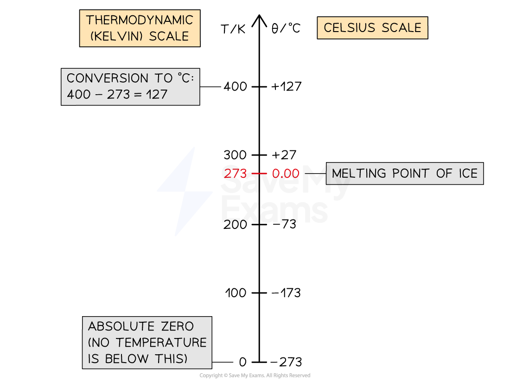
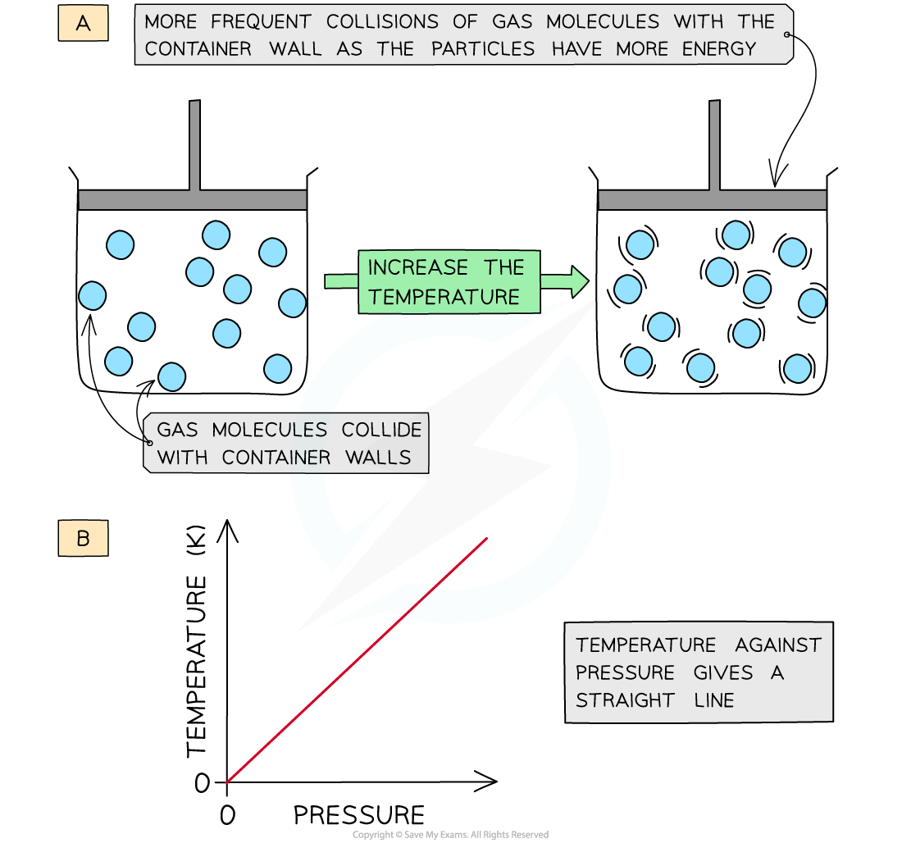

# Gases & Absolute Temperature

## Absolute temperature

> **Spec point** — `spcpt_B2pbhmtfPGrq9YMR` · Convert temperatures between kelvin and degrees Celsius; recall and use the equation T (in K) = θ (in °C) + 273

## Absolute temperature

### What is absolute temperature?

- Temperature measured in kelvin is called **absolute temperature**
- The **kelvin temperature scale** begins at **absolute zero**

  - **0 K is equal to -273 °C **
  - An increase of 1 K is the same change as an increase of 1 °C
- It is not possible to have a temperature** lower** than 0 K
- This means a temperature in kelvin will **never** have a negative value

- To convert between a temperature *θ*  in degrees Celsius and a temperature *T* in kelvin, use the following conversion:

$T(\mathrm{in}K)=θ(\mathrm{in}^{\circ}C)+273$

$θ(\mathrm{in}^{\circ}C)=T(\mathrm{in}K)-273$

*Conversion chart relating the temperature on the Kelvin and Celsius scales*

> **Worked Example**
> Convert the following values between the Kelvin (absolute) and Celsius scales of temperature.
> 
> a) 0 K = _______  °C [1]
> 
> b) 0 °C = _______  K [1]
> 
> c) 20 °C = _______  K [1]
> 
> **Answer:**
> 
> **Part (a)**
> 
> **Step 1: Choose whether to add or subtract 273 to the value**
> 
> - The question is in kelvin therefore subtract 273 to convert to Celsius
> 
> **Step 2: Do the calculation**
> 
> - $0-273=-273$
> 
> **Step 3: Write the answer with units**
> 
> - 0 K = −273 °C **[1 mark]**
> 
> **Part (b)**
> 
> **Step 1: Choose whether to add or subtract 273 to the value**
> 
> - The question is in Celsius therefore add 273 to convert to kelvin
> 
> **Step 2: Do the calculation**
> 
> - $0+273=273$
> 
> **Step 3: Write the answer with units**
> 
> - 0 °C = 273 K **[1 mark]**
> 
> **Part (c)**
> 
> **Step 1: Choose whether to add or subtract 273 to the value**
> 
> - The question is in Celsius therefore add 273 to convert to kelvin
> 
> **Step 2: Do the calculation**
> 
> - $20+273=293$
> 
> **Step 3: Write the answer with units**
> 
> - 20 °C = 293 K **[1 mark]**

## The gas laws

> **Spec point** — `spcpt_45XFyxVbJCBM32jz` · Describe qualitatively, in terms of particles, the effect on the pressure of a fixed mass of gas of:
   (a) a change of temperature at constant volume
   (b) a change of volume at constant temperature

## The gas laws

### Pressure and volume (constant temperature)

- For a **fixed mass** of gas, if the temperature of a gas remains **constant**, the pressure of the gas changes when it is:

  - **Compressed** – decreases the volume which **increases** the pressure
  - **Expanded** – increases the volume which **decreases** the pressure

*At constant temperature, changing the volume changes the pressure*

- Similarly, a change in pressure can cause a change in volume
- A **vacuum pump** can be used to remove the air from a sealed container
- The diagram below shows the change in volume to a tied-up balloon when the pressure of the air around it decreases:

  - The balloon is tied, so there are a **fixed number** of air particles within it
  - At **normal pressure**, the air pressure outside the balloon is **greater **than the air pressure inside the balloon
  - When **air is removed** from the bell jar, the air pressure outside the balloon is **less than** the air pressure inside the balloon
  - The **space between** the air particles in the balloon increases, so the **volume **of the balloon increases

*At constant temperature, changing the pressure changes the volume*

- When a gas is compressed, the molecules will hit the walls of the container **more frequently**

  - Each wall is struck more often, and so the **total force** on each wall increases, which increases the **pressure**

### Pressure and temperature (constant volume)

- For a **fixed mass** of gas, **increasing temperature increases the pressure** of a gas which is kept at a **constant volume**
- The **average speed** of molecules increases when the temperature increases (and vice versa)
- As the gas heats up, the molecules will travel at a higher speed

  - They collide with the walls more often and with greater force, increasing the pressure
- Therefore, at a constant volume, an **increase** in temperature **increases** the pressure of a gas and vice versa

  - Diagram A shows that molecules in the same volume collide with the walls of the container more frequently, and with greater force, as the temperature increases
  - Diagram B shows that the pressure increases steadily as the temperature rises
  
    - If the temperature is measured in kelvin, pressure is directly proportional to temperature and the line passes through the origin

*At constant volume, an increase in the temperature of the gas increases the pressure due to more collisions on the container walls*

## Boyle's law

> **Spec point** — `spcpt_8Gk474PRTcm9CcNG` · Recall and use the equation pV = constant for a fixed mass of gas at constant temperature, including a graphical representation of this relationship

## Boyle's law

### Extended Tier Only

- For a fixed mass of gas at constant temperature, **Boyle’s law** is given by:

$p\propto\frac{1}{V}$

- This means the pressure is **inversely proportional **to the volume of a gas
- This can also be written as:

$pV=\mathrm{constant}$

- The relationship between the pressure and volume for a fixed mass of gas at constant temperature can also be written as:

$p_{1}V_{1}=p_{2}V_{2}$

- Where:

  - *p**1* = initial pressure (Pa)
  - *p**2* = final pressure (Pa)
  - *V**1** *= initial volume (m3)
  - *V**2* = final volume (m3)

- Notice that pressure and volume are measured in Pa and m3 respectively

  - Exam questions often give the pressure and volume in units other than Pa and m³, such as kPa and cm³. You can work in those units, as long as the initial and final units match and you give your answer in the same units**     **

*Boyle's law graph: Pressure is inversely proportional to volume*

> **Worked Example**
> A fixed mass of gas has a volume of 35 cm³ at a pressure of 120 kPa. The volume is slowly decreased by 20 cm³ at constant temperature. Calculate the change in pressure.
> 
> [3]
> 
> **Answer:**
> 
> **Step 1: List the known quantities**
> 
> - Initial pressure, $p_{1}=120\mathrm{kPa}$
> - Initial volume, $V_{1}=35\mathrm{cm}^{3}$
> 
> **Step 2: Write down the equation for Boyle's law**
> 
> $p_{1}V_{1}=p_{2}V_{2}$
> 
> **Step 3: Calculate the final volume**
> 
> $V_{2}=35-20=15\mathrm{cm}^{3}$ **[1 mark]**
> 
> **Step 4: Calculate the final pressure using Boyle's law**
> 
> $p_{2}=\frac{p_{1}V_{1}}{V_{2}}$
> 
> $p_{2}=\frac{120\times35}{15}$
> 
> $p_{2}=280\mathrm{kPa}$ **[1 mark]**
> 
> **Step 5: Calculate the change in pressure**
> 
> $\Deltap=p_{2}-p_{1}$
> 
> $\Deltap=280-120=160\mathrm{kPa}$ **[1 mark]**

> **Exam Hint**
> It is an easy mistake to make to think that an** inversely proportional** graph will be a straight line sloping downwards. After all, a directly proportional graph is a straight line (through the origin) which slopes upwards.
> 
> An inversely proportional graph is a curve that tends towards zero — it gets closer and closer to each axis but never touches it, as the graph below shows.
> 
> 
