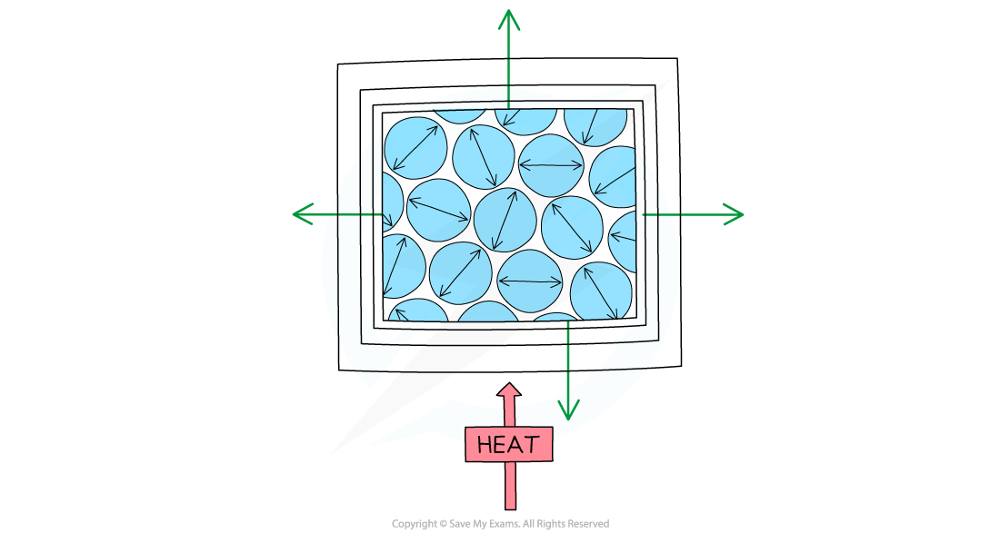

# Thermal Expansion

## Thermal expansion

> **Spec point** — `spcpt_pRhK3Zg6hGVvVFKB` · Describe, qualitatively, the thermal expansion of solids, liquids and gases at constant pressure

## Thermal expansion

- When a material is heated at constant pressure:

  - Its temperature increases
  - Its overall volume increases (it **expands**)
  - Its density decreases

- This expansion happens because:

  - The particles gain kinetic energy and vibrate or move faster
  - This increases the average distance between the particles, so the material expands
- The expansion comes from an increase in particle **separation** — the particles themselves do **not** get any bigger

*When a solid is heated, the molecules vibrate more, pushing each other apart*

> **Exam Hint**
> Remember that it is **the material that expands, not the molecules**. This trips up many students, losing marks.
> 
> As thermal energy is transferred to the material:
> 
> 1. The temperature increases
> 2. Which increases the kinetic energy of the particles
> 3. So the molecules and atoms move or vibrate more quickly
> 4. And move further apart
> 5. So the separation of the molecules increases and the substance gets bigger

## Thermal expansion in terms of particles

> **Spec point** — `spcpt_DPhgvnpzCzNVZcHh` · Explain, in terms of the motion and arrangement of particles, the relative order of magnitudes of the expansion of solids, liquids and gases as their temperatures rise

## Thermal expansion in terms of particles

### Extended Tier Only

- Thermal expansion occurs in solids, liquids and gases

- When temperature is increased (at constant pressure):

  - Solids will tend to expand the least
  - Gases expand the most
  - Liquids fall in between the two
- This behaviour is influenced by the distances and strength of the [forces between particles in each state](https://www.savemyexams.com/igcse/physics/cie/23/revision-notes/2-thermal-physics/2-1-kinetic-particle-model-of-matter/2-1-2-molecular-matter/?_ai=internal-linking)

| **State** | **Magnitude of Expansion** | **Explanation** |
|---|---|---|
| Solid | Expands slightly | Strong forces hold the particles in fixed positions, so they can only vibrate a little further apart |
| Liquid | Expands more than solids | Weaker forces let the particles move further apart than in a solid, so the expansion is greater |
| Gas | Expands significantly | There are almost no forces between the particles, so they move much further apart and the expansion is far greater |

## Uses & consequences of thermal expansion

> **Spec point** — `spcpt_v6WJnzrZDymqsSyr` · Describe some of the everyday applications and consequences of thermal expansion

## Uses & consequences of thermal expansion

- The thermal expansion of materials can have some **useful applications** as well as some **undesirable consequences**

### Applications of thermal expansion

- Useful applications of thermal expansion include:

  - Liquid-in-glass thermometers
  - Temperature-activated switches

#### Liquid-in-glass thermometer

- A liquid-in-glass thermometer relies on the expansion of liquids to measure temperature
- It consists of a thin glass capillary tube containing a liquid that expands with temperature

  - At one end of the tube is a glass bulb, containing a large volume of the liquid which expands into the narrow tube when heated
  - A scale along the side of the tube allows the temperature to be measured based on the length of liquid within the tube

- A thermometer is more sensitive if the capillary tube is narrower, because the same expansion of liquid moves further along a narrower tube

  - Thinner glass around the bulb also makes the thermometer respond more quickly

*As the bulb is heated, the liquid expands and moves along the capillary tube*

#### Temperature-activated switches

- Temperature-activated switches use a **bimetallic** strip, made from two different metals joined together
- The two metals expand by different amounts when heated, so the strip bends by a predictable amount at a given temperature

*The bimetallic strip will bend upwards when heated, closing the circuit*

### Consequences of thermal expansion

- The expansion of solid materials can cause them to buckle if they get too hot
- This could include:

  - Metal railway tracks
  - Road surfaces
  - Bridges

- Objects that are prone to buckling in this way have gaps built into them to create space for the expansion to happen without causing damage
