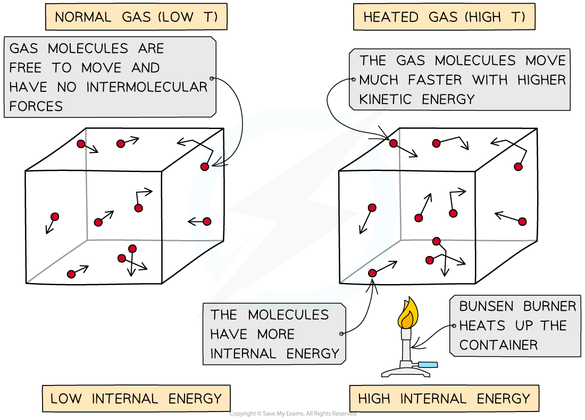
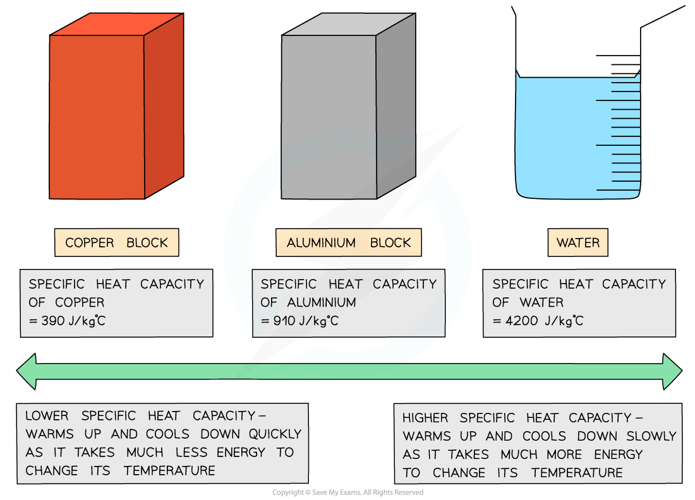

# Specific Heat Capacity

## Internal energy

> **Spec point** — `spcpt_nsnnmnRPbmMmXJrd` · Know that a rise in the temperature of an object increases its internal energy

## Internal energy

- A rise in the temperature of an object increases its **internal energy**

  - This can be thought of as due to an increase in the average speed of the particles
  - Increasing speed increases kinetic energy

- Internal energy is defined as:

**The total energy stored inside a system by the particles that make up the system due to their motion and positions**

- **Motion **of the particles affects their **kinetic energy**
- **Positions **of the particles relative to each other affects their **potential energy**

  - Together, these two make up the **internal energy** of the system

*Substances have internal energy due to the motion of the particles and their positions relative to each other*

## Average kinetic energy

> **Spec point** — `spcpt_QPpqhjvk4RWnjdpG` · Describe an increase in temperature of an object in terms of an increase in the average kinetic energies of all of the particles in the object

## Average kinetic energy

### Extended Tier Only

- Heating a system changes a substance's internal energy by increasing the** **kinetic energy of its particles

  - The **temperature** of the material, therefore, is related to the **average kinetic energy** of the molecules

- An **increase **in **temperature** leads to an **increase** of the **average kinetic energy** of the particles in the substance

  - This also means that **internal energy increases,** as internal energy is the sum of all kinetic and potential energies

*As the container heats up, the gas molecules move faster. Faster motion causes higher kinetic energy and therefore higher internal energy*

## Specific heat capacity

> **Spec point** — `spcpt_qYwr6S5bMbBD2Drg` · Define specific heat capacity as the energy required per unit mass per unit temperature increase; 
 - recall and use the equation c = ∆E/m∆θ

## Specific heat capacity

### Extended Tier Only

### What is specific heat capacity?

- When heated, a substance's temperature can increase
- The amount by which the temperature increases depends on:

  - The **mass** of the substance heated
  - The **type** of material
  - The amount of **thermal energy** transferred into the system

- The **specific heat capacity**, *c*, of a substance is defined as:

** The energy required per unit mass per unit temperature increase**

- In other words, this is the amount of energy required to raise the temperature of 1 kg of a substance by 1 °C
- Different substances have different specific heat capacities

  - If a substance has a **low** specific heat capacity, it heats up and cools down quickly (i.e. it takes less energy to change its temperature)
  - If a substance has a **high** specific heat capacity, it heats up and cools down slowly (i.e. it takes more energy to change its temperature)

*Low vs high specific heat capacity*

### Calculating specific heat capacity

- The amount of energy needed to raise the temperature of a given mass by a given amount can be calculated using the equation:

$c=\frac{ΔE}{mΔθ}$

- Where:

  - Δ*E* = change in thermal energy, in joules (J)
  - *m* =* *mass, in kilograms (kg)
  - *c* =* *specific heat capacity, in joules per kilogram per degree Celsius (J/kg °C)
  - Δ*θ* =* *change in temperature, in degrees Celsius (°C)

> **Worked Example**
> What unit is used to measure energy when calculating specific heat capacity?
> 
> **A. **kilograms
> 
> **B. **joules
> 
> **C. **joules per kilogram per degree Celsius
> 
> **D. **kelvin
> 
> [1]
> 
> **Answer: B**
> 
> - The correct answer is **B ****[1 mark]**
> - The question asks what unit is used to measure **energy** when calculating specific heat capacity
> - The units of energy are **joules**
> 
>   - A common mistake is for students to see 'specific heat capacity' and state the units of that, not energy

> **Worked Example**
> Water of mass 0.48 kg is increased in temperature by 0.7 °C. The specific heat capacity of water is 4200 J/kg °C.
> 
> Calculate the amount of thermal energy transferred to the water.
> 
> [2]
> 
> **Answer:**
> 
> **Step 1: Write down the known quantities**
> 
> - Mass, *m* = 0.48 kg
> - Change in temperature, Δ*θ* =* *0.7 °C
> - Specific heat capacity, *c* = 4200 J/kg °C
> 
> **Step 2: Write down the relevant equation **
> 
> $ΔE=mcΔθ$ **[1 mark]**
> 
> **Step 3: Calculate the thermal energy transferred by substituting in the values**
> 
> $ΔE=(0.48)\times(4200)\times(0.7)=1411.2J$
> 
> **Step 4: Round the answer to 2 significant figures and include the units**
> 
> $ΔE=1400J$ **[1 mark]**

> **Exam Hint**
> While you must remember the equation for specific heat capacity, you will always be given the specific heat capacity of a substance so you do not need to memorise any values.
> 
> However, it's useful to have the general idea that, the **larger the number**, the **less the substance will increase in temperature** for a given amount of thermal energy.
> 
> You can see this for yourself in the kitchen. Metal pans, which have a relatively low specific heat capacity get very hot, very quickly when put on the hob. Add water to the pan, which has a relatively high specific heat capacity and the water will take much longer to heat up.
> 
> Notice the **units **of specific heat capacity:
> 
> ** joules *****per *****kilogram *****per *****degree Celsius  : J/kg °C**
> 
> 'per' means 'divided by'. You say 'per' in front of every value that is being divided by, hence 'per kilogram per degree Celsius'
