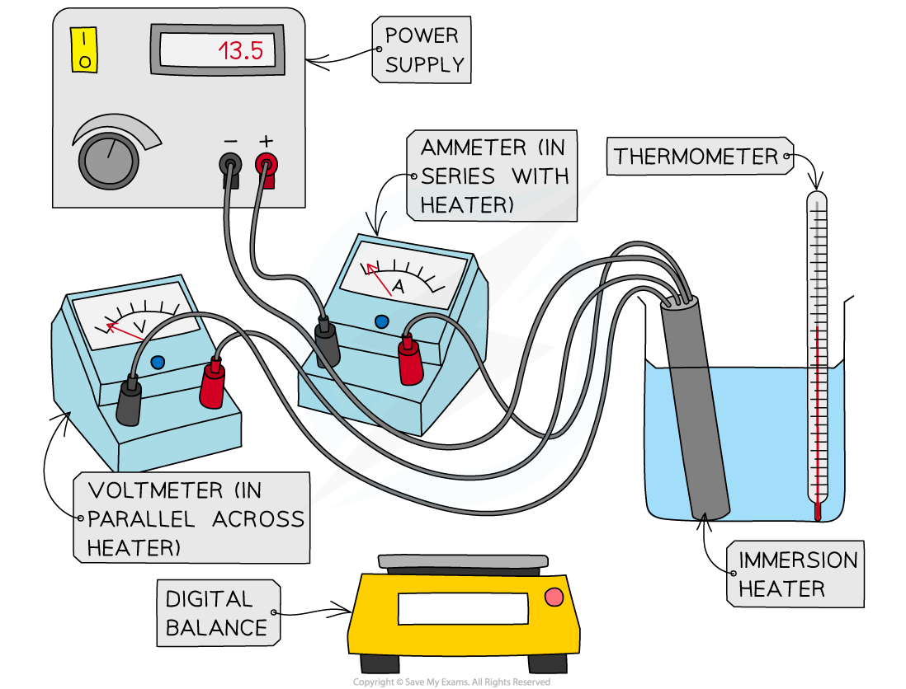

# Investigating Specific Heat Capacity

## Investigating specific heat capacity

> **Spec point** — `spcpt_x7T43ZQYHg9sZpyy` · Describe experiments to measure the specific heat capacity of a solid and a liquid

## Investigating specific heat capacity

### Extended Tier Only

### Aim of the experiment

- The aim of the experiment is to determine the specific heat capacity of a substance, by linking the decrease of one energy store (or work done) to the increase in temperature and subsequent increase in thermal energy stored

### Variables

- ***Independent variable*** = Time, *t*
- ***Dependent variable*** = Temperature, *θ*
- Control variables:

  - Current supplied, *I*
  - Potential difference supplied, *V*

### Equipment

| **Equipment** | **Purpose** |
|---|---|
| Thermometer | To measure the temperature change of the solid / the water |
| Solid block of aluminium | To investigate temperature changes |
| Beaker of water (400 cm3) | To investigate temperature changes |
| Immersion heater | To heat the solid / the water |
| Voltmeter | To measure the voltage across the immersion heater |
| Ammeter | To measure the current through the immersion heater |
| Power supply | To supply power to the immersion heater |
| Digital balance | To measure the mass of the solid / the water |
| Stopwatch | To time the heating of the solid / the water |

- ***Resolution*** of measuring equipment:

  - Thermometer = 0.1 °C
  - Voltmeter = 0.1 V
  - Ammeter = 0.1 A
  - Stopwatch = 0.01 s
  - Digital balance = 0.1 g

### Method

#### The experiment set-up for the specific heat capacity practical

*Apparatus for heating water and measuring energy supplied*

1. Place the beaker on the digital balance and press 'zero'
2. Add approximately 250 cm3 of water and record the mass of the water using the digital balance
3. Place the immersion heater and thermometer in the water
4. Connect up the circuit as shown in the diagram, with the ammeter in series with the power supply and immersion heater, and the voltmeter in parallel with the immersion heater
5. Use a direct current supply, so that the current and potential difference readings stay steady
6. Record the initial temperature of the water at time 0 s
7. Turn on the power supply, set it at approximately 10 V, and start the stopwatch
8. Record the voltage from the voltmeter and the current from the ammeter
9. Continue to record the temperature, voltage and current every 60 seconds for 10 minutes

#### To perform this experiment with the solid block of aluminium

1. Record the mass of the solid block of aluminium using the digital balance
2. Insert the thermometer into one hole of the aluminium block and the immersion heater into the other
3. Connect up the circuit as shown in the diagram, with the ammeter in series with the power supply and immersion heater, and the voltmeter in parallel with the immersion heater
4. Record the initial temperature of the block at time 0 s
5. Turn on the power supply, set it at approximately 10 V, and start the stopwatch
6. Record the voltage from the voltmeter and the current from the ammeter
7. Continue to record the temperature, voltage and current every 60 seconds for 10 minutes

### Results

#### An example of a results table for the specific heat capacity practical

| Time / s | Voltage / V | Current / A | Termperature / °C | Energy supplied / J | Temperature change / °C |
|---|---|---|---|---|---|
| 0 |   |   |   | 0 | 0 |
| 60 |   |   |   |   |   |
| 120 |   |   |   |   |   |
| 180 |   |   |   |   |   |
| 240 |   |   |   |   |   |
| 300 |   |   |   |   |   |
| 360 |   |   |   |   |   |
| 420 |   |   |   |   |   |
| 480 |   |   |   |   |   |
| 540 |   |   |   |   |   |
| 600 |   |   |   |   |   |

***An example of a suitable results table for the specific heat capacity experiment, where energy supplied = voltage × current × time***

### Analysis of results

- The thermal energy supplied to the block can be calculated using the equation:

$ΔE=IV\Deltat$

- Where:

  - Δ*E* = change in thermal energy, in joules (J)
  - *I* = current, in amperes (A)
  - *V* = potential difference, in volts (V)
  - Δ*t* = change in time, in seconds (s)

- The change in thermal energy is defined by the equation:

$ΔE=mc\Deltaθ$

- Where:

  - Δ*E* = change in thermal energy, in joules (J)
  - *m *=* *mass, in kilograms (kg)
  - *c *=* *specific heat capacity, in joules per kilogram per degree Celsius (J/kg °C
  - Δ*θ *=* *change in temperature, in degrees Celsius (°C)

- Rearranging for the specific heat capacity, *c*:

$c=\frac{ΔE}{mΔθ}$

- To calculate Δθ:

$\Deltaθ=\mathrm{final} \mathrm{temperature}-\mathrm{initial} \mathrm{temperature}$

- To calculate Δ*E:*

$ΔE=IV\Deltat$

- Where:

  - *I* = average current, in amperes (A)
  - *V = *average potential difference (V)
  - Δ*t* = time spent heating, in seconds (s)
- These values are then substituted into the specific heat capacity equation to calculate the specific heat capacity of the aluminium block

### Evaluating the specific heat capacity practical

- ***Systematic Errors:***

  - Ensure the digital balance is set to zero before taking measurements of mass
  - Make sure the thermometer does not touch the sides or base of the beaker, or the reading will be of the glass rather than the liquid
  - When the heater is switched off, wait for the temperature to stop rising before recording the final value
  - Some water may be lost to the surroundings by evaporation. Calculate an average mass of water (using the mass before the experiment and the mass after) to account for this
  - Thermal energy is lost to the surroundings during heating, which makes the measured specific heat capacity too high. Reduce this by wrapping the beaker, by using a lid, and by heating for a shorter time
  - Stir the water constantly whilst heating it to ensure the temperature measured is the temperature throughout the fluid
- ***Random Errors:***

  - When the current or voltage values appear to be changing between two values next to one another then be consistent in choosing the higher value

### Safety considerations for the specific heat capacity practical

- The immersion heater will get very **hot**

  - Make sure not to touch it, and have a heatproof mat ready to place it on
- The beaker may become **unstable** with an immersion heater and thermometer resting in it

  - If you feel this is the case then use a clamp stand to hold both
- Wear goggles while heating water
- Make sure to stand up during the whole experiment, to react quickly to any spills

> **Exam Hint**
> Remember to convert mass into kilograms when calculating the specific heat capacity. Note that answers which referred to poor experimental practice or 'human error' will not gain the mark in the exam.
