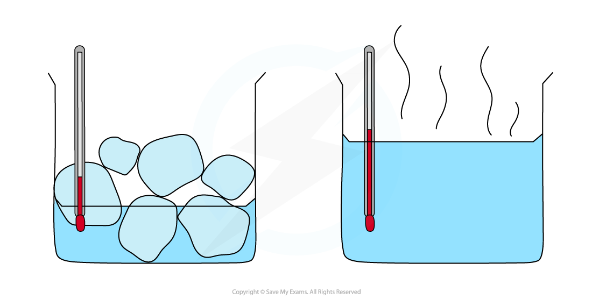

# Melting & Boiling

## Fixed points of water

> **Spec point** — `spcpt_zN32VBT8XZHhS5QJ` · Know the melting and boiling temperatures for water at standard atmospheric pressure

## Fixed points of water

- The melting and boiling points of pure water are known as **fixed points**

  - Ice melts at 0 °C
  - Pure water boils at 100 °C
- These are the accepted values for **pure water **at **standard atmospheric pressure**

*Ice melts at 0 °C and water boils at 100 °C *

## Melting & boiling

> **Spec point** — `spcpt_9kkYvqFDXhhjCjjB` · Describe melting and boiling in terms of energy input without a change in temperature

## Melting & boiling

- While a substance is **changing state **(e.g. melting or boiling):

  - The **temperature** of the substance **does not change**
  - Energy is still being transferred to or away from the thermal energy store of the substance

*When the substance is changing state, the temperature remains constant as shown by the horizontal regions of this graph*

### Melting

- When solid water (ice) is heated by adding thermal energy, the temperature of the ice increases until the melting point is reached

  - At the **melting** point, even if more thermal energy is added, the temperature of the ice does not increase

- The additional thermal energy is transferred to the **potential energy** of the molecules, not the kinetic energy

  - This energy goes into overcoming the intermolecular forces between the molecules of the ice, so the **internal energy continues to rise** even though the temperature stays constant
  - As the forces are overcome, the solid water becomes **liquid**; this is **melting**
- In ice, the molecules are held in a **regular** lattice and can only vibrate
- After melting, the arrangement becomes **irregular** and random, and the molecules can move around and slide over one another

> **Exam Hint**
> When a question asks about arrangement, describing the spacing of molecules will not gain the mark. You must explicitly contrast the regular solid arrangement with the irregular liquid arrangement.

### Boiling

- One major difference between melting and boiling (sometimes referred to as vaporisation) is that boiling occurs at a higher temperature

  - Melting results in particles being able to flow and move more freely
  - During boiling, enough energy is transferred such that the [intermolecular forces](https://www.savemyexams.com/igcse/physics/cie/23/revision-notes/2-thermal-physics/2-1-kinetic-particle-model-of-matter/2-1-2-molecular-matter/?_ai=internal-linking) can be completely **overcome**
- When liquid water is heated by adding thermal energy (e.g. from a gas flame or kettle element), the temperature of the water rises until the water boils

  - At the **boiling** point, even if more thermal energy is added, the temperature of the liquid water does not increase

- The additional thermal energy is transferred to the **potential energy** of the molecules, not the kinetic energy

  - This energy goes into overcoming the intermolecular forces between the molecules of water, so the **internal energy continues to rise** even though the temperature stays constant
  - As the forces are overcome, the liquid water becomes water vapour (steam); the water is now a **gas**

## Condensation & solidification

> **Spec point** — `spcpt_XpVdw7sx8Pz7D2dF` · Describe condensation and solidification in terms of particles

## Condensation & solidification

- Changes of state depend on whether energy is being transferred **to** or **away from** the system

  - Heating is when energy is transferred **to** the system, increasing the internal energy of the molecules
  - Cooling is when energy is transferred **away from** the system (or dissipated to the surroundings), decreasing the internal energy of the molecules

### Condensation

- When a gas **cools**, energy is transferred away from the system, and kinetic energy decreases until the temperature reaches the **boiling point**

  - At the boiling point, energy transferred away from the system reduces its potential energy
  - The particles no longer have enough energy to overcome the** intermolecular forces** of attraction
  - They only have enough energy to **flow** over one another
- The gas has condensed; it is now a liquid

  - As the energy has been transferred away from the **potential **energy of the particles, the **kinetic **energy is unchanged, so **temperature remains constant** through this process

### Solidification (freezing)

- When a liquid **cools**, energy is transferred away from the system, and kinetic energy decreases until the temperature reaches the **melting point**

  - At the melting point, energy transferred away from the system reduces its potential energy
  - The particles no longer have enough energy to overcome the** intermolecular forces** of attraction
  - They are now low enough in energy to be bound to each other and can only vibrate around a fixed point
- The liquid has solidified; it is now a solid

  - As the energy has been transferred away from the **potential **energy of the particles, the **kinetic **energy is unchanged, so **temperature remains constant** through this process
