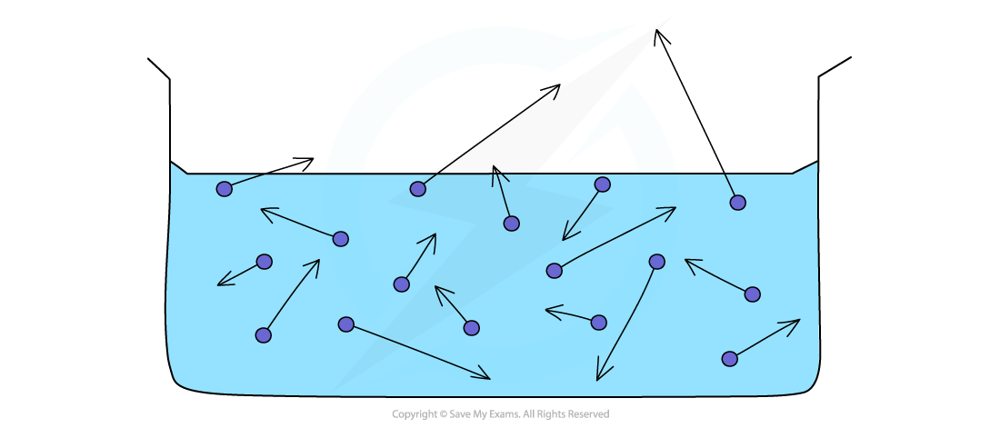

# Evaporation

## Evaporation

> **Spec point** — `spcpt_yK2MqhzhS79kPV6J` · - Describe evaporation in terms of the escape of more energetic particles from the surface of a liquid (C)
 - Know that evaporation causes cooling of a liquid (C)

## Evaporation

- **Evaporation** is a change in state of a liquid to a gas
- It happens:

  - At **any **temperature
  - Only from the **surface **of a liquid

- The molecules in a liquid have a **range **of energies

  - Some have lots of energy, others have very little
  - Their **average energy** relates to the temperature of the liquid

- Evaporation occurs when **more energetic molecules** moving near the surface of the liquid have enough energy to **escape**

  - The average energy of the liquid is **reduced **when the particles with most energy leave
  - Therefore liquids are **cooled down** by evaporation

*Evaporation occurs when more energetic molecules near the surface of a liquid escape*

## Factors affecting evaporation & explaining cooling

> **Spec point** — `spcpt_SWtQ8yctW7Sty5c3` ·  - Describe how temperature, surface area and air movement over a surface affect evaporation (E)
 - Explain the cooling of an object in contact with an evaporating liquid (E)

## Factors affecting evaporation & explaining cooling

### Extended Tier Only

### Factors affecting evaporation

- These factors all affect the rate of evaporation

#### Temperature of the liquid

- Increased temperature increases the **kinetic energy** of the molecules in the liquid

  - Molecules with more energy are more likely to **overcome the intermolecular forces** holding them in the liquid state and escape the surface
  - Therefore **higher temperature** leads to a **higher rate of evaporation**

#### Surface area of the liquid

- Molecules only **escape **the intermolecular forces of attraction at the **surface** of the liquid

  - Therefore a **larger surface area** leads to a **higher rate of evaporation**

#### Air movement

- Air movement carries away the water vapour which has just evaporated

  - This replaces the air above the liquid with drier air, which accepts water vapour more easily
  - Therefore **increasing air movement** (e.g. wind or a fan) **increases the rate of evaporation**

### Evaporation and cooling

- The process of evaporation can be used to cool things down
- As evaporation occurs, the liquid **cools**

  - This is because the most energetic particles escape from the surface
  - The average kinetic energy of the remaining particles **reduces**, so the temperature of the liquid falls

- An object in contact with an evaporating liquid is **cooled**

  - This is because **thermal energy is transferred** from the object to the cooler liquid
  - This process is used in some refrigerators and air conditioning units

> **Exam Hint**
> Note that the rate of evaporation depends on the surface area of the liquid, **not** on the volume of liquid.

## Boiling vs evaporation

> **Spec point** — `spcpt_h9pVnFfMtrvDwVNf` · Describe the differences between boiling and evaporation

## Boiling vs evaporation

### Extended Tier Only

- Boiling is **also **a change in state from liquid to gas

  - Boiling happens only at the boiling point of the liquid
  - The change of state happens **throughout **the liquid (seen as bubbles at the bottom of a pan of boiling water, for example)
- The following table shows the difference between boiling and evaporation:

| Feature | **Boiling** | **Evaporation** |
|---|---|---|
| Change of state | Liquid to gas | Liquid to gas |
| Temperature | Boiling point | Any temperature between melting and boiling point |
| Where it happens | Throughout the whole liquid | From the surface |

> **Exam Hint**
> If you are asked for the differences between boiling and evaporation, remember that 'evaporation happens only at the surface' and 'there are no bubbles in evaporation' count as the same difference, not two. Make sure one of your differences is about temperature.
