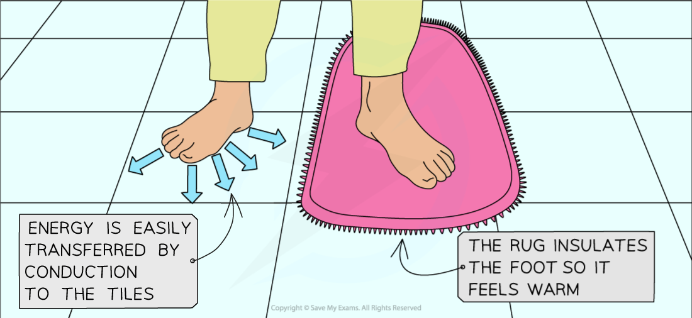
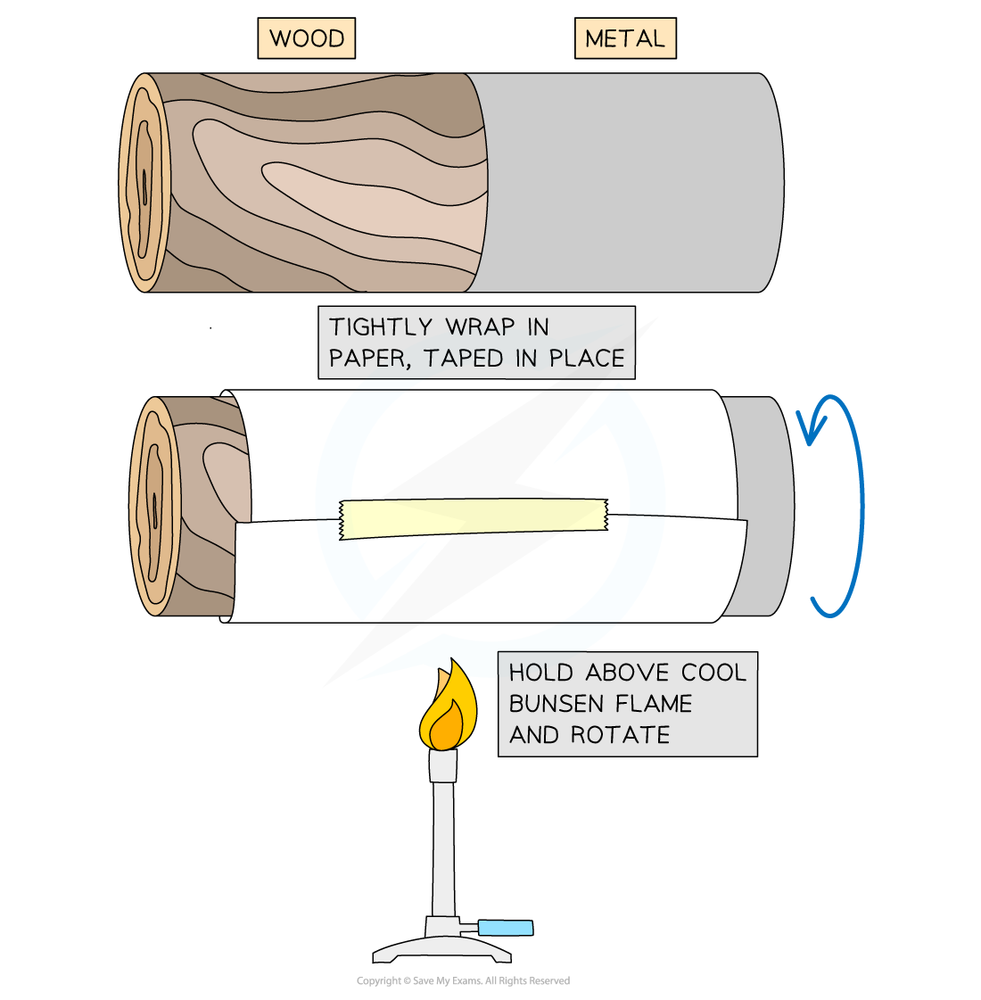
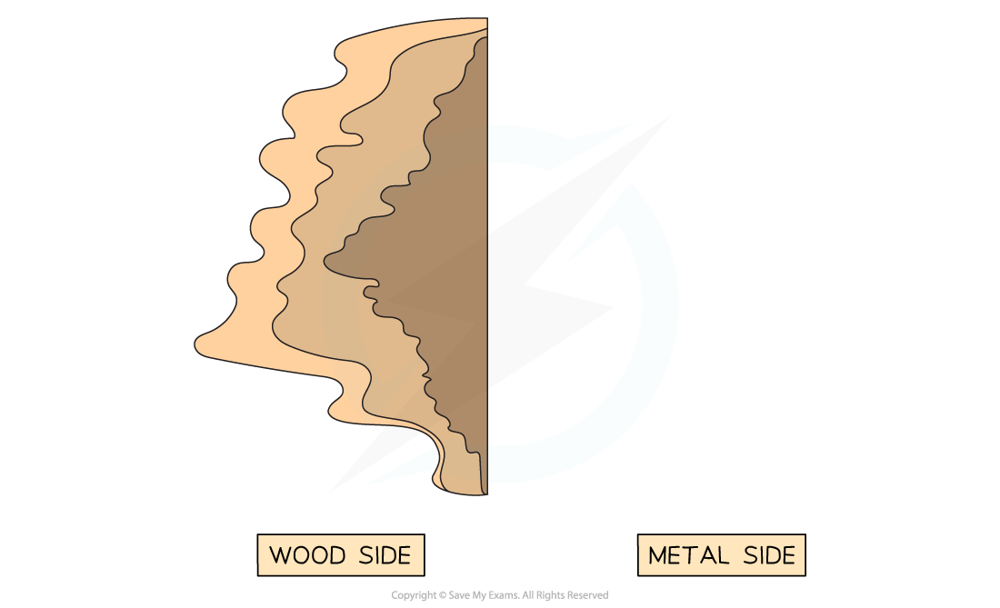
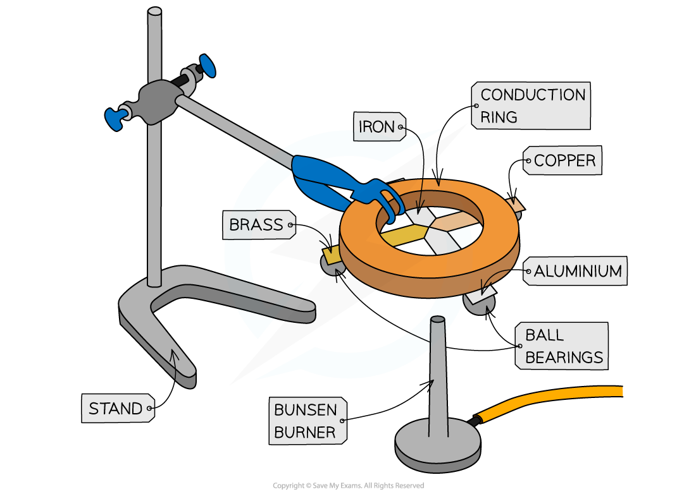

# Demonstrating Conduction

## Experiments demonstrating thermal conductors

> **Spec point** — `spcpt_twfhtNGMdcM5yHxQ` · Describe experiments to demonstrate the properties of good thermal conductors and bad
thermal conductors (thermal insulators)

## Experiments demonstrating thermal conductors

### Good and bad thermal conductors

- Good thermal conductors are materials that transfer thermal energy quickly

  - For example: an aluminium pan or copper wire
- Bad thermal conductors (also called thermal insulators) are solids which do not transfer thermal energy well

  - For example: a wool blanket or layers of cardboard or paper

### Comparing conduction in tiles and textiles

- This conduction experiment shows why homes use rugs and carpets
- Find a tiled or stone area of floor

  - In the same room leave a rug or bath towel (not a thin cloth, it must be thick)
  - The textile must stay in place on the floor for several hours to ensure it is at thermal equilibrium (the same temperature) with the floor

- Stand with bare feet, or use the palms of your hands instead

  - Place one foot on the tiles or stone area, and the other on the textile (towel or rug)
  - Observe the apparent temperature of the two materials as felt through the feet
  - It will feel as though the tiles are cold while the rug is warm
  - In fact, they are at exactly the same temperature

*Thermal energy is transferred from the hotter foot to the cooler tiles by conduction*

#### Explanation

- Tiles and stone are good conductors of thermal energy

  - Where the foot touches the tiles, **thermal energy is transferred away** from the foot, making it **feel **cold
  - The **foot **has become colder since it lost thermal energy to the tiles
- Textiles such as rugs are thermal insulators, meaning they are bad conductors of thermal energy

  - Where the foot touches the rug, thermal energy is not transferred away from the foot
  - This foot feels relatively warmer than the one which has lost thermal energy to the tiles
  - This foot has lost very little thermal energy, so it stays close to its starting temperature

### Comparing conduction in wood and metal

- A cylindrical rod made of half wood and half metal is wrapped tightly in paper

*Method for showing different thermal conduction of wood and metal*

- Using a gentle flame, and holding the rod clear of the top of the flame, gently heat the paper at the join of the wood and metal

  - Turn the rod so that the paper is well-heated all around the circumference of the rod
  - Stop when the paper is clearly discoloured
- Remove the rod from the flame, gently unwrap the paper and observe the burn pattern

  - A distinct pattern is seen:
  
    - Where the paper touched the metal surface, it is undamaged
    - Where the paper touched the wood surface, it is charred

*The paper charred only where it touched the wood, because the metal conducted thermal energy away before the paper could burn*

#### Explanation

- Metal is a good conductor of thermal energy

  - Where the paper touched the metal in this conduction experiment, thermal energy was transferred from the paper into the metal and along the length of the metal
  - This prevented the paper from getting hot
- Wood is a thermal insulator, meaning it is a bad conductor of thermal energy

  - Where the paper touched the wood, thermal energy was not transferred from the paper
  - This meant that the paper did get hot enough to start to burn

### Demonstrating different rates of thermal conduction in metals

- A simple conduction experiment to demonstrate the relative conducting properties of different materials can be carried out using apparatus similar to that shown in the diagram below

*Strips of equal width and length are arranged around a central heated point, so only the material differs between them*

- Ball bearings can be stuck to each of the strips and equal distance from the centre, using a small amount of wax
- The strips should then be turned upside down and the centre heated gently using a candle, so that each of the strips is heated at the point where they meet
- When thermal energy is conducted along to the ball bearing, the wax will melt and the ball bearing will drop
- By timing how long this takes for each of the strips, their relative thermal conductivities can be determined
- The better the conductor, the shorter the time taken for the wax to melt and the ball bearing to fall

> **Exam Hint**
> With two of the demonstrations above (the rug and tiles and the rod made of wood and metal) students often get confused, as the result may 'feel' as though it is the wrong way round. Think about the movement or transfer of thermal energy.
> 
> The more thermal energy is taken away, the cooler something will be. That is why the paper doesn't burn when it is next to the metal (although usually everyone guesses that it will).
> 
> The more thermal energy is held in by a layer of insulation, the more thermal energy remains, which is why rugs and carpets help your feet to feel warm.
