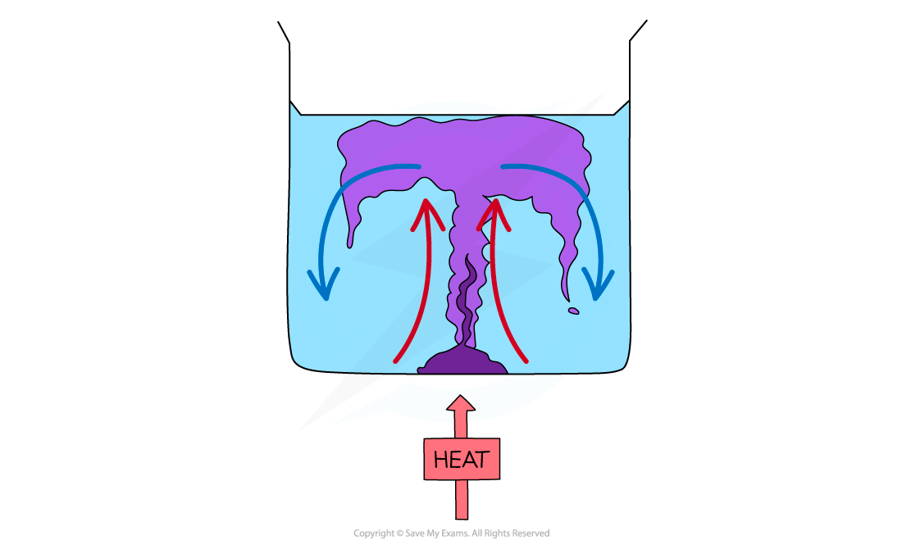

# Convection

## Convection

> **Spec point** — `spcpt_Gbf3XsJ7DpjcvTTF` · Know that convection is an important method of thermal energy transfer in liquids and gases
Explain convection in liquids and gases
 -  in terms of density changes and 
 - describe experiments to illustrate convection

## Convection

- Convection is an important method of thermal energy transfer in **liquids and gases**

  - Convection **only** occurs in fluids
  - Convection **cannot** happen in solids

### Density and convection

- Descriptions of convection currents **always** need to refer to changes in temperature causing changes in **density**
- The temperature may fall or rise, both can create a convection current
- **When a liquid (or gas) is heated (for example by a radiator near the floor)**:

  - The heated molecules gain kinetic energy and move faster, pushing each other further apart and **making the liquid or gas expand**
  - This makes the hot liquid/gas **less dense** than the surroundings
  - The **hot liquid/gas rises**, and the cooler (surrounding) liquid/gas moves in to take its place
  - Eventually the hot liquid/gas cools and contracts, increasing in density, and sinks back down again
  - The resulting motion is called a **convection current**

#### Simple convection current diagram

*When a liquid or gas is heated, it becomes less dense and rises*

- **When a liquid (or gas) is cooled (for example by an air conditioning unit high up on a wall)**:

  - The molecules lose kinetic energy, move more slowly and collide less frequently, **making the liquid or gas contract**
  - This makes the cold liquid/gas **more dense** than the surroundings
  - The **cold liquid/gas sinks**, so that warmer, less dense liquid or gas can move into the space created
  - The warmer liquid/gas gets cooled and also contracts and falls down
  - The resulting motion is called a **convection current**

### Demonstrating convection currents

- A simple demonstration of convection in liquids involves taking a beaker of water and placing a few crystals of potassium permanganate in it as shown in the diagram below – this compound is purple in water
- When the water is heated around the crystals, the potassium permanganate will dissolve in the heated water and rise along with the warmed water, revealing the convection current
- As the warmed water cools and becomes more dense, it will fall and carry the potassium permanganate with it

#### Demonstrating convection in a liquid with potassium permanganate

*Diagram showing an experiment with potassium permanganate to demonstrate convection*

- A simple demonstration of convection in gases involves a central column with angled blades on top and candles that sit underneath the blades
- When the candles are lit, the heated air around them becomes less dense
- The heated air rises and pushes the angled blades sideways, making them spin

> **Exam Hint**
> Note that the presence of a liquid or gas does **not** automatically imply convection. You should check whether the fluid is free to circulate — if it is trapped or the heating is from above, the process is usually conduction.
> 
> **Thermal energy does not rise** – it is the hot gases or liquids which rise due to the change in density when they were heated.

## Demonstrating Convection video

> **Spec point** — `spcpt_Q9h2J89BhYFFNzHy` · nan

##
