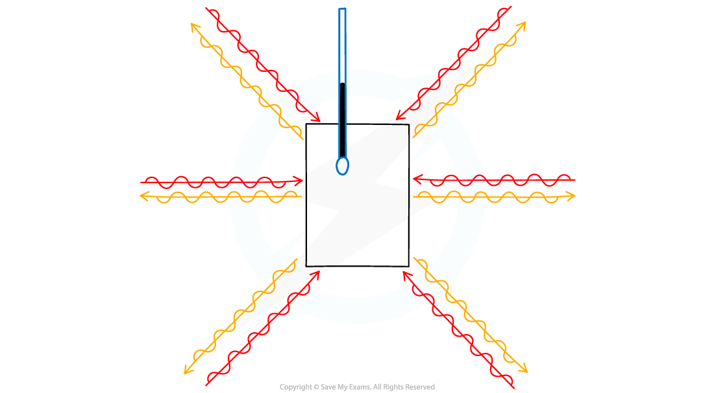

# Radiation

## Thermal radiation

> **Spec point** — `spcpt_h4v9pvr9HyNMC2Mm` · Know that thermal radiation is infrared radiation and that all objects emit this radiation (C)
Know that thermal energy transfer by thermal radiation does not require a medium (C)

## Thermal radiation

### What is thermal radiation?

- All objects give off thermal radiation

  - The hotter an object is, the more thermal radiation it emits
  - Thermal radiation is **infrared** **radiation** (part of the electromagnetic spectrum)
- Thermal radiation is **the only way in which thermal energy can travel through a vacuum**

  - It is the way in which thermal energy reaches us from the Sun through the vacuum of space
  - Thermal radiation does **not need a medium** to travel, unlike convection and conduction

## Effects of different surfaces

> **Spec point** — `spcpt_vXBb2PPxkhDS66zk` · Describe the effect of 
 - surface colour (black or white) and 
 - texture (dull or shiny) 
on the  emission, absorption and reflection of infrared radiation

## Effects of different surfaces

### How do surface colour and texture affect infrared radiation?

- The amount of [thermal radiation emitted by an object](https://www.savemyexams.com/igcse/physics/cie/23/revision-notes/2-thermal-physics/2-3-transfer-of-thermal-energy/2-3-6-investigating-ir-radiation/?_ai=internal-linking) depends on a number of factors:

  - The **surface colour** of the object (black = more radiation emitted and absorbed)
  - The **texture **of the surface (shiny surfaces = less radiation emitted and absorbed)

#### Table of the effect of coloured surfaces on absorbing, emitting and reflecting ability

| **Surface colour/texture** | **Absorbing** | **Emitting** | Reflecting |
|---|---|---|---|
| Black | Good absorber | Good emitter | Poor reflector |
| White | Poor absorber | Poor emitter | Good reflector |
| Dull | Reasonable absorber | Reasonable emitter | Poor reflector |
| Shiny | Very poor absorber | Very poor emitter | Good reflector |

- Black objects are very good at absorbing thermal radiation; for example, black clothes make you feel hotter in sunny weather

  - Black objects are also very good at emitting thermal radiation, which is the reason that some chargers for laptops and radiators in cars are coloured black – it helps them to cool down
- Shiny objects reflect thermal radiation and so absorb very little

  - They also emit very little, though, and so take longer to cool down

#### Comparing emission from different surfaces

*The infrared radiation emitted from a hot object can be detected using a special camera. The dull black side of the cube (left) is seen to glow brighter with infrared radiation than the shiny light side of the cube (right)*

> **Exam Hint**
> Note that when a question on thermal energy transfer mentions the surface properties of an object, such as describing it as shiny, black or white, this does **not** automatically imply thermal radiation. You should identify the process from the physics rather than from a keyword.
> 
> Shiny things are both poor emitters **and **poor absorbers of thermal radiation, while black surfaces are both good emitters **and **good absorbers. However, make sure you are able to distinguish between emission and absorption. These factors can also be combined into single descriptors, such as 'dull black' and 'shiny white'.

## Thermal equilibrium

> **Spec point** — `spcpt_cdGGnMGwnZm3m8Vm` · Know that for an object to be at a constant temperature it needs to transfer energy away from the object at the same rate that it receives energy (E)

## Thermal equilibrium

### Extended Tier Only

- As an object **absorbs** thermal radiation it will become **hotter**

  - As it gets hotter it will also **emit** more thermal radiation
- Eventually, the object reaches a point where it transfers energy **away** at the **same rate** as it **receives** energy

  - At this point, the object will be at a **constant temperature**
  - An object at a constant temperature is in **thermal equilibrium**

*An object will remain at a constant temperature if it absorbs thermal energy at the same rate as it loses thermal energy*

> **Exam Hint**
> Note that when an object is at a constant temperature, energy is still transferred in both directions, but the rates of energy transfer are equal.

## Heating & cooling by energy transfer

> **Spec point** — `spcpt_bXFk6WFVNy3KvTbF` · Know what happens to an object if the rate at which it receives energy is less or more than the rate at which it transfers energy away from the object

## Heating & cooling by energy transfer

### Extended Tier Only

- If the rate at which an object **receives **energy is **greater **than the rate at which it **transfers** energy **away**:

  - the object's temperature will **increase**

- If the rate at which an object **transfers **energy **away **is **greater **than the rate at which it **receives **energy:

  - the object's temperature will **decrease**

- The process will **always **move towards thermal equilibrium

  - As temperature increases, the object emits more radiation until the rates are equal
  - As temperature decreases, the object transfers less energy until the rates are equal
