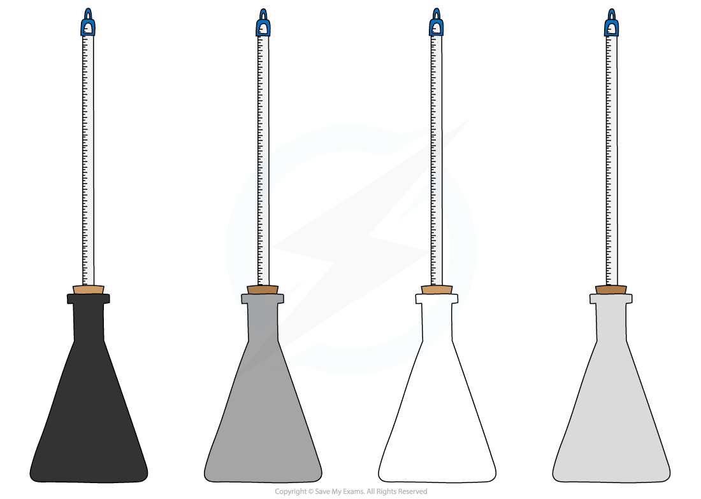

# Investigating IR Radiation

## Investigating thermal radiation

> **Spec point** — `spcpt_cCcthYS5WCgxcgkc` · - Describe experiments to distinguish between good and bad emitters of infrared radiation
- Describe experiments to distinguish between good and bad absorbers of infrared radiation
- Describe how the rate of emission of radiation depends on the surface temperature and surface area of an object

## Investigating thermal radiation

### Extended Tier Only

### Aims of the experiment

- The aim of the experiment is to investigate how the amount of [infrared radiation](https://www.savemyexams.com/igcse/physics/cie/23/revision-notes/2-thermal-physics/2-3-transfer-of-thermal-energy/2-3-4-radiation/?_ai=internal-linking) absorbed or radiated by a surface depends on the nature of that surface

### Variables

- ***Independent variable*** = Surface colour and texture
- ***Dependent variable*** = Temperature
- Control variables:

  - Identical flasks (except for their colour)
  - Same amounts of hot water
  - Same starting temperature of the water
  - Same time interval
  - Same room temperature

### Equipment

#### Equipment List

| **Equipment** | **Purpose** |
|---|---|
| Heatproof mat | To protect the bench from hot equipment |
| Stopwatch | To measure time taken for cooling |
| Kettle | To boil water |
| Four thermometers | To measure the water temperature in each flask |
| Flasks painted different colours (black, dull grey, white, silver) | To compare the rate of cooling of differently coloured surfaces |

- ***Resolution*** of measuring equipment:

  - Thermometer = 1 °C
  - Stopwatch = 0.01 s

### Method

#### Apparatus for the cooling experiment

*Different coloured flasks for investigating infrared radiation apparatus*

1. Set up the four identical flasks painted in different colours: black, dull grey, white and silver
2. Fill each flask with the same volume of hot water, ensuring the measurements start from the same initial temperature
3. Note the starting temperature, then measure the temperatures at regular intervals, e.g. every 30 seconds for 10 minutes
4. The flask whose temperature falls fastest has the surface that is the best emitter

### Results

#### Example results table

| Time / mins | Black / °C | Dull grey / °C | White / °C | Silver / °C |
|---|---|---|---|---|
| 0.5 |   |   |   |   |
| 1.0 |   |   |   |   |
| 1.5 |   |   |   |   |
| 2.0 |   |   |   |   |
| 2.5 |   |   |   |   |
| 3.0 |   |   |   |   |
| 3.5 |   |   |   |   |
| 4.0 |   |   |   |   |
| 4.5 |   |   |   |   |
| 5.0 |   |   |   |   |
| 5.5 |   |   |   |   |
| 6.0 |   |   |   |   |
| 6.5 |   |   |   |   |
| 7.0 |   |   |   |   |

***An example of a suitable results table for the cooling experiment***

### Analysis of results

- All objects emit **infrared radiation**, but the hotter an object is, the more infrared waves are emitted
- The rate of emission of radiation depends on:

  - The **temperature** of the body (hotter objects emit more thermal radiation)
  - The **surface area** of the body (a larger surface area allows more radiation to be emitted)
  - The **colour** of the surface

- Most of the energy lost from the flasks will be **by heating** due to **conduction** and **convection**

  - This will be **equal **for each flask, as colour does not affect energy transferred by conduction and convection
- Any **difference** in energy transferred away from each flask must, therefore, be due to infrared **radiation**

- To compare the rate of energy transfer away from each flask, plot a graph of **temperature** on the y-axis against **time** on the x-axis and draw curves of best fit
- The expected results are shown on the graph below:

desk and

> **Exam Hint**
> Note that a larger surface area increases the **rate** of emission of radiation, but it does not change the total energy the object has to lose.

### Evaluating the experiments

- ***Systematic Errors:***

  - Make sure the hole for the thermometer is not too big; otherwise, thermal energy will escape through the hole
  - Read the values on the thermometer at eye level to avoid parallax error
  - Use a data logger connected to a digital thermometer to get more accurate readings

- ***Random Errors:***

  - Take repeated readings for each coloured flask
  - Doing this experiment in pairs to coordinate starting the stopwatch and immersing the thermometer can lead to a random timing error

### Safety considerations

- Safety goggles should be worn when filling the flasks with boiling water
- Keep water away from all electrical equipment
- Make sure not to touch the hot water directly

  - Run any burns immediately under cold running water for at least 5 minutes
- Do not overfill the kettle
- Make sure all the equipment is in the middle of the desk, and not at the end to avoid knocking over the flasks
- Carry out the experiments only whilst standing in order to react quickly to any spills or burns

> **Exam Hint**
> Remember that an emission experiment measures cooling, while an absorption experiment measures heating.
