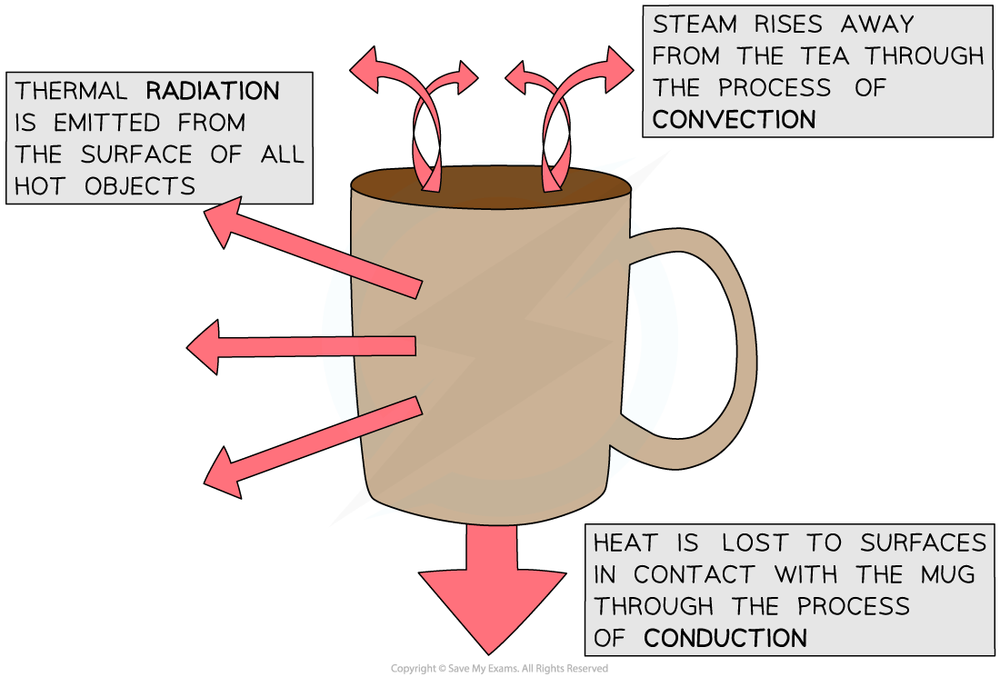
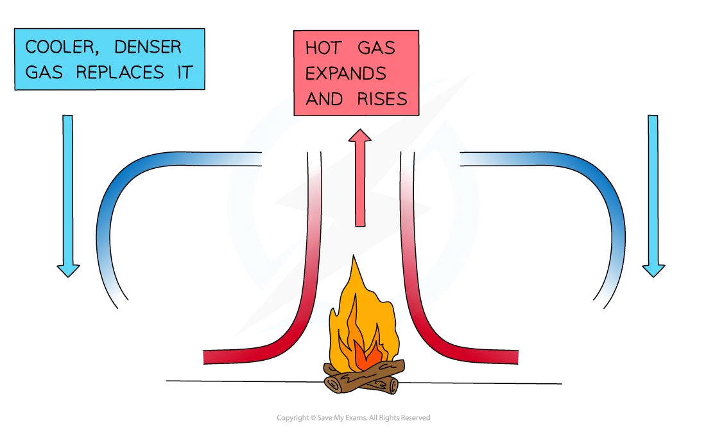

# Consequences of Thermal Energy Transfer

## Simple consequences of energy transfer

> **Spec point** — `spcpt_MjFHHPnfDKrzNHjp` · Explain some of the basic everyday applications and consequences of conduction, convection and radiation, including:
    (a) heating objects such as kitchen pans
    (b) heating a room by convection

## Simple consequences of energy transfer

- Conduction, convection and radiation have many everyday applications and consequences

### Examples of conduction

- Good conductors help transfer thermal energy **quickly**
- Examples include:

  - Metal pans to transfer thermal energy to food quickly
  - Metal radiators to transfer thermal energy from water inside to the surrounding air quickly
- Bad conductors (insulators) help retain thermal energy as they transfer thermal energy **slowly**
- Examples include:

  - Plastic handles of saucepans to slow thermal energy transferred to hands
  - Air spaces in the walls or windows of some houses help to retain thermal energy, as air is a poor conductor

### Examples of convection

- Common applications of convection are:

  - heating a room with a radiator
  - warm air rising above a hot drink, carrying thermal energy away from the surface
- Radiators use **convection** to raise the temperature of a room in a building:

  1. The metal radiator is hot and transfers thermal energy to air nearby
  2. The particles of this hot air spread out, making it less dense
  3. The spread-out air is less dense than the air above it, so this [hot air rises](https://www.savemyexams.com/igcse/physics/cie/23/revision-notes/2-thermal-physics/2-3-transfer-of-thermal-energy/2-3-3-convection/?_ai=internal-linking)
  4. The radiator transfers thermal energy to the cold air which replaces the hot air
  5. The newly heated air also rises, cools and sinks (as it contracts and increases in density)

#### Convection in steam from coffee

*Thermal energy is transferred from the hot coffee to the air by convection currents rising from the surface*

> **Exam Hint**
> The name 'radiator' is misleading — these should really be called convection heaters. Almost all of their heating comes from convection, and radiation plays only a very small part.

### Examples of radiation

- Common applications of radiation are:

  - Keeping food hot: The outside of a metal cooking pan is brightly polished and shiny to reduce thermal energy loss by radiation, meaning less power is needed to maintain the correct cooking temperature
  - Solar panels**:** These devices absorb infrared radiation from the Sun to heat water, and the pipes inside them are typically painted dull black to maximise the absorption of thermal radiation

## Complex consequences of energy transfer

> **Spec point** — `spcpt_q5qbtd9rYY3Y62SV` · Explain some of the complex applications and consequences of conduction, convection and radiation where more than one type of thermal energy transfer is significant, including:
    (a) a fire burning wood or coal
    (b) a radiator in a car

## Complex consequences of energy transfer

### Extended Tier Only

### Multiple paths of energy transfer

- In real situations there is very rarely only one form of energy transfer

  - Usually two or three happen at once
  - These are sometimes called 'complex' applications of energy transfer

#### Tea cup example

- The diagram below shows a more complex, more realistic version of the coffee cup example
- Thermal energy is transferred **from hotter areas (the coffee) to cooler areas (the cup, hands and air)** by the processes of:

  - **Conduction** — by **direct contact **between the tea and the **solid **sides of the cup and also by direct contact from the cup to the surface it is sitting on
  - **Convection** — from the **surface** of the tea to the air **directly above** it
  - **Radiation** — from the sides of the **hot cup** in **all directions** to the surrounding air

*In this example, thermal energy is lost via conduction, convection and radiation*

#### Double-glazed windows example

- A double-glazed window transfers thermal energy through **conduction** and **convection**

  - **Radiation** is **not** reduced by double glazing because thermal radiation passes through glass and air
- Trapping air between two glass panes reduces conduction because air is a poor thermal conductor
- The gap is deliberately narrow so that convection currents cannot easily form

*Double-glazed windows use a layer of air to act as an insulator and slow the transfer of thermal energy out of the house*

#### Wood fire example

- A wood (or coal) fire in a room transfers thermal energy through **radiation** and **convection**
- As the fuel is so hot in a wood fire, it transfers a lot of thermal energy to the room through radiation

  - The fire transfers a much greater amount of thermal energy to **nearby **objects via radiation
- Air surrounding the fire is heated and rises, forming a convection current

  - This transfers thermal energy throughout the whole room

*Convection currents are set up in a room with a wood or coal fire*

#### Car radiator example

- A car radiator transfers thermal energy away from the engine, which reaches high temperatures
- A liquid travels between the radiator and the engine

  - When the liquid passes over the engine, it absorbs energy from the engine through **conduction**
  - This liquid then travels back to the radiator and transfers thermal energy to the radiator, again by **conduction**
  - The radiator then transfers thermal energy to the surrounding air, mainly by **convection** as air is driven through its fins, and also by **radiation** from its surface
- A car radiator is a [dark colour](https://www.savemyexams.com/igcse/physics/cie/23/revision-notes/2-thermal-physics/2-3-transfer-of-thermal-energy/2-3-4-radiation/?_ai=internal-linking), which allows it to emit more radiation

  - A large surface area also helps
- Once the radiator has absorbed thermal energy from the liquid, the liquid is cooler and the cycle begins again

> **Exam Hint**
> The specification requires you to have knowledge of energy transfers in:
> 
> - A wood or coal fire
> - A car radiator
> 
> If an exam question asks you to identify **"processes"** (plural), you must name at least **two** to get full marks. You must **name** the specific thermal energy transfer processes (conduction, convection or radiation) rather than just describing how the thermal energy changes.
