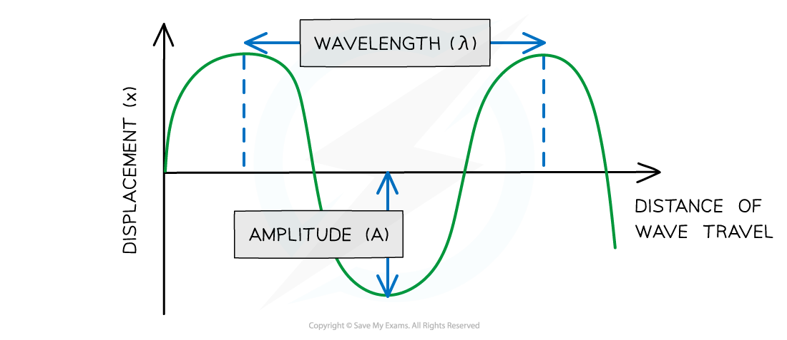
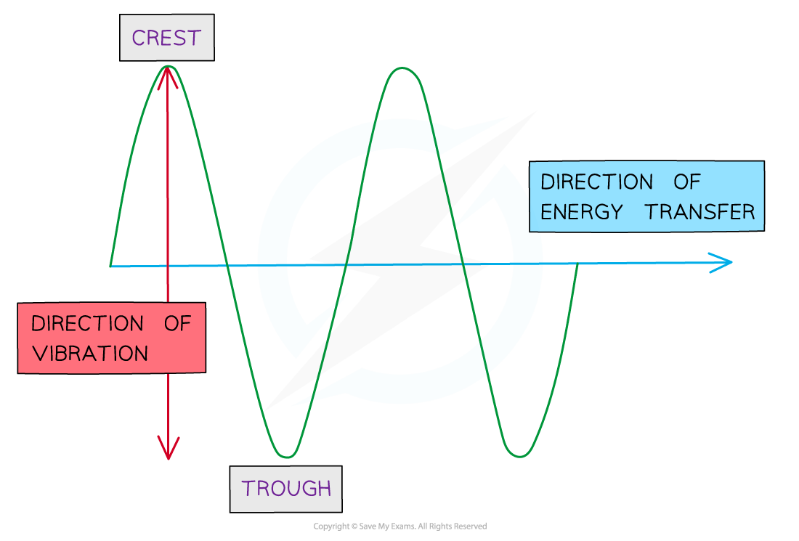

# Features of Waves

## Waves & energy transfer

> **Spec point** — `spcpt_53jMqY442jNQ3nx4` · Know that waves transfer energy without transferring matter

## Waves & energy transfer

- Waves transfer **energy** **without** transferring **matter**

  - For sound waves, this means it is the **wave** and not the **air molecules** (the matter) itself that travels
- Objects floating on water provide evidence that waves only transfer energy and **not** matter

  - It is possible to see objects on the surface of the water bob up and down but not change their position
  - This is because it is the **wave**,** **and not the **water** (the matter), that travels

- Waves are described as **oscillations** or **vibrations** about a fixed point

  - For example, **ripples** cause particles of water to oscillate up and down
  - **Sound** waves cause particles of air to vibrate back and forth

> **Worked Example**
> The diagram below shows a toy duck bobbing up and down on top of the surface of some water, as waves pass it underneath.
> 
> 
> 
> <u>[Use this image](https://www.savemyexams.com/info/policies/using-our-illustrations-images-fair-use/)</u>
> 
> Explain how the toy duck demonstrates that waves do not transfer matter.
> 
> [2]
> 
> **Answer: **
> 
> - The plastic duck moves up and down but does not travel with the wave along the surface of the water
> - The water waves transfer **energy**, but the water particles only oscillate up and down about a fixed position — they do not travel along with the wave **[1 mark]**
> - This means when a wave travels between two points, no matter travels with it and the points on the wave vibrate up and down about **fixed** positions** ****[1 mark]**

> **Exam Hint**
> There is a key distinction between the particles (or oscillations) of a wave and the wave itself.
> 
> The motion of the wave **causes** the particles to move. The particles themselves are not the wave.

## Wave motion

> **Spec point** — `spcpt_dbYxFDnJsNtGrKzg` · Describe what is meant by wave motion as illustrated by vibrations in ropes and springs, and by experiments using water waves

## Wave motion

- Wave motion can be illustrated by:

  - vibrations in ropes and springs
  - experiments using water waves

*Waves can be shown through vibrations in ropes or springs*

<u>[Use this image](https://www.savemyexams.com/info/policies/using-our-illustrations-images-fair-use/)</u>

- Properties of waves can be observed using water waves in a** **[ripple tank](https://www.savemyexams.com/igcse/physics/cie/23/revision-notes/3-waves/3-1-general-properties-of-waves/3-1-5-ripple-tank/?_ai=internal-linking)

  - These properties include frequency, wavelength, amplitude and wave speed

*Wave motion of water waves may be demonstrated using a ripple tank*

<u>[Use this image](https://www.savemyexams.com/info/policies/using-our-illustrations-images-fair-use/)</u>

## Features of a wave

> **Spec point** — `spcpt_D3P88nJrv2PNxvNm` · Describe the features of a wave in terms of wavefront, wavelength, frequency, crest (peak), trough, amplitude and wave speed

## Features of a wave

- When describing wave motion, there are several terms which are important to know, including:

  - wavefront
  - amplitude
  - wavelength
  - frequency
  - crest (peak)
  - trough
  - wave speed

### Wavefront

- Wavefronts are a useful way of picturing waves from above
- Each wavefront, drawn as a single line, joins points on the wave that are in step with each other, which in practice are usually the crests
- The image below illustrates how wavefronts are visualised:

  - The arrow shows the direction the wave is moving and is sometimes called a **ray**
  - The space between each wavefront represents the **wavelength**
  - When the wavefronts are **close together**, this represents a wave with a **short** wavelength
  - When the wavefronts are **far apart**, this represents a wave with a **long** wavelength

#### Wavefronts as viewed from above

*Diagram showing a wave moving to the right, drawn as a series of wavefronts*

<u>[Use this image](https://www.savemyexams.com/info/policies/using-our-illustrations-images-fair-use/)</u>

### Amplitude

- Amplitude is defined as:

**The maximum displacement of a wave from its undisturbed position**

- It is given the symbol $A$ and is measured in **metres (m)**
- On a graph where the vertical axis is **displacement**, amplitude is measured from the ***undisturbed position*** to either the highest point of the wave (peak) or the lowest point (trough)

### Wavelength

- Wavelength is defined as:

**The distance from one point on the wave to the same point on the next wave**

- In a [transverse wave](https://www.savemyexams.com/igcse/physics/cie/23/revision-notes/3-waves/3-1-general-properties-of-waves/3-1-3-transverse-and-longitudinal-waves/?_ai=internal-linking):

  - The wavelength can be measured from one peak to the next peak
- In a **longitudinal** wave:

  - The wavelength can be measured from the centre of one compression to the centre of the next
- Wavelength is given the symbol $λ$ (lambda) and is measured in** metres (m)**
- On a graph where the horizontal axis is **distance**, the wavelength can be determined by measuring the distance from one point on the wave to the same point on the next wave

#### Using a graph to determine wavelength and amplitude

*Diagram showing the amplitude and wavelength of a wave*

<u>[Use this image](https://www.savemyexams.com/info/policies/using-our-illustrations-images-fair-use/)</u>

### Frequency

- Frequency is defined as:

**The number of waves passing a point in a second**

- Frequency is given the symbol $f$*** ***and is measured in **hertz (Hz)**

### Crests and troughs

- A crest, or a peak, is defined as:

**The highest point on a wave above its undisturbed position**

- A trough is defined as:

**The lowest point on a wave below its undisturbed position**

#### Wave crests and troughs

*Diagram showing a crest and a trough on a transverse wave*

<u>[Use this image](https://www.savemyexams.com/info/policies/using-our-illustrations-images-fair-use/)</u>

### Wave speed

- Wave speed is the speed at which **energy** is transferred through a medium
- Wave speed is defined as:

**The distance travelled by a wave each second**

- The equation used to calculate wave speed is explained in [The wave equation](https://www.savemyexams.com/igcse/physics/cie/23/revision-notes/3-waves/3-1-general-properties-of-waves/3-1-2-the-wave-equation/)

> **Worked Example**
> Small water waves are created in a ripple tank by a wooden bar. The wooden bar vibrates up and down hitting the surface of the water. The diagram below shows a cross-section of the ripple tank and water.
> 
> ![Diagram of water waves in a ripple tank. Various dimensions of the wave are marked with lettered arrows:
> Arrow A: A horizontal arrow spanning the distance across one crest, past the next and to the next crest.
> Arrow B: A vertical arrow measuring from a trough to a crest.
> Arrow C: A horizontal arrow measuring the distance from a trough to the next trough.
> Arrow D: A vertical arrow measuring the distance from the center resting level of the water up to a peak.
> Arrow E: A vertical arrow measuring the distance from the bottom of the tank to the top of a peak.
> Arrow F: A horizontal arrow measuring the distance from a trough to the adjacent peak.](assets/7635d497ce29-6-1-4-we-ripple-tank-question-image.png)
> 
> <u>[Use this image](https://www.savemyexams.com/info/policies/using-our-illustrations-images-fair-use/)</u>
> 
> Identify the letter which shows:
> 
> a) the amplitude of a water wave. [1]
> 
> b) the wavelength of the water wave. [1]
> 
> **Answer: **
> 
> **Part (a)**
> 
> **Step 1: Recall the definition of amplitude**
> 
> - Amplitude = The distance from the undisturbed position to the peak or trough of a wave
> 
> **Step 2: Mark the undisturbed position on the wave**
> 
> - This is the centre of the wave
> 
> ![Diagram of water waves in a ripple tank with a dashed blue line showing the undisturbed position of the water wave. Various dimensions of the wave are marked with lettered arrows:
> Arrow A: A horizontal arrow spanning the distance across one crest, past the next and to the next crest.
> Arrow B: A vertical arrow measuring from a trough to a crest.
> Arrow C: A horizontal arrow measuring the distance from a trough to the next trough.
> Arrow D: A vertical arrow measuring the distance from the center resting level of the water up to a peak.
> Arrow E: A vertical arrow measuring the distance from the bottom of the tank to the top of a peak.
> Arrow F: A horizontal arrow measuring the distance from a trough to the adjacent peak.](assets/b256067e82b3-6-1-4-we-ripple-tank-ans-1.png)
> 
> <u>[Use this image](https://www.savemyexams.com/info/policies/using-our-illustrations-images-fair-use/)</u>
> 
> **Step 3: Identify the arrow between the undisturbed position and a peak**
> 
> - The amplitude is shown by arrow **D ****[1 mark]**
> 
> **Part (b)**
> 
> **Step 1: Recall the definition of wavelength**
> 
> - Wavelength = The distance from one point on the wave to the same point on the next wave
> 
> **Step 2: Draw lines on each horizontal arrow**
> 
> - This helps to identify the points on the wave the arrows are referring to
> 
> ![Diagram of water waves in a ripple tank with blue vertical lines from arrows A, C and F to help to identify the points on the wave. Various dimensions of the wave are marked with lettered arrows:
> Arrow A: A horizontal arrow spanning the distance across one crest, past the next and to the next crest.
> Arrow B: A vertical arrow measuring from a trough to a crest.
> Arrow C: A horizontal arrow measuring the distance from a trough to the next trough.
> Arrow D: A vertical arrow measuring the distance from the center resting level of the water up to a peak.
> Arrow E: A vertical arrow measuring the distance from the bottom of the tank to the top of a peak.
> Arrow F: A horizontal arrow measuring the distance from a trough to the adjacent peak.](assets/e5fbc709fe81-6-1-4-we-ripple-tank-ans-2.png)
> 
> <u>[Use this image](https://www.savemyexams.com/info/policies/using-our-illustrations-images-fair-use/)</u>
> 
> **Step 3: Identify the arrow between two of the same points on the wave**
> 
> - The wavelength is shown by arrow **C ****[1 mark]**

> **Exam Hint**
> Make sure you understand how to identify the wavelength and amplitude of a wave from a diagram. On a displacement-distance graph, the wavelength is the distance from one point on the wave to the same point on the next wave (e.g. crest to crest), while amplitude is the distance from its undisturbed position to either a peak or trough (**not** the crest to trough distance).
