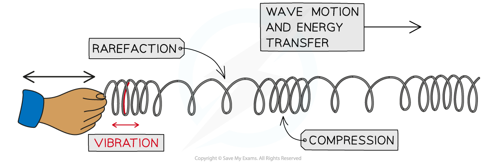

# Transverse & Longitudinal Waves

## Transverse waves

> **Spec point** — `spcpt_z9T4mKnXNxHDjV8s` · Know that for a transverse wave, the direction of vibration is at right angles to the direction of propagation and understand that electromagnetic radiation, water waves and seismic S-waves (secondary) can be modelled as transverse

## Transverse waves

- Waves can exist as one of two types:

  - **Transverse**
  - **Longitudinal**

- Transverse waves are defined as:

**Waves where the direction of vibration is at right angles to the direction of propagation**

- For a transverse wave, the particles of the medium vibrate **perpendicular to** the direction in which the wave is travelling
- Mechanical transverse waves can travel through **solids** and along the surface of a liquid, but not through the body of a liquid or through a gas
- Non-mechanical transverse waves can move in a ***vacuum***

*Transverse waves can be seen in a rope when it is moved quickly up and down*

- Examples of waves that can be modelled as transverse are:

  - [Electromagnetic waves](https://www.savemyexams.com/igcse/physics/cie/23/revision-notes/3-waves/3-3-electromagnetic-spectrum/3-3-1-electromagnetic-waves/) (such as radio waves, visible light, X-rays)
  - Ripples on the surface of water
  - Seismic S-waves (secondary earthquake waves)

## Longitudinal waves

> **Spec point** — `spcpt_dDdZDzTdVwqj9mWr` · Know that for a longitudinal wave, the direction of vibration is parallel to the direction of propagation and understand that sound waves and seismic P-waves (primary) can be modelled as longitudinal

## Longitudinal waves

- Longitudinal waves are defined as:

**Waves where the direction of vibration is parallel to the direction of propagation**

- For a longitudinal wave:

  - The particles of the medium vibrate back and forth **parallel** to the direction in which the wave travels
  - They can move in solids, liquids and gases
  - They **cannot** move in a vacuum (since there are no particles)
- The key features of a longitudinal wave are:

  - Regions where the particles of the medium are close together, called **compressions**
  - Regions where the particles of the medium are spread apart, called **rarefactions**

*Longitudinal waves can be seen in a slinky spring when it is moved quickly backwards and forwards*

- Examples of waves that can be modelled as longitudinal waves are:

  - Sound waves
  - Seismic P-waves (primary earthquake waves)

### Difference between transverse and longitudinal waves

| **Property** | **Transverse waves** | **Longitudinal waves** |
|---|---|---|
| Structure | Crests (peaks) and troughs | Compressions and rarefactions |
| Vibration | Right angles to the direction of propagation | Parallel to the direction of propagation |
| Vacuum | Only electromagnetic waves can travel in a vacuum | Cannot travel in a vacuum |
| Material | Can move in solids and the surfaces of liquids | Can move in solids, liquids and gases |
| Density | A constant density | The density of the medium varies |
| Pressure | Has a constant pressure | The pressure of the medium varies |

> **Exam Hint**
> Make sure you state the direction of **vibration** with respect to the direction of **wave travel** when defining transverse and longitudinal waves. Saying that a wave travels in the direction of energy transfer will not gain the mark, because this is true of every wave.
> 
> Remember that P-waves are longitudinal, while S-waves are transverse.
