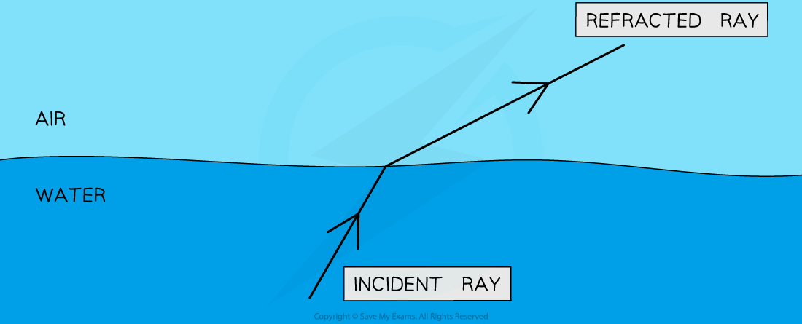
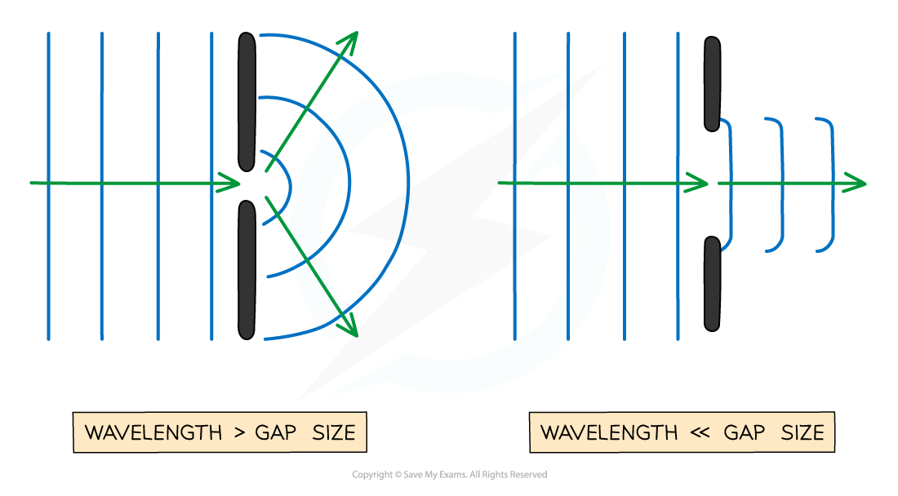
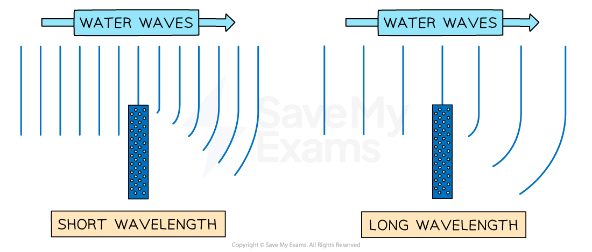

# Wave Behaviour

## Reflection, refraction & diffraction

> **Spec point** — `spcpt_dmrpS6gpJ9kpdHY8` · Describe how waves can undergo:
   (a) reflection at a plane surface
   (b) refraction due to a change of speed
   (c) diffraction through a narrow gap

## Reflection, refraction & diffraction

- All waves, whether transverse or longitudinal, can undergo:

  - **reflection** at a plane surface
  - **refraction** due to a change of speed
  - **diffraction** through a narrow gap

- The material a wave travels through is called a **medium**

  - When referring to more than one medium, these are called **media**

### Reflection

- Reflection occurs when:

**A wave hits the boundary between two media and bounces back, staying in the original medium instead of passing through**

#### An example of reflection

*An identical image of the tree is seen in the water due to reflection*

### Refraction

- When waves enter a different medium, their speed can change
- This effect is called refraction,** **and it occurs when:

**A wave passes a boundary between two different media and undergoes a change in speed**

- When a wave **refracts**, the wave undergoes:

  - a change in **speed**
  - a change in **wavelength**
  - a change in **direction**
  - **no** change in **frequency**

#### An example of refraction

*Waves change direction when their speed changes on crossing a boundary between two media*

- The direction of the [incident and refracted rays](https://www.savemyexams.com/igcse/physics/cie/23/revision-notes/3-waves/3-2-light/3-2-3-refraction-of-light/?_ai=internal-linking) is also taken from the **normal **line
- If the waves **slow down**, they will bunch together, causing the wavelength to decrease

  - The waves will also start to turn slightly **towards** the normal
- If the waves **speed up** then they will spread out, causing the wavelength to increase

  - The waves will also turn slightly **away from** the normal

### Diffraction

- When waves pass through a narrow gap, **the waves spread out**
- This effect is called **diffraction**

#### Waves diffracting through a narrow gap

diffracted,

> **Exam Hint**
> When drawing waves being reflected, take care to:
> 
> - Make sure that the angle of incidence is equal to the angle of reflection
> - Keep the wavelength of the waves the same
> 
> Similarly, when waves are diffracted **the wavelength remains constant**.
> 
> Refraction is the only wave effect in which the wavelength changes.
> 
> Refraction is the name given to the change in the **speed** of a wave when it passes from one medium to another. The change in direction is a consequence of this.

## Factors affecting diffraction

> **Spec point** — `spcpt_Wg7BJRk8cTxT7pCw` · Describe how wavelength and gap size affects diffraction through a gap
Describe how wavelength affects diffraction at an edge

## Factors affecting diffraction

### Extended Tier Only

- The extent of diffraction depends on the **width** of the gap compared with the **wavelength** of the waves

  - Diffraction is greatest when the **wavelength** of the wave is **similar** to (or equal to) the **width** of the gap
- As the **gap gets bigger**, the **effect** gradually gets **less pronounced** until, in the case that the gap is very much larger than the wavelength, the waves no longer spread out at all

*The size of the gap (compared to the wavelength) affects how much the waves spread out*

- Diffraction can also occur when waves curve around an **edge** or **barrier**
- The waves spread out into the region behind the object
- The extent of this diffraction also depends upon the wavelength of the waves

  - The **greater** the **wavelength**, the greater the **diffraction**

*When a wave goes past the edge of a barrier, the waves can curve around it. Shorter wavelengths undergo less diffraction than longer wavelengths*

> **Exam Hint**
> When you are asked to draw wavefronts diffracting through a narrow gap, make sure that you draw semi-circular crests centred on the gap when its size is similar to the wavelength, and ensure that the wavelength is unchanged.
