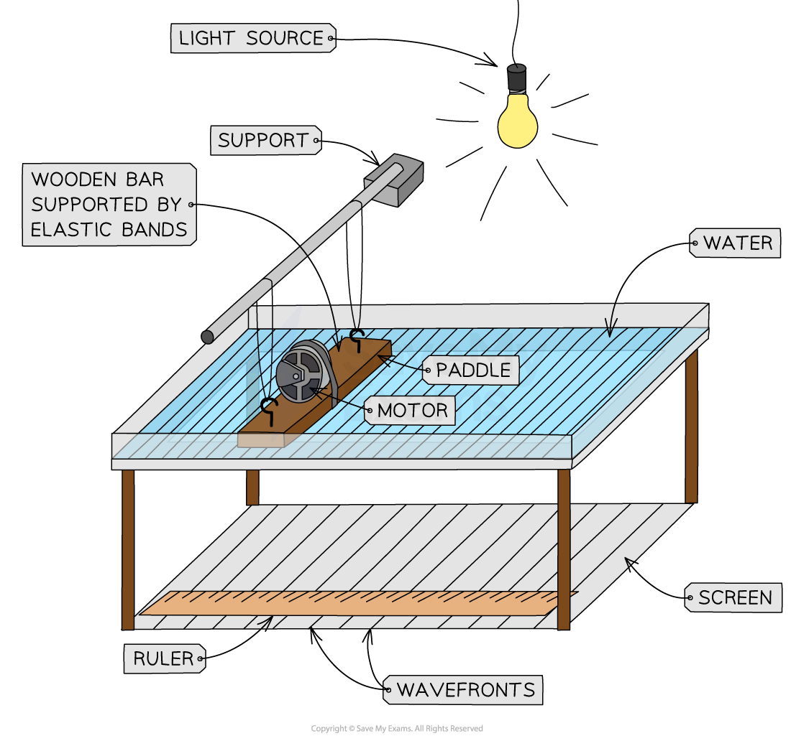
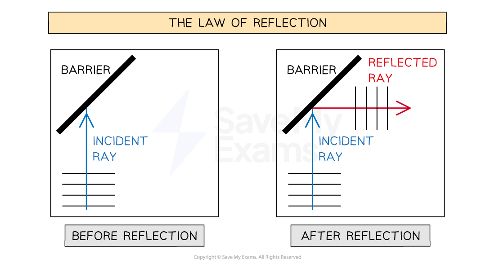
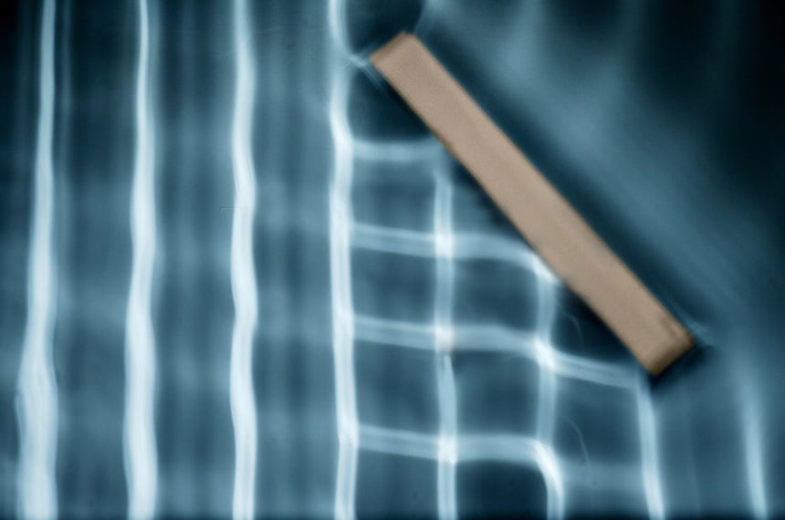
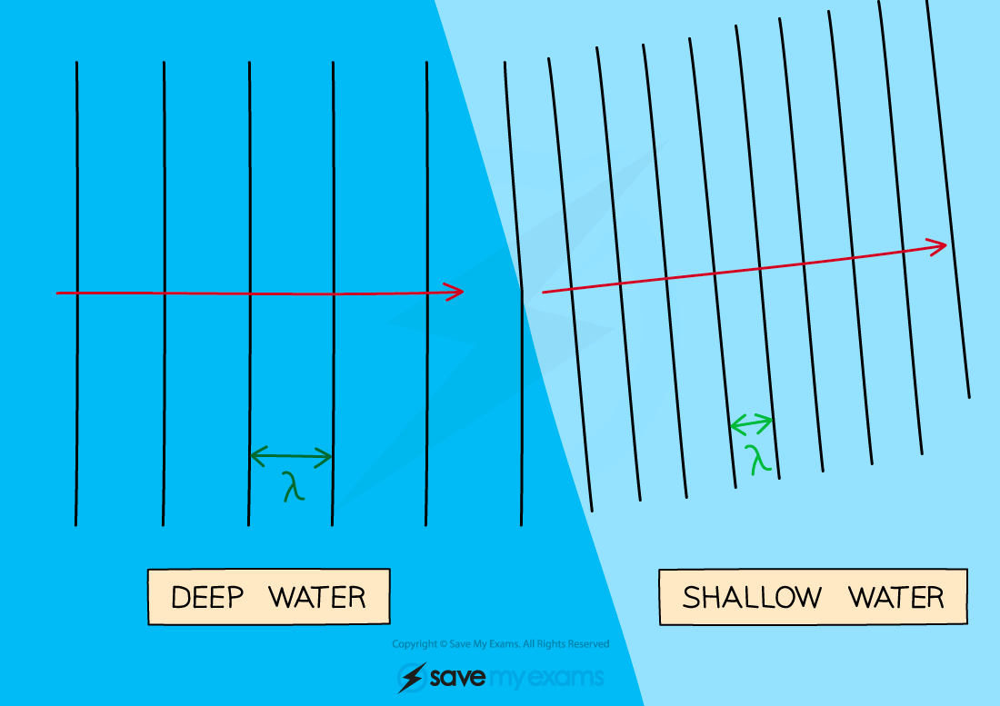
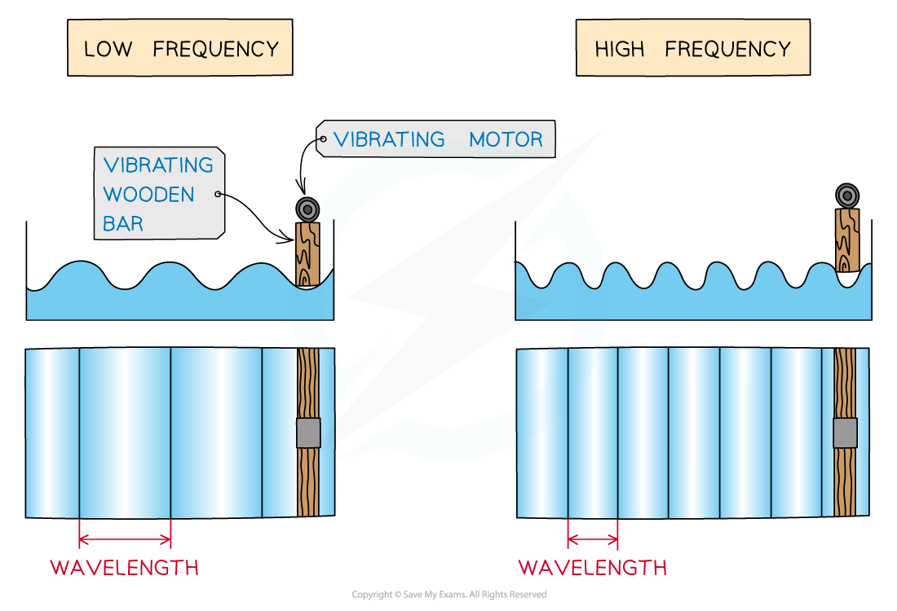

# Ripple Tank

## Investigating waves with a ripple tank

> **Spec point** — `spcpt_G5h5ZfxSRZBP6dSz` · Describe the use of a ripple tank to show:
   (a) reflection at a plane surface
   (b) refraction due to a change in speed caused by a change in depth
   (c) diffraction due to a gap
   (d) diffraction due to an edge

## Investigating waves with a ripple tank

- Ripple tanks are commonly used in experiments to demonstrate the following properties of water waves:

  - **Reflection** at a plane surface
  - **Refraction** due to a change in speed caused by a change in depth
  - [Diffraction](https://www.savemyexams.com/igcse/physics/cie/23/revision-notes/3-waves/3-1-general-properties-of-waves/3-1-4-wave-behaviour/) due to a **gap**
  - **Diffraction** due to an **edge**

*Reflection, refraction and diffraction can be demonstrated using a ripple tank*

- A lamp above the tank shines through the water, projecting the **wavefronts** onto a screen below the tank, where they can be viewed and analysed

### Investigating reflection

- **Wavefronts** are reflected off a metal bar (plane surface) placed in the water of the ripple tank
- When the bar is placed at an angle, the wavefronts generated by the paddle reflect according to the [law of reflection](https://www.savemyexams.com/igcse/physics/cie/23/revision-notes/3-waves/3-2-light/3-2-1-reflection-of-light/), which states that:

**Angle of incidence (*****i*****) = Angle of reflection (*****r*****)**

#### Diagram of reflected wavefronts in a ripple tank

*Wavefronts reflect off the barrier so that the angle of reflection equals the angle of incidence*

#### Reflected wavefronts in a ripple tank

*In this arrangement, the barrier is at 45° to the incident wavefronts, so the incident and reflected wavefronts meet at right angles*

### Investigating refraction

- Refraction can be shown by placing a **glass block** in the tank

  - The glass block should sit below the surface of the water and cover only some of the tank floor
- The depth of water becomes **shallower** where the glass block is placed

  - Since speed depends on depth, the ripples slow down when travelling over the block
- The water surface waves **slow down** when passing from **deep to shallow** water in the ripple tank

  - The wavelength also becomes **shorter** in the shallow water, while the **frequency** stays the **same**

#### Refracted wavefronts in a ripple tank

*When water waves travel from deep areas to shallow areas they slow down*

### Investigating diffraction

- **Diffraction** can be shown in a ripple tank by placing small barriers with a **gap** or an **edge** in the tank
- The amount of [diffraction](https://www.savemyexams.com/igcse/physics/cie/23/revision-notes/3-waves/3-1-general-properties-of-waves/3-1-4-wave-behaviour/) that occurs can be changed by changing the wavelength of the waves compared to the gap size
- Diffraction at the edge of a single barrier shows waves curving around the edge into the region behind it

  - The longer the wavelength, the more the waves bend around the edge

#### Changing the gap size for diffraction in a ripple tank

*When the gap size is bigger than the wavelength, less diffraction occurs and the waves spread out less after passing through*

### Changing the wavelength of waves in the ripple tank

- The **motor** creates the up-and-down movement of the **paddle**
- The frequency of the motor affects the wavelength of the waves generated by the paddle
- The diagram below shows how the wavelengths differ with frequency in a ripple tank

  - The **higher** the frequency of the motor, the **shorter** the wavelength
  - The **lower** the frequency of the motor, the **longer** the wavelength

#### Wavelength and frequency of waves in a ripple tank

*Ripple tank patterns for low and high-frequency vibration*

> **Exam Hint**
> If the wavefronts change direction at a boundary where the depth changes, the effect is refraction. Diffraction happens at a gap or an edge, not at a change of depth.
