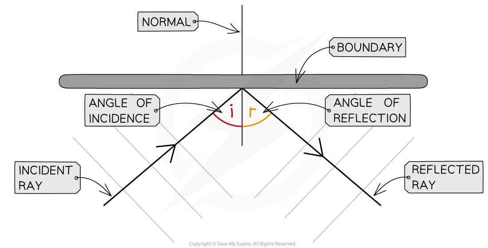
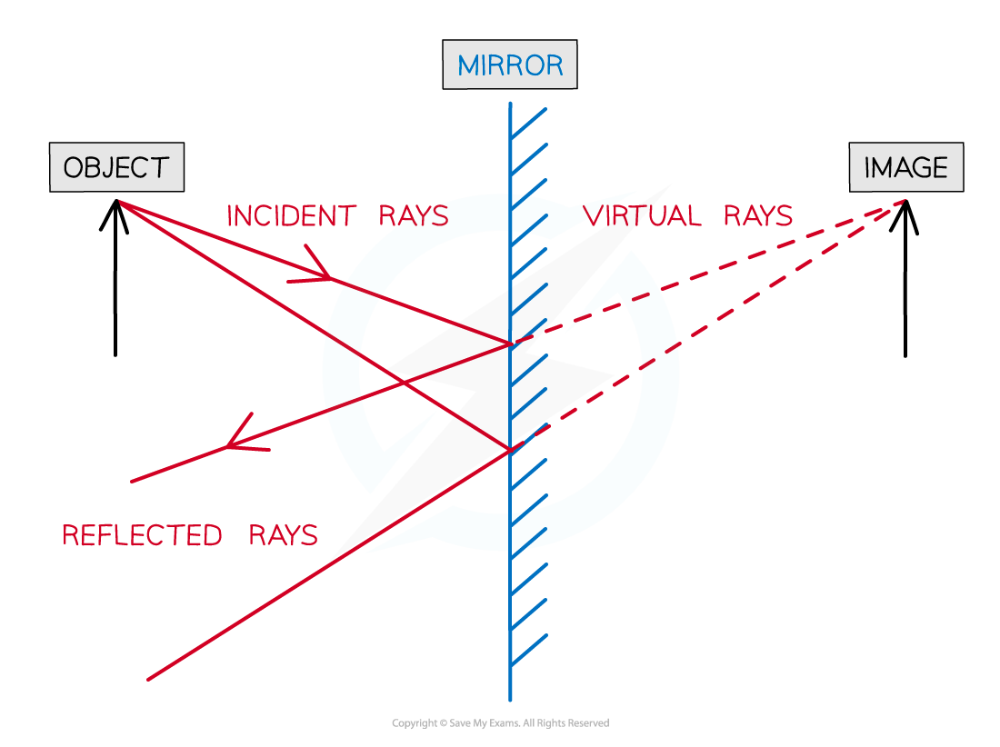

# Reflection of Light

## Ray diagrams

> **Spec point** — `spcpt_sVtBPzCFJvxzMn83` · Define and use the terms normal, angle of incidence and angle of reflection

## Ray diagrams

- In optics, a **normal line** is drawn at **right angles** to the **boundary** between two **media**
- In reflection, angles are measured between the ray (showing the wave direction) and the normal line

  - The angle between the incident ray and the normal is called the **angle of incidence** ($i$)
  - The angle between the reflected ray and the normal is called the **angle of reflection** ($r$)

- When drawing a ray diagram, an arrow is used to show the direction the wave is travelling

  - An **incident** ray has an arrow pointing **towards** the boundary
  - A **reflected** ray has an arrow pointing **away** from the boundary

*A ray diagram for light reflecting at a boundary, showing the normal, angle of incidence and angle of reflection*

## The law of reflection

> **Spec point** — `spcpt_jxPh3cP43CphsY4X` · State that for reflection, the angle of incidence is equal to the angle of reflection; recall and use this relationship

## The law of reflection

- The **law of reflection** states that the angles of incidence and reflection are equal:

$i=r$

- Where:

  - $i$ = angle of incidence in degrees (°)
  - $r$ = angle of reflection in degrees (°)

- This law of reflection is used in many devices such as:

  - mirrors
  - cameras
  - [optical fibres](https://www.savemyexams.com/igcse/physics/cie/23/revision-notes/3-waves/3-2-light/3-2-5-total-internal-reflection/)
  - periscopes

## Reflection in a plane mirror

> **Spec point** — `spcpt_mJJmqHChyqkgnmBG` · Describe the formation of an optical image by a plane mirror, and give its characteristics, i.e. 
- same size, 
-  same distance from mirror, 
 - virtual

## Reflection in a plane mirror

- When an object is placed in front of a plane mirror, an image of that object can be seen in the mirror
- The image will be:

  - the **same size** as the object
  - the **same distance behind** the mirror as the object is in front of it
  - **virtual**

- A **plane mirror** defines a **flat, smooth** and **polished surface**
- The formation of this image can be understood by drawing a ray diagram

*Ray diagram showing the formation of an image in a mirror by the reflection of light*

- Each incident ray on the diagram above can be drawn following these steps:

  - Light from the object hits the mirror, reflecting from it (*i=r*)
  - To an observer, the reflected ray appears to have come from behind the mirror
  - The reflected ray can be traced back in this same direction behind the mirror, forming a **virtual ray**
  - This process is **repeated** for another ray travelling in a slightly different direction

- An image of the object will appear where these two **virtual rays cross**
- The type of image formed in the mirror is called a **virtual image** because of the divergence of the rays from the image

  - It cannot be projected onto a piece of paper (because the rays don’t go through the image)

> **Exam Hint**
> When drawing light waves being reflected **take care to get the angle about right.**
> 
> If they are slightly out it won’t be a problem, but if there is an obvious difference between the angle of incidence and the angle of reflection then you will probably lose a mark.
