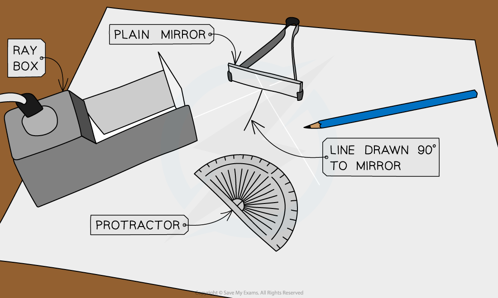

# Investigating Reflection

## Investigating reflection

> **Spec point** — `spcpt_CKrN9YvsXyjcmCzz` · Use simple constructions, measurements and calculations for reflection by plane mirrors

## Investigating reflection

### Extended Tier Only

### Aims of the experiment

- To investigate reflection by a plane mirror

### Variables

- ***Independent variable*** = angle of incidence, *i*
- ***Dependent variable*** = angle of reflection, *r*
- Control variables:

  - Distance of ray box from mirror
  - Width of the light beam
  - Same frequency / wavelength of the light

### Equipment list

| **Equipment** | **Purpose** |
|---|---|
| Ray Box | To provide a narrow beam of light that can be easily reflected |
| Protractor | To measure the angles of incidence and reflection |
| Sheet of Paper | To mark the lines indicating the incident and reflected rays |
| Pencil | To draw the incident and reflected ray lines onto the paper |
| Ruler | To draw the incident and reflected ray lines onto the paper |
| Plane mirror | To reflect the light beam |

### Method

*Apparatus to investigate reflection*

1. Set up the apparatus as shown in the **diagram**
2. In the middle of the paper use a ruler to mark a straight line about **10 cm** long
3. Use a protractor to draw a **90° line** that bisects (cuts in half) the 10 cm line
4. Place the mirror on the **first line** as shown in the diagram above
5. Switch on the **ray box** and aim a beam of light at the point where the two **drawn lines cross** at an angle
6. Use the pencil to mark **two positions** of the light beam:

  - A point just after leaving the ray box
  - The point on the reflected beam about 10 cm away from the mirror
7. Remove the ray box and mirror
8. Use a ruler to join the two marked positions to the point where the originally drawn lines crossed
9. Use the protractor to measure the two angles from the 90° line. The angle for the ray towards the mirror is the angle of incidence, and the other is the angle of reflection
10. **Repeat** the experiment three times with the beam of light aimed at different angles

### Results

#### Example results table

| **Angle of incidence, **$i$*** *****(°)** | **Angle of reflection, **$r$*** *****(°)** |
|---|---|
| 10 |   |
| 30 |   |
| 45 |   |
| 80 |   |

#### Analysis of results

- The law of reflection states:

$i=r$

- Where:

  - $i$ = angle of incidence in degrees (°)
  - $r$ = angle of reflection in degrees (°)
- If the experiment was carried out correctly, the angles of incidence and reflection should be the same

### Evaluating the experiment

- *Systematic errors*:

  - An error could occur if the 90° lines are drawn incorrectly
  
    - Use a set square to draw perpendicular lines
  - If the mirror is distorted, this could affect the reflection angle, so make sure there are little to no blemishes on it
- *Random errors*:

  - The points for the incoming and reflected beam may be inaccurately marked
  
    - Use a sharpened pencil and mark in the middle of the beam
  - The protractor resolution may make it difficult to read the angles accurately
  
    - Use a protractor with a higher resolution

### Safety considerations

- The ray box light could cause **burns** if touched

  - Run burns under cold running water for at least 5 minutes
- Looking directly into the light may **damage the eyes**

  - Avoid looking directly at the light
  - Stand behind the ray box during the experiment
- Keep all **liquids** away from the electrical equipment and paper
- Take care using the **mirror**

  - Damages on the mirror can affect the outcome of the reflection experiment
