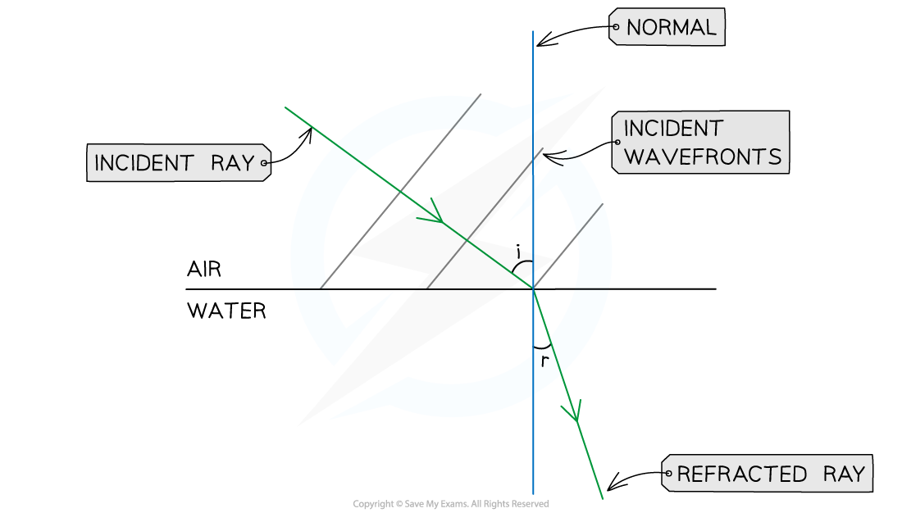
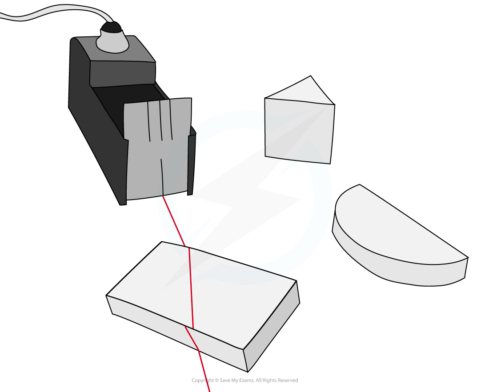
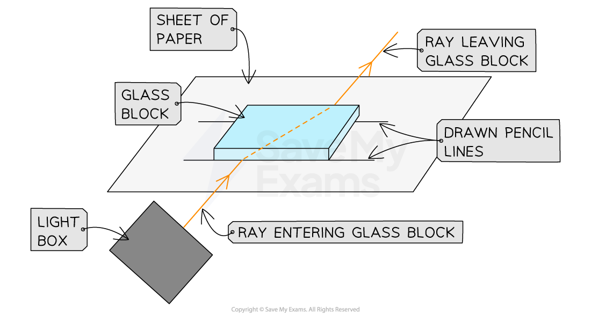
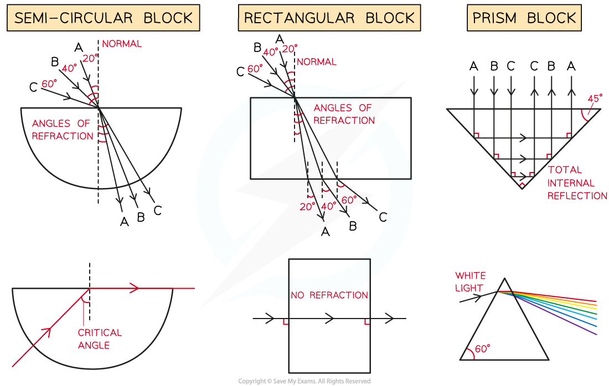

# Refraction of Light

## Ray diagrams for refraction

> **Spec point** — `spcpt_SV3dgVnqKRnxrJXh` · Define and use the terms normal, angle of incidence and angle of refraction

## Ray diagrams for refraction

- In refraction, angles are measured between the ray (showing the direction of the wave) and the normal line

  - The angle of the wave approaching the boundary is called the **angle of incidence** ($i$)
  - The angle of the wave leaving the boundary is called the **angle of refraction** ($r$)

- When drawing a ray diagram an arrow is used to show the direction the wave is travelling

  - An **incident** ray has an arrow pointing **towards** the boundary
  - A **refracted** ray has an arrow pointing **away** from the boundary
- The **angles** of **incidence** and **refraction** are usually labelled $i$ and $r$ respectively

*A ray diagram for light refracting at a boundary, showing the normal, angle of incidence and angle of refraction*

## Refraction of light

> **Spec point** — `spcpt_j8z9XjQJNtZ2cc3c` · Describe the passage of light through a transparent material (limited to the boundaries between two media only)

## Refraction of light

- **Refraction** occurs when light passes a **boundary** between two different **transparent** materials

  - At the boundary, the rays of light change **direction**
- This change in direction depends on the difference i**n optical density** between the two media:

  - From **less dense to more dense** (e.g. air to glass), light bends **towards** the normal
  - From **more dense to less dense** (e.g. glass to air), light bends **away** from the normal
  - When passing along the **normal** (perpendicular) the light **does not bend** at all
- Note that when a light wave enters and leaves the glass block there are **two** boundaries

  - The **refracted** ray at the **first** boundary becomes the **incident **ray at the **second **boundary

*How to construct a ray diagram showing the refraction of light as it passes through a rectangular glass block*

- The **change in direction **occurs due to the **change in speed** when travelling in different substances

  - When light passes into a more optically dense substance, the waves will **slow down**; hence, they bend **towards the normal**
  - When light passes into a less optically dense substance, the waves will **speed up**; hence, they bend **away from the normal**
- The only properties that **change** during refraction are **speed and wavelength** – the frequency of waves **does not change**

  - Different frequencies account for different **colours** of light (red has a low frequency, whilst blue has a high frequency)
  - When light refracts, **it does not change colour **(think of a pencil in a glass of water), therefore, the frequency does not change

> **Exam Hint**
> Practise drawing refraction diagrams as much as you can. It's very important to remember which way the light bends when it crosses a boundary:
> 
> As the light **enters** the block it bends **towards** the normal line
> 
> **Remember: Enters Towards**
> 
> When it **leaves** the block it bends **away** from the normal line
> 
> **Remember: Leaves Away**
> 
> You only need to know about light passing through the boundaries between **two **media.

## Investigating refraction

> **Spec point** — `spcpt_2Xn8gqWxCNcTVqP7` · Describe an experiment to show refraction of light by transparent blocks of different shapes

## Investigating refraction

### Aims of the experiment

- To investigate the refraction of light using rectangular blocks, semi-circular blocks and triangular prisms

### Variables

- ***Independent variable*** = shape of the block
- ***Dependent variable*** = angle of refraction
- Control variables:

  - Width of the light beam
  - Same frequency / wavelength of the light

### Equipment list

| **Equipment** | **Purpose** |
|---|---|
| Ray box | To provide a narrow beam of light that can be easily refracted |
| Protractor | To measure the angles of incidence and refraction |
| Sheet of paper | To mark the lines indicating the incident and refracted rays |
| Pencil | To draw the incident and refracted ray lines onto the paper |
| Ruler | To draw the incident and refracted ray lines onto the paper |
| Perspex blocks (rectangular, semi-circular & prism) | To refract the light beam |

- ***Resolution*** of measuring equipment:

  - Protractor = 1°
  - Ruler = 1 mm

#### Refraction diagram for equipment

*Diagram showing a ray box alongside three different-shaped glass blocks*

### Method

#### Refraction diagram set up

*Apparatus to investigate refraction*

1. Place the glass block on a sheet of paper, and carefully draw around the rectangular perspex block using a pencil
2. Switch on the ray box and direct a beam of light at the side face of the block
3. Mark on the paper:

  - a point on the ray close to the ray box
  - the point where the ray enters the block
  - the point where the ray exits the block
  - a point on the exit light ray which is a distance of about 5 cm away from the block
4. Draw a dashed line normal (at right angles) to the outline of the block where the points are
5. Remove the block and join the points marked with three straight lines
6. Replace the block within its outline and repeat the above process for a ray striking the block at a different angle
7. Repeat the procedure for each shape of perspex block (prism and semi-circular)

### Analysis of results

- Consider the light paths through the different-shaped blocks

#### Refraction experiment results with different media

*Refraction of light through different shapes of perspex blocks*

- The final diagram for each shape will include multiple light ray paths for the different angles of incidences ($i$) at which the light strikes the blocks
- This will help demonstrate how the angle of refraction ($r$) changes with the angle of incidence

  - Label these paths clearly with (1) (2) (3) or **A**, **B**, **C** to make these clearer
- Use the laws of refraction to analyse these results

### Evaluating the experiment

- *Systematic errors*:

  - An error could occur if the 90° lines are drawn incorrectly
  
    - Use a set square to draw perpendicular lines
- *Random errors*:

  - The points for the incoming and reflected beam may be inaccurately marked
  
    - Use a sharpened pencil and mark in the middle of the beam
  - The protractor resolution may make it difficult to read the angles accurately
  
    - Use a protractor with a higher resolution

### Safety considerations

- The ray box light could cause burns if touched

  - Run burns under cold running water for at least 5 minutes
- Looking directly into the light may damage the eyes

  - Avoid looking directly at the light
  - Stand behind the ray box during the experiment

- Keep all liquids away from the electrical equipment and paper

> **Exam Hint**
> In your examination, you might be asked to write a method explaining how you might investigate the refraction of light through different shaped blocks.
> 
> As part of this method you should describe:
> 
> - What equipment you need
> - How you will use the equipment
> - How you will trace the rays of light before, while and after they pass through the block
