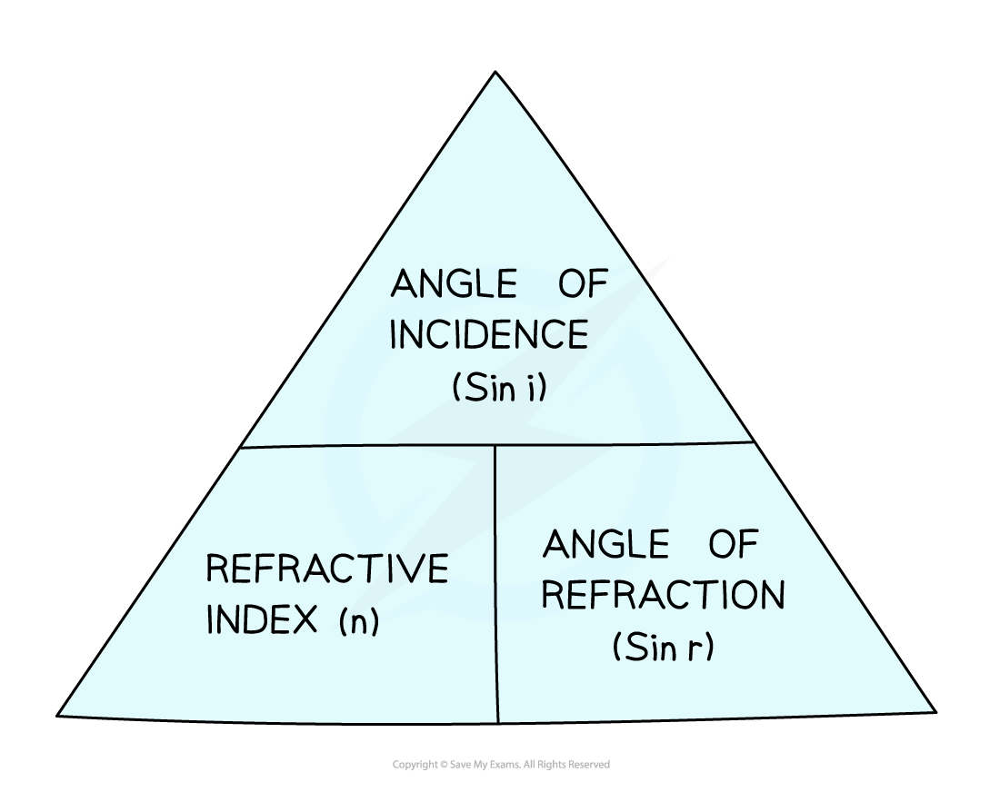

# Refractive Index

## Refractive Index as a ratio of speed

> **Spec point** — `spcpt_RHG5JXhHvGV4RryB` · Define refractive index, n, as the ratio of the speeds of a wave in two different regions

## Refractive index as a ratio of speed

### Extended Tier Only

- The refractive index can be calculated in two different ways:

  - using the **ratio of speeds**
  - using the **ratio of angles**
- The refractive index is a number that is **always larger than 1** and is different for different materials

  - Objects which are more **optically dense** have a **higher** refractive index, e.g., $n$ is about 2.4 for diamond
  - Objects which are less **optically dense** have a **lower** refractive index, e.g., $n$ is about 1.5 for glass
- Since the refractive index is a **ratio**, it has **no units**
- The refractive index, $n$, for the ratio of speeds, is defined as:

**The ratio of the speeds of a wave in two different regions**

- The refractive index, $n$, for the ratio of speeds, is given by the equation:

$n=\frac{\mathrm{speed} \mathrm{of} \mathrm{light} \mathrm{in}a\mathrm{vacuum}}{\mathrm{speed} \mathrm{of} \mathrm{light} \mathrm{in}a\mathrm{material}}$

## Refractive Index as a ratio of angles

> **Spec point** — `spcpt_5B984s8HMCx3jCgY` · Recall and use the equation n = sini/sinr

## Refractive index as a ratio of angles

### Extended Tier Only

- The refractive index, $n$, for the ratio of angles, is defined as:

**The ratio of the sine of the angle of incidence and the sine of the angle of refraction of a wave in two different regions**

- The refractive index, $n$, for the ratio of angles, is given by the equation:

$n=\frac{\mathrm{sin}i}{\mathrm{sin}r}$

- Where:

  - $n$ = the refractive index of the material
  - $i$ = angle of incidence of the light (°)
  - $r$ = angle of refraction of the light (°)

- This equation can be rearranged with the help of the formula triangle:

*Formula triangle for the refractive index in terms of angles*

> **Worked Example**
> A ray of light enters a glass block of refractive index 1.53 making an angle of 15° with the normal before entering the block.
> 
> Calculate the angle it makes with the normal after it enters the glass block.
> 
> [3]
> 
> **Answer:**
> 
> **Step 1: List the known quantities**
> 
> - Refractive index of glass, $n$* *= 1.53
> - Angle of incidence, $i$* *= 15°
> 
> **Step 2: Write the equation for refractive index in terms of the ratio of angles**
> 
> $n=\frac{\mathrm{sin}i}{\mathrm{sin}r}$ **[1 mark]**
> 
> **Step 3: Rearrange the equation and calculate sin (r)**
> 
> $\mathrm{sin}r=\frac{\mathrm{sin}i}{n}$
> 
> $\mathrm{sin}r=\frac{\mathrm{sin}15}{1.53}$
> 
> $\mathrm{sin}r=0.1692$ **[1 mark]**
> 
> **Step 4: Find the angle of refraction (*****r*****) by using the inverse sine function**
> 
> $r=\mathrm{sin}^{-1}(0.1692)$
> 
> $r=9.7\text{°}$ **[1 mark]**

> **Exam Hint**
> The equation** **$n=\frac{\mathrm{sin}i}{\mathrm{sin}r}$** **is also known as Snell's law, but you do not need to know this for your exam.
> 
> **Important:** `open parentheses fraction numerator sin space i over denominator sin space r end fraction close parentheses` is not the same as `open parentheses i over r close parentheses`. Incorrectly cancelling the sin terms is a very common mistake!
> 
> When calculating the value of $i$ or $r$, start by calculating the value of $\mathrm{sin}i$ or $\mathrm{sin}r$*.*
> 
> You can then use the **inverse sine** function (sin–1 on most calculators by pressing 'shift' then 'sine') to find the angle.
> 
> One way to remember which way around $i$ and $r$ are in the fraction is remembering that '$i$' comes before '$r$' in the alphabet, and therefore is on the top of the fraction (whilst $r$ is on the bottom).
