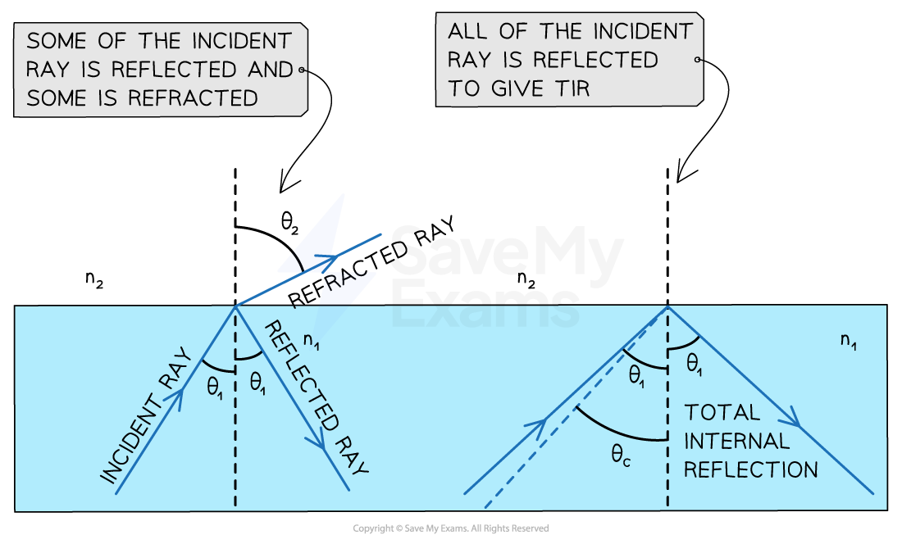
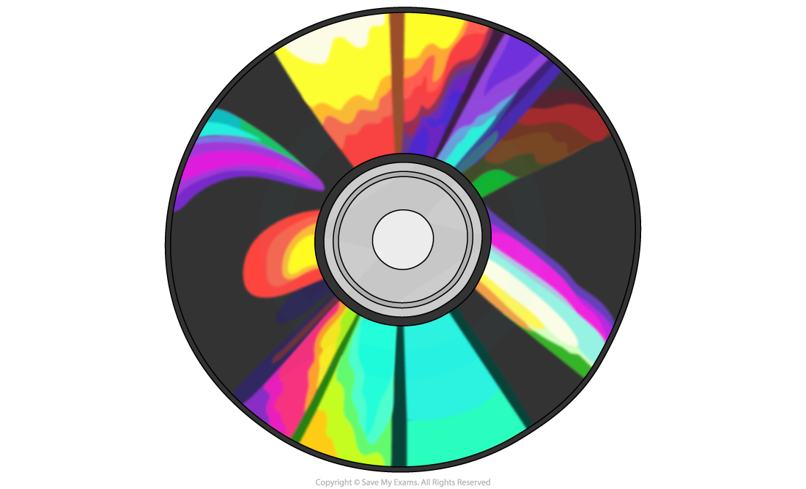
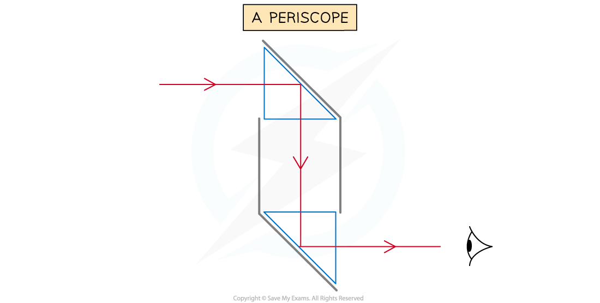
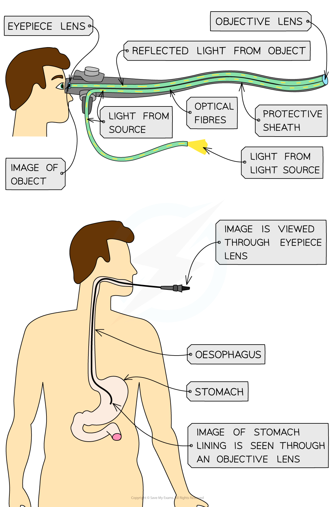
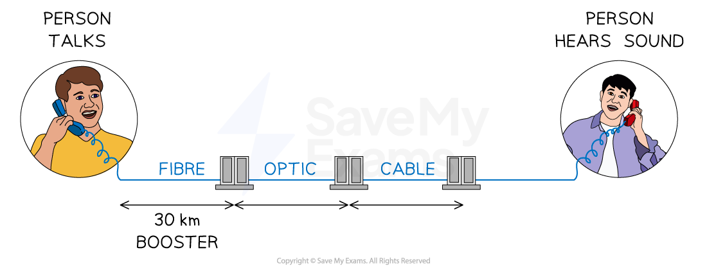

# Total Internal Reflection

## Total internal reflection

> **Spec point** — `spcpt_m2M6dKsHD2K7M3Y2` · Describe internal reflection and total internal reflection using both experimental and everyday examples

## Total internal reflection

- **Total internal reflection** (TIR) occurs at the boundary between two media when:

**All the incident ray in medium 1 is reflected back into medium 1**

- When light passes between the boundary of an optically **dense** to a **less dense** medium and the **angles of incidence are small**

  - The **refracted ray** is **strong**
  - The **reflected ray** is **weak**
- The weak ray is reflected back into the **denser medium**

  - This means **some internal reflection** occurs
- It is not TIR because not all of the ray is reflected, only **some** of it

*Comparing refraction and total internal reflection at a boundary between water and air*

### Comparing internal reflection and total internal reflection

- Normal reflection produces a less intense light compared to TIR

  - In **TIR** the light ray is **brighter** and more intense
- Normal reflection occurs **independent** of the **refractive indices** of both media

  - For **TIR** to occur, the incident material must be **denser** than the second material

#### Conditions for internal reflection

*Total internal reflection happens when the angle of incidence is greater than the critical angle*

### Internal reflection examples

- **Thin film interference** is an example of **internal reflection**
- An example of this is the shiny side of a CD

#### Example of internal reflection

*The colourful pattern observed on a CD is a result of thin film interference*

- Other examples of thin film interference include:

  - soap bubbles
  - thin layers of oil on water
- In these examples, internal reflection occurs at the boundaries between:

  - air and water
  - water and oil
- A spectrum of colours will be seen by the observer due to the rays partially reflected at the boundary

#### A ray diagram of an example of internal reflection

*Light is reflected and transmitted at the boundary from a less dense to a more dense material. Light is transmitted only at the boundary from a more dense to a less dense material. Hence, in this diagram P and Q exist but the third unlabelled ray does not.*

### Total internal reflection examples

- Total internal reflection is used to reflect light along **optical fibres**, meaning they can be used for:

  - communications
  - endoscopes
  - decorative lamps

- Light travelling down an optical fibre is totally internally reflected each time it hits the edge of the fibre

#### Total internal reflection example: optical fibre

*Optical fibres utilise total internal reflection for communications*

- Prisms are used in a variety of optical instruments, including:

  - periscopes
  - binoculars
  - telescopes
  - cameras
  - safety reflectors

- A **periscope** is a device that can be used to see over tall objects

  - It consists of two right-angled prisms

#### Total internal reflection example: a periscope

*Reflection of light through a periscope*

- The light totally internally reflects in both prisms

> **Exam Hint**
> If asked to name the phenomena make sure you give the whole name – **total internal reflection**
> 
> **Remember:** total internal reflection occurs when light travels from a denser material to less dense material and **ALL** of the light is reflected.
> 
> If asked to give an example of a use of total internal reflection, first state the name of the object that causes the reflection (e.g. a right-angled prism) and then name the device in which it is used (e.g. a periscope)

## Critical angle

> **Spec point** — `spcpt_tVs7cm8yXDpfBhNP` · State the meaning of critical angle

## Critical angle

- At the boundary between a more dense and a less dense medium, as the angle of incidence is increased, the angle of refraction also increases until it gets closer to 90°
- When the angle of refraction is exactly 90° the light is refracted along the boundary

  - At this point, the angle of incidence is known as the **critical angle** *c*

*As the angle of incidence increases it will eventually surplus the critical angle and lead to total internal reflection of the light*

- When the angle of incidence is larger than the critical angle, the refracted ray is now **reflected**

  - This is ***total internal reflection***

> **Worked Example**
> A glass cube is held in contact with a liquid and a light ray is directed at a vertical face of the cube. The angle of incidence at the vertical face is 39° and the angle of refraction is 25° as shown in the diagram. The light ray is totally internally reflected for the first time at **X**.
> 
> 
> 
> Complete the diagram to show the path of the ray beyond **X** to the air and calculate the critical angle for the glass-liquid boundary.
> 
> [5]
> 
> **Answer:**
> 
> ![Diagram of a light ray passing from air into a glass cube at 39° to the normal line. Upon entering the glass cube, the ray makes an angle of 25° to the normal line. The ray continues through the glass cube until it hits the horizontal bottom liquid surface at point X, making an angle of 65° to the normal line of the glass-liquid boundary. 
> The ray totally internally reflects at X with an angle of 65°. The green reflected ray travels upwards and hits the vertical right surface of the glass cube at an angle of 25° to a horizontal dashed normal line. It refracts back out into the air at an angle of 39° to the normal line.](assets/eb6a333a035a-total-internal-reflection-worked-example-2.png)
> 
> **[1 mark]**
> 
> **Step 1: Draw the reflected angle at the glass-liquid boundary**
> 
> - When a light ray is reflected, the angle of incidence = angle of reflection
> - Therefore, the angle of incidence (or reflection) is 90° – 25° = 65° **[1 mark]**
> 
> **Step 2: Draw the refracted angle at the glass-air boundary**
> 
> - At the glass-air boundary, the light ray refracts **away** from the normal **[1 mark]**
> - Due to the reflection, the light rays are symmetrical to the other side **[1 mark]**
> 
> **Step 3: Calculate the critical angle**
> 
> - The question states the ray is “totally internally reflected for the first time” meaning that this is the lowest angle at which TIR occurs
> - Therefore, 65° is the critical angle **[1 mark]**

> **Exam Hint**
> If you are asked to explain what is meant by the critical angle in an exam, you can be sure to gain full marks by drawing and labelling the same diagram above (showing the three semi-circular blocks)

## Refractive index & critical angle equation

> **Spec point** — `spcpt_NBggGy7v8qKt6Nxd` · Recall and use the equation n = 1/sinc

## Refractive index & critical angle equation

### Extended Tier Only

- The critical angle, $c$, of a material, is related to its ***refractive index***, $n$
- The relationship between the two quantities is given by the equation:

$\mathrm{sin}c=\frac{1}{n}$

- This can also be rearranged to calculate the [refractive index](https://www.savemyexams.com/igcse/physics/cie/23/revision-notes/3-waves/3-2-light/3-2-4-snells-law/?_ai=internal-linking), *n*:

$n=\frac{1}{\mathrm{sin}c}$

- This equation shows that:

  - The larger the **refractive index** of a material, the smaller the **critical angle**
  - Light rays inside a material with a **high refractive index** are more likely to be **totally internally reflected**

> **Worked Example**
> Opals and diamonds are transparent stones used in jewellery. Jewellers shape the stones so that light is reflected inside. Compare the critical angles of opal and diamond and explain which stone would appear to sparkle more.
> 
> The refractive index of opal is about 1.5.
> 
> The refractive index of diamond is about 2.4.
> 
> [4]
> 
> **Answer:**
> 
> **Step 1: List the known quantities**
> 
> - Refractive index of opal, $n_{o}$ = 1.5
> - Refractive index of diamond, $n_{d}$ = 2.4
> 
> **Step 2: Write out the equation relating critical angle and refractive index**
> 
> $\mathrm{sin}c=\frac{1}{n}$
> 
> **Step 3: Calculate the critical angle of opal (**$c_{o}$**)**
> 
> $\mathrm{sin}(c_{o})=\frac{1}{1.5}=0.6667$
> 
> $c_{o}=\mathrm{sin}^{-1}(0.6667)$
> 
> $c_{o}=41.8^{\circ}$
> 
> $c_{o}=42^{\circ}$ **[1 mark]**
> 
> **Step 4: Calculate the critical angle of diamond (**$c_{d}$**)**
> 
> $\mathrm{sin}(c_{d})=\frac{1}{2.4}=0.4167$
> 
> $c_{d}=\mathrm{sin}^{--1}(0.4167)$
> 
> $c_{d}=24.6^{\circ}$
> 
> $c_{d}=25^{\circ}$ **[1 mark]**
> 
> **Step 5: Compare the two values and write a conclusion**
> 
> - Total internal reflection occurs when the angle of incidence of light is **larger** than the critical angle ($i>c$)
> - In opal, total internal reflection will occur for angles of incidence between 42° and 90°
> - The critical angle of diamond is **lower** than the critical angle of opal ($c_{d}<c_{o}$)
> - This means light rays will be totally internally reflected in diamond over a **larger** range of angles (25° to 90°) **[1 mark]**
> - Therefore, more total internal reflection will occur in diamond hence it will appear to sparkle more than the opal **[1 mark]**

> **Exam Hint**
> When calculating the value of the critical angle using the above equation:
> 
> - First use the refractive index, *n*, to find sin(*c*)
> - Then use the **inverse** sin function (sin–1) to find the value of *c*

## Optical fibres

> **Spec point** — `spcpt_5kJxRhJTzxwZFS3x` · Describe the use of optical fibres, particularly in telecommunications

## Optical fibres

### Extended Tier Only

- Optical fibres have many uses, particularly in telecommunications
- **Endoscopes** are used to look within the human body

  - A camera on the end of an optical fibre is placed down the throat and moved into the stomach
  - Light from inside the stomach is captured by the camera, is totally internally reflected along the optical fibre and viewed by doctors through the eyepiece

*Endoscopes utilise total internal reflection to see inside a patient's body*

### Total internal reflection using telecommunication

- **Optical fibres** can be used to transmit:

  - home (landline) telephone signals
  - internet signals
  - cable television signals

- In **phone calls** from landline phones:

  - Electrical signals are converted to **light pulses**
  - That travel close to the speed of light along optical fibres
  - At the receiving end, the digital signal is converted into **sound**

#### Total internal reflection example: landline telephone signal path

*Sound from a landline telephone travels through optical fibres to the landline of the person listening*

- Optical fibres are installed:

  - in cables attached to telephone (or telegraph) poles in the street
  - underground from the service box to the telegraph pole or under the sea

#### Total internal reflection example: telegraph poles

*Fibre optic cables can be found in the phone cables attached between the telephone poles and the street*
