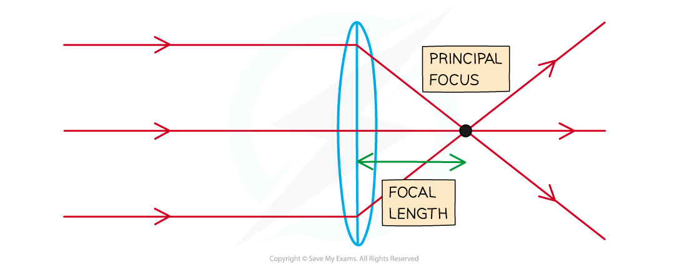
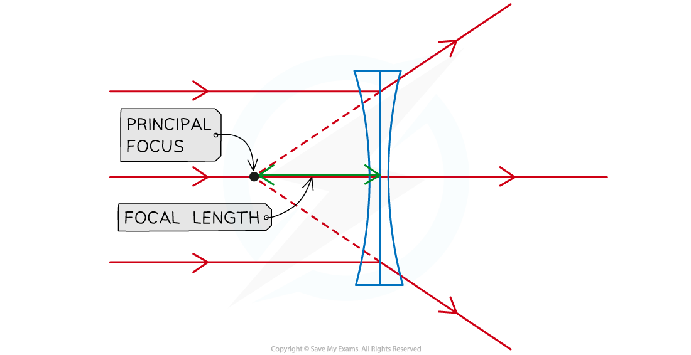
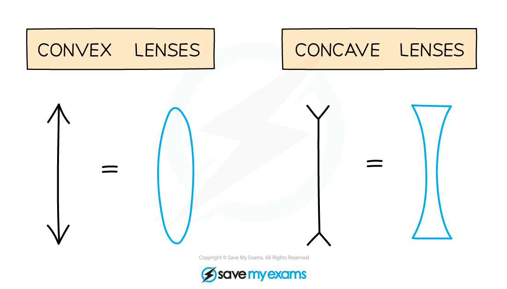

# Ray Diagrams

## Features of Ray Diagrams

> **Spec point** — `spcpt_nKCmbzVPhxYyyYzb` · Define and use the terms focal length, principal axis and principal focus (focal point)

## Features of ray diagrams

- Ray diagrams can be described using the following terms:

  - principal axis
  - principal focus, or focal point
  - focal length

- The principal axis is defined as:

**A line which passes through the centre of a lens**

- The principal focus, or focal point, is defined as:

**The point at which rays of light travelling parallel to the principal axis intersect the principal axis and converge or the point at which diverging rays appear to proceed**

- Focal length is defined as:

**The distance between the centre of the lens and the principal focus**

## Converging & diverging lenses

> **Spec point** — `spcpt_qwBWr2b5WDgWpCZn` · Describe the action of thin converging and thin diverging lenses on a parallel beam of light

## Converging & diverging lenses

- A lens is a piece of equipment that forms an image by [refracting light](https://www.savemyexams.com/igcse/physics/cie/23/revision-notes/3-waves/3-2-light/3-2-3-refraction-of-light/?_ai=internal-linking)
- There are two types of lens:

  - converging
  - diverging

### Converging lenses

- In a converging lens, parallel rays of light are brought to a focus

  - This point is called the **principal focus**

- This lens is sometimes referred to as a **convex** lens
- The distance from the lens to the principal focus is called the **focal length**

  - This depends on how **curved** the lens is
  - The **more** curved the lens, the **shorter** the focal length

#### Converging lens diagram

*The focal length is the distance from the lens to the principal focus*

### Diverging lenses

- In a diverging lens, parallel rays of light are made to diverge (spread out) from a point

  - This lens is sometimes referred to as a **concave** lens

- The principal focus is now the point from which the rays appear to diverge from

#### Diverging lens diagram

*Parallel rays from a diverging lens appear to come from the principal focus*

### Representing lenses

- In diagrams, the following symbols are often used to represent each type of lens:

#### Converging and diverging lens symbols

*Concave and convex lens symbols*

> **Exam Hint**
> To remember which lens is converging or diverging, think of the following: Con**v**ex lens = Con**v**erging. You need to be able to describe how the lenses affect the light rays.
