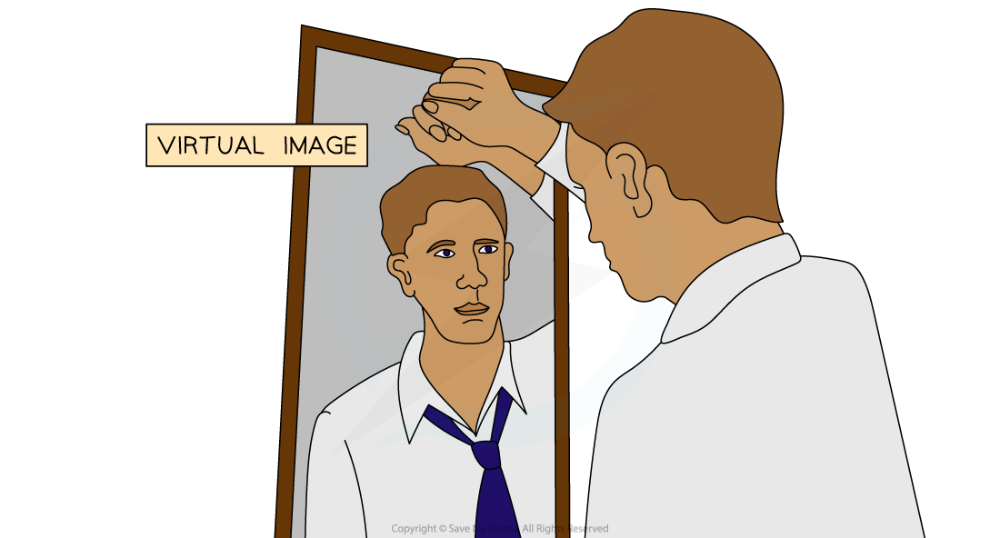

# Real & Virtual Images

## Real images & virtual images

> **Spec point** — `spcpt_3pbkJmVTMxHcDZ8B` · Describe the characteristics of an image using the terms enlarged/same size/diminished, upright/inverted and real/virtual 

## Real images & virtual images

- Images produced by lenses can be one of two types:

  - a real image
  - a virtual image

- Images can be described **compared to their object** as:

  - **enlarged**/same size/**diminished**
  - **upright/inverted**
  - **real/virtual**

### Real images

- A real image is defined as:

**An image that is formed when the light rays from an object converge and meet each other and can be projected onto a screen**

- A real image is one produced by the [convergence of light towards a focus](https://www.savemyexams.com/igcse/physics/cie/23/revision-notes/3-waves/3-2-light/real-images/?_ai=internal-linking)
- Real images are always **inverted**
- Real images can be projected onto pieces of paper or screens

  - An example of a real image is the image formed on a cinema screen

#### A real image

*A real image can be projected onto a screen*

### Virtual images

- A virtual image is defined as:

**An image that is formed when the light rays from an object do not meet but appear to meet behind the lens and cannot be projected onto a screen**

- A virtual image is formed by the **divergence** of light away from a point
- Virtual images are always **upright**
- Virtual images **cannot** be projected onto a piece of paper or a screen

  - An example of a virtual image is a person's reflection in a mirror

#### A virtual image

*A reflection in a mirror is an example of a virtual image*
