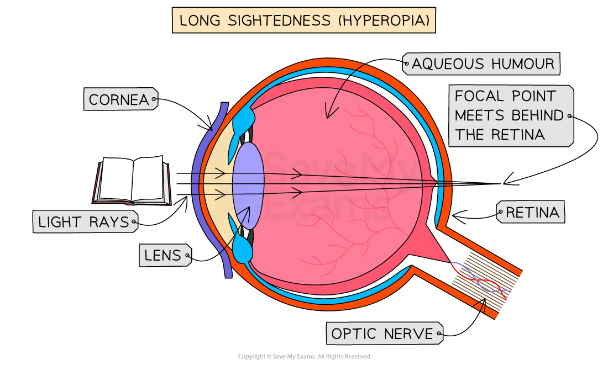
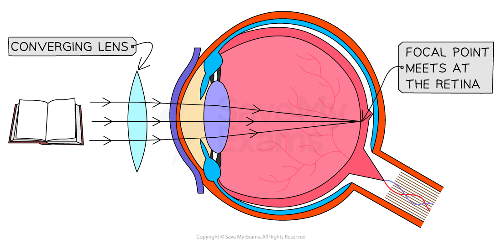
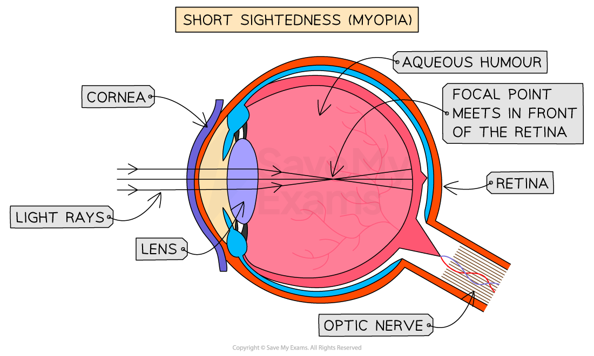
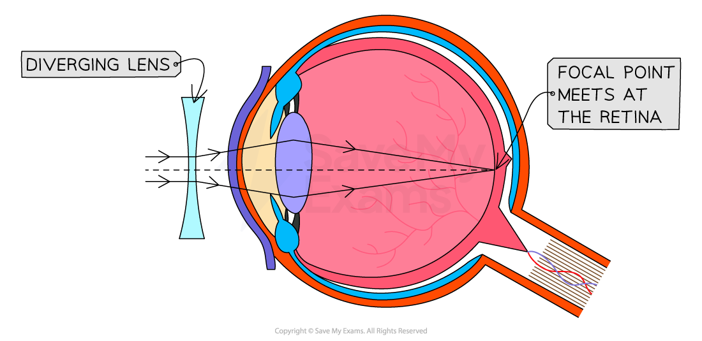

# Correcting Sight

## Correcting sight

> **Spec point** — `spcpt_FzjWDSzXdVydyy5M` · Describe the use of converging and diverging lenses to correct long-sightedness and short- sightedness

## Correcting sight

### Extended Tier Only

- Converging and diverging lenses are commonly used in glasses and contact lenses to correct defects of sight

  - [Converging lenses](https://www.savemyexams.com/igcse/physics/cie/23/revision-notes/3-waves/3-2-light/3-2-6-thin-lenses/?_ai=internal-linking) can be used to correct long-sighted vision
  - [Diverging lenses](https://www.savemyexams.com/igcse/physics/cie/23/revision-notes/3-waves/3-2-light/3-2-6-thin-lenses/?_ai=internal-linking) can be used to correct short-sighted vision

### Use of lenses to correct long-sightedness

- Long-sighted people have eyes that are **less curved** than normal or the eyeball is **too short**

  - This means they cannot see things that are close and can only clearly see things that are far away

#### Ray diagram to show long-sightedness

*An eye that is long-sighted has a narrower lens with a smaller focussing power so the light rays meet and form an image behind the retina and not on it*

- The eye refracts the light rays and they are brought to a focus **beyond** the retina

  - In other words, the focus point is behind the retina at the back of the eye

- This can be corrected by using a convex or **converging lens**

#### The effect of a converging lens on a long-sighted eye

*The converging lens causes the rays to converge before they reach the eye, so the image is formed on the retina and not behind it*

### Use of lenses to correct short-sightedness

- People who are **short-sighted** have eyes that are **more curved** than normal or have an eyeball that is **too long**

  - This means they cannot see things that are far away, and only see things that are close to them

#### Ray diagram of short-sightedness

*An eye that is short-sighted has a wider lens with a larger focussing power so the light rays meet and form an image in front of the retina and not on it*

- This is because the eye refracts the light and brings it to a focus **before** it reaches the retina

  - In other words, the focus point is in front of the retina at the back of the eye
- This can be corrected by using a concave or a **diverging lens**

#### The effect of a diverging lens on a short-sighted eye

*The diverging lens causes the rays to diverge before they reach the eye, so the image is formed on the retina and not in front of it*
