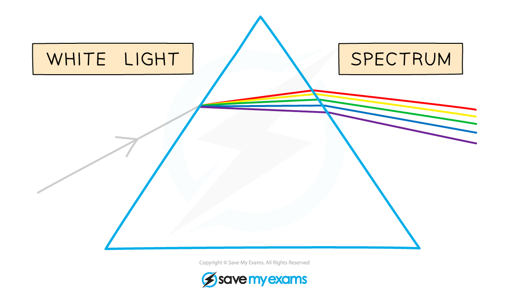
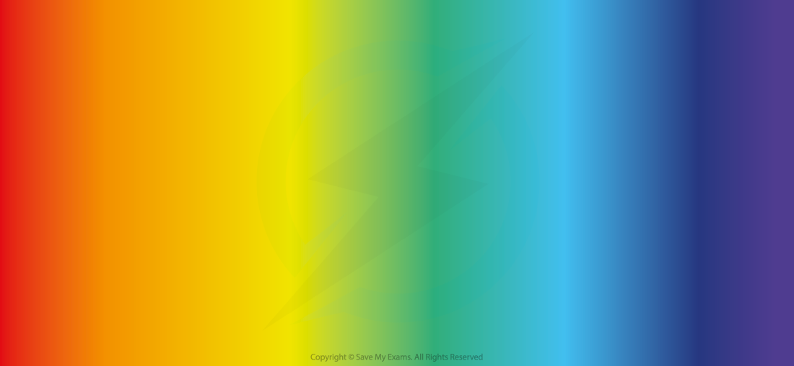
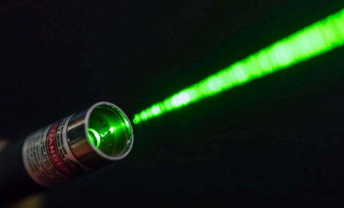

# Dispersion of Light

## Dispersion of light

> **Spec point** — `spcpt_rJhhBGHwt22vnjc8` · Describe the dispersion of light as illustrated by the refraction of white light by a glass prism

## Dispersion of light

- The **dispersion** of light is illustrated by the [refraction of white light](https://www.savemyexams.com/igcse/physics/cie/23/revision-notes/3-waves/3-2-light/3-2-3-refraction-of-light/?_ai=internal-linking) by a **glass prism**
- White light contains the wavelengths of **all** the colours of the spectrum

  - Each colour has a different wavelength (and frequency), making up a very narrow part of the electromagnetic spectrum
- White light may be separated into all its colours by passing it through a **glass** **prism**

  - This is done by **refraction**
  - Violet light is refracted the most, whilst red light is refracted the least
  - This splits up the colours to form a **spectrum**

- This process is similar to how a rainbow is created

*White light is separated into colours by passing it through a triangular prism*

## The visible spectrum of light

> **Spec point** — `spcpt_3MDYf2vYZcDDdgFy` · Know the traditional seven colours of the visible spectrum in order of frequency and in order of wavelength

## The visible spectrum of light

- Visible light is the **only** part of the spectrum detectable by the human eye

  - In the natural world, many animals, such as birds, bees and certain fish, can perceive beyond visible light and can see infra-red and UV wavelengths of light

- The seven different colours of visible light waves correspond to different wavelengths
- In order of longest wavelength and lowest frequency to shortest wavelength and highest frequency:

  - **red**
  - **orange**
  - **yellow**
  - **green**
  - **blue**
  - **indigo**
  - **violet**

*The dispersion of light creates the seven colours of the visible spectrum: red has the longest wavelength; violet has the shortest*

> **Exam Hint**
> To remember the colours of the visible spectrum you could remember either:
> 
> - the name “Roy G. Biv”
> - the saying “Richard Of York Gave Battle In Vain”

## Monochromatic light

> **Spec point** — `spcpt_5g3m7QQw3PXpWdfk` · Recall that visible light of a single frequency is described as monochromatic

## Monochromatic light

### Extended Tier Only

- A visible light source of a single frequency (a single colour) is **monochromatic**
- A laser beam is monochromatic because it emits a single colour of light

*The laser emits monochromatic green light*
