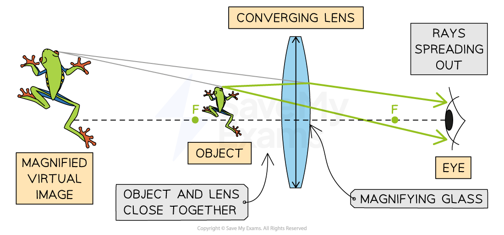
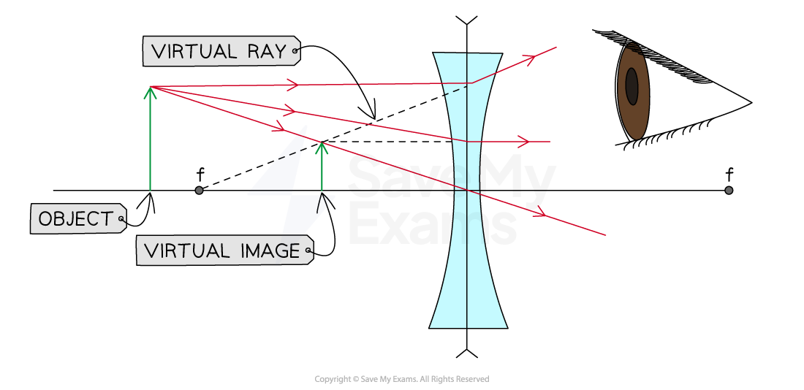
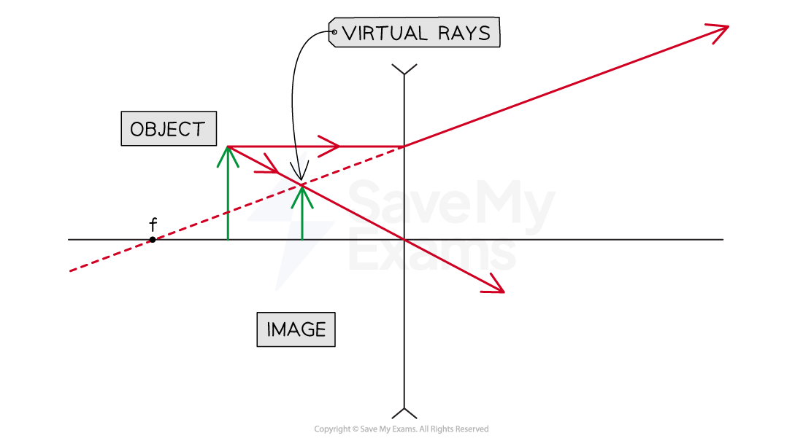

# Virtual Images

## Converging lens - virtual image

> **Spec point** — `spcpt_RsCtwWsTkvN5ZKDH` · Draw and use ray diagrams for the formation of a virtual image by a converging lens
Describe the use of a single lens as a magnifying glass

## Converging lens - virtual image

### Extended Tier Only

### Constructing converging ray diagrams of virtual images

- A single lens placed at a distance **less than** the focal length of an object can be used as a **magnifying glass**

#### A converging lens ray diagram for an object placed less than f

*Ray diagram showing light converging through a magnifying glass to form a magnified virtual image*

- The image that forms will have the following properties:

| **The image forms...** | at 2*f *(on the same side as the object) |
|---|---|
| **The nature of the image is...** | virtual |
| **The orientation of the image is...** | upright |
| **The size of the image is...** | magnified |

## Diverging lens - virtual image

> **Spec point** — `spcpt_jKFCJZCPPGGZZNGq` · Know that a virtual image is formed when diverging rays are extrapolated backwards and does not form a visible projection on a screen

## Diverging lens - virtual image

### Image formation by a diverging lens

- No matter the position of the object, all images formed by diverging lenses are:

  - **virtual** (and not real)
  - **upright** (the same as the object)
  - **diminished** (smaller than the object)
  - on the **same side** of the lens as the object
- For an object placed at any distance away from the lens (further than the focal point or closer than):

  - The ray of light incident on the centre of the lens does not change direction
  - The rays of light parallel to the principal axis are refracted
  - These rays can be extrapolated backwards
  
    - It appears that they come from a **virtual focus**
  - A visible projection cannot be formed on a screen

#### Virtual image produced by a diverging lens with object beyond f

*A diverging lens always produces a virtual image no matter the position of the object in relation to the focal point or the lens. Here the object is further away from the lens than the focal point.*

#### Virtual image produced by a diverging lens with object closer than f

*A diverging lens always produces a virtual image no matter the position of the object in relation to the focal point or the lens. Here the object is closer to the lens than the focal point.*

### Comparing converging and diverging lenses

- The image produced by a **converging** lens can be either **real** or **virtual**

  - This means the image can be inverted (real) or upright (virtual)

- The image produced by a **diverging** lens is always **virtual**

  - This means the image will always be upright

> **Worked Example**
> An object is placed outside the focal point of a diverging lens.
> 
> 
> 
> Complete the ray diagram by drawing where the image of this object will be seen.
> 
> [3]
> 
> **Answer:**
> 
> ![A diverging lens is shown at the centre of a graph. The focal points are located four grid squares left and four grid squares right of the diverging lens. An upright object is placed five grid squares left of the diverging lens. A ray is drawn from the top of the object towards the optical centre of the lens and is undeflected. A ray parallel to the principal axis is refracted outwards to the top right of the graph. The point at which the extension of this refracted ray intersects with the other ray is where the virtual image is formed.](assets/50cc2c22fe81-6-3-2-ray-diagrams-worked-example-solution.png)
> 
> **Step 1: Draw a line from the top of the object through the middle of the lens**
> 
> - The top of the image lies somewhere along this line **[1 mark]**
> 
> **Step 2: Draw a line from the focal point through the top of the lens**
> 
> - The dashed line shows the continuation of the upward arrow **[1 mark]**
> - The top of the image is where the two lines cross **[1 mark]**

> **Exam Hint**
> You are not expected to draw ray diagrams for a diverging lens but you must be able to explain how the virtual images are formed.
