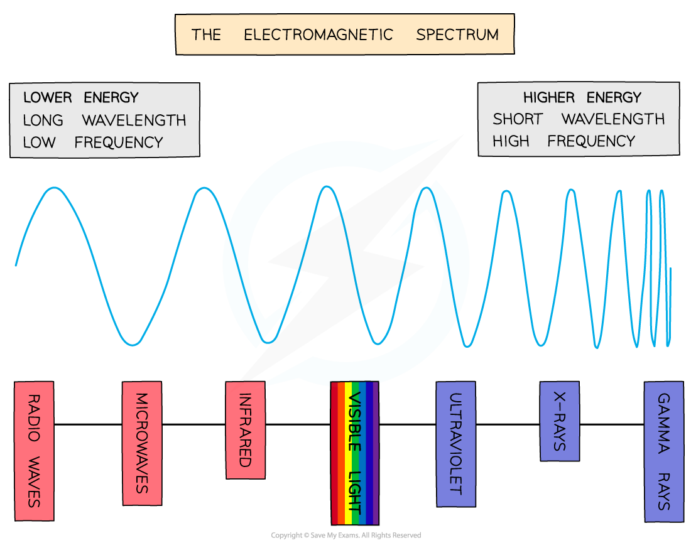

# Electromagnetic Waves

## Electromagnetic waves

> **Spec point** — `spcpt_fSbTpWY88XXwV44p` · Know the main regions of the electromagnetic spectrum in order of frequency and in order of wavelength

## Electromagnetic waves

- The electromagnetic spectrum is arranged in a specific order based on the wavelengths or frequencies of the radiation in each region

  - Regions with a **long wavelength** have a **low frequency** and vice versa
- The main regions of the continuous electromagnetic (EM) spectrum from longest to shortest wavelength are:

  - radio waves
  - microwaves
  - infrared
  - visible (red, orange, yellow, green, blue, indigo, violet)
  - ultraviolet
  - X-rays
  - gamma rays

*Visible light is just one small part of a much bigger spectrum: the electromagnetic spectrum*

> **Exam Hint**
> See if you can make up a mnemonic to help you remember the EM spectrum!
> 
> One possibility is:
> 
> **R**aging **M**artians **I**nvaded **V**enus **U**sing **X**-ray **G**uns
> 
> The electromagnetic spectrum is usually given in order of **decreasing wavelength** and **increasing frequency** i.e. from radio waves to gamma waves
> 
> Remember:
> 
> - Radios are **big** (long wavelength)
> - Gamma rays are emitted from atoms which are **very small** (short wavelength)

## Properties of electromagnetic waves

> **Spec point** — `spcpt_wg8rVkBPfRFS68dt` · Know that all electromagnetic waves travel at the same high speed in a vacuum

## Properties of electromagnetic waves

- All electromagnetic waves travel at the same **high speed** in a ***vacuum***
- Electromagnetic waves are defined as:

**[Transverse waves that transfer energy](https://www.savemyexams.com/igcse/physics/cie/23/revision-notes/3-waves/3-1-general-properties-of-waves/3-1-3-transverse-and-longitudinal-waves/?_ai=internal-linking)**** from the source of the waves to an absorber**

## The speed of electromagnetic waves

> **Spec point** — `spcpt_n7NFKfhPXxqjTS5G` · Know that the speed of electromagnetic waves in a vacuum is 3.0 × 10^8m/s and is approximately the same in air

## The speed of electromagnetic waves

### Extended Tier Only

- The speed of electromagnetic waves in a vacuum is

$3.0\times10^{8}m/s$

- This is approximately the same speed as electromagnetic waves in air
