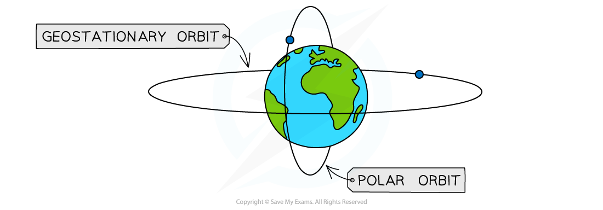
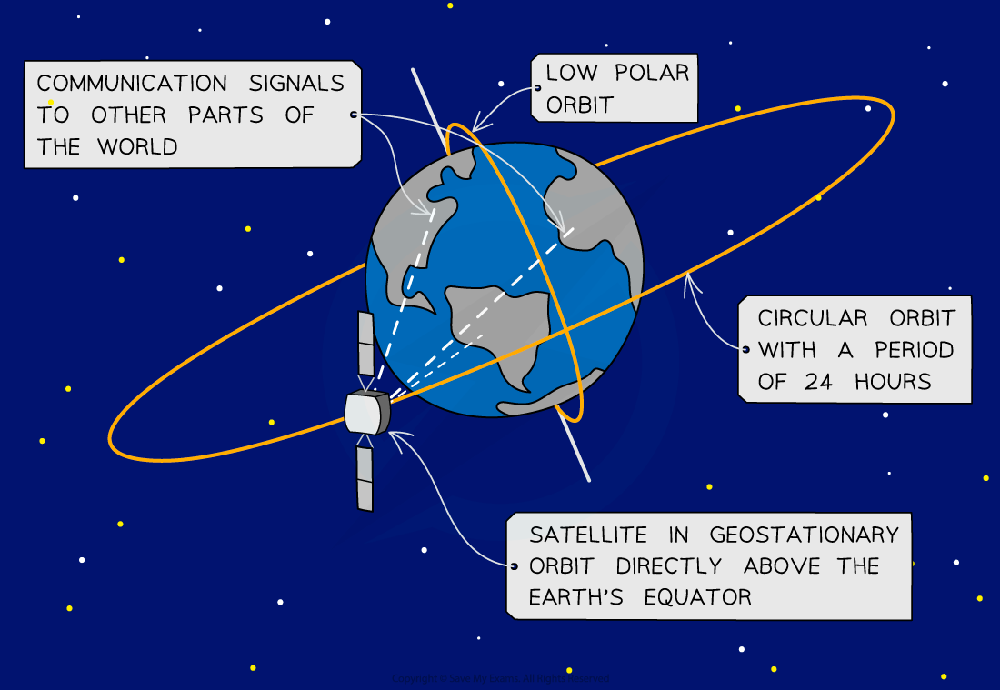
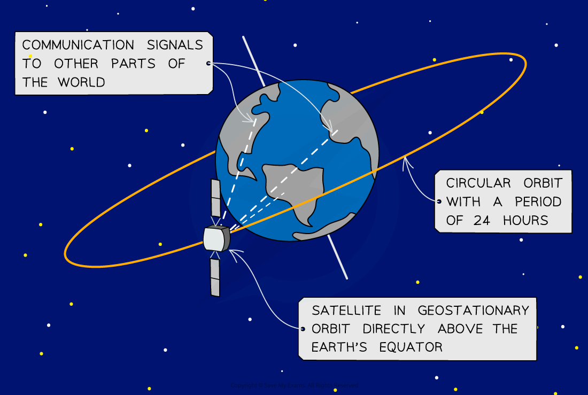
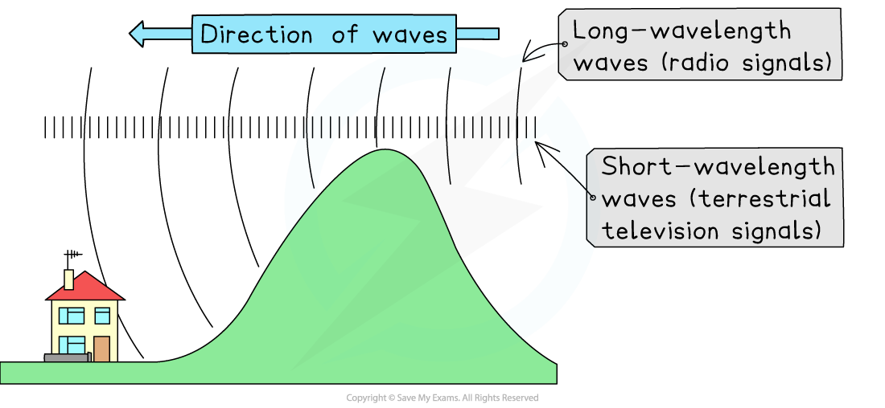

# Communications

## Communications with satellites

> **Spec point** — `spcpt_sFNtCnS5zKXQGp7J` · Know that communication with artificial satellites is mainly by microwaves:
(a) some satellite phones use low orbit artificial satellites
(b) some satellite phones and direct broadcast satellite television use geostationary satellites

## Communications with satellites

- Communications with **artificial satellites** use **microwaves**:

  - Some satellite phones use low-orbit artificial satellites
  - Some satellite phones and direct broadcast satellite televisions use geostationary satellites

*Geostationary and polar orbits around the Earth*

### Low orbit satellites

- Low orbit satellites orbit much lower than geostationary satellites, at around 200 km above sea level

  - Used for monitoring the weather, military applications, and taking images of the Earth’s surface
  - There is a much shorter time delay for signals compared to geostationary orbit signals
  - The signals and images are much clearer due to the lower orbit
  - However, there is limited use in any one orbit because more than one satellite is required for continuous operation
- Polar orbit satellites are a type of low Earth orbit satellite that orbit around the poles

*Some satellite phones use low-orbit artificial satellites if a more detailed signal is required*

### Geostationary satellites

- Geostationary satellites orbit **above the Earth’s equator**

  - The orbit of the satellite is 24 hours
  - At a height of 36 000 km above the Earth’s surface, much higher than polar satellites
  - Used for radio and telecommunication broadcasting around the world due to their high orbit

#### Orbit of geostationary satellite

*Some satellite phones and direct broadcast satellite television use geostationary satellites*

## Systems of communications

> **Spec point** — `spcpt_KZ5jBqWZNQxB5dyR` · Know that many important systems of communications rely on electromagnetic radiation including:
(a) mobile phones (cell phones) and wireless internet use microwaves because microwaves can penetrate some walls and only require a short aerial for transmission and reception
(b) Bluetooth uses radio waves because radio waves pass through walls but the signal is weakened on doing so
(c) optical fibres (visible light or infrared) are used for cable television and high-speed broadband because glass is transparent to visible light and some infrared; visible light and short wavelength infrared can carry high rates of data

## Systems of communications

### Extended Tier Only

- Many important systems of communication rely on **long-wave** electromagnetic radiation, including:

  - mobile phones, wireless internet & satellite television (using **microwaves**)
  - Bluetooth, terrestrial television signals & local radio stations (using **radio** waves)
  - optical fibres (using **visible** or **infrared** waves)

### Microwaves

- Microwaves can be used to transmit signals over **large** distances
- As with radio waves, microwave signals will be clearer if there are no obstacles in the way which may cause [diffraction of the beam](https://www.savemyexams.com/igcse/physics/cie/23/revision-notes/3-waves/3-1-general-properties-of-waves/3-1-4-wave-behaviour/?_ai=internal-linking)
- On the ground, mobile phone signals use a network of **microwave transmitter masts** to relay the signals from the nearest mast to the receiving phone

  - They cannot be spaced so far apart that, for example, hills or the curvature of the Earth diffract the beam

- Mobile phones and wireless internet use microwaves because microwaves are not refracted, reflected or absorbed by the **atmosphere** or **ionosphere**

  - This means satellites can relay signals around the Earth allowing communication 24 hours a day all around the world
  - Also, they can penetrate most walls and only require a short aerial for transmission and reception

### Radio waves

- Radio waves can be used to transmit signals over **short** distances
- Radio waves have wavelengths of around a kilometre
- Radio waves can **diffract** around hills

  - This is because radio waves have wavelengths similar to the size of the hill

- Bluetooth uses radio waves instead of wires or cables to transmit information between electronic devices such as phones and speakers, over short distances

  - Bluetooth signals tend to have **shorter** wavelengths than radio or television signals
  - This enables high rates of data transmission that can only be used over a short distance (for example, within a household)
  - This means they can pass through walls but the signal is significantly **weakened** on doing so

#### Radio waves diffract around hills

*Radio signals diffract around hills because they are a similar wavelength to the hill*

### Optical fibres

- Optical fibres use visible light and short-wavelength infrared radiation for cable television and high-speed broadband

  - Visible light and infrared radiation can carry high rates of data due to their high frequency
