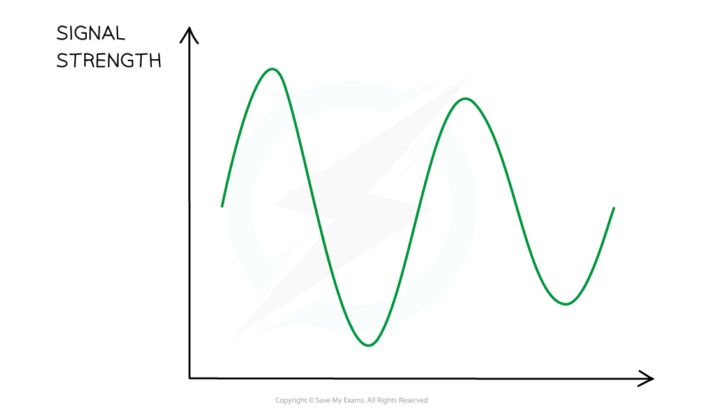
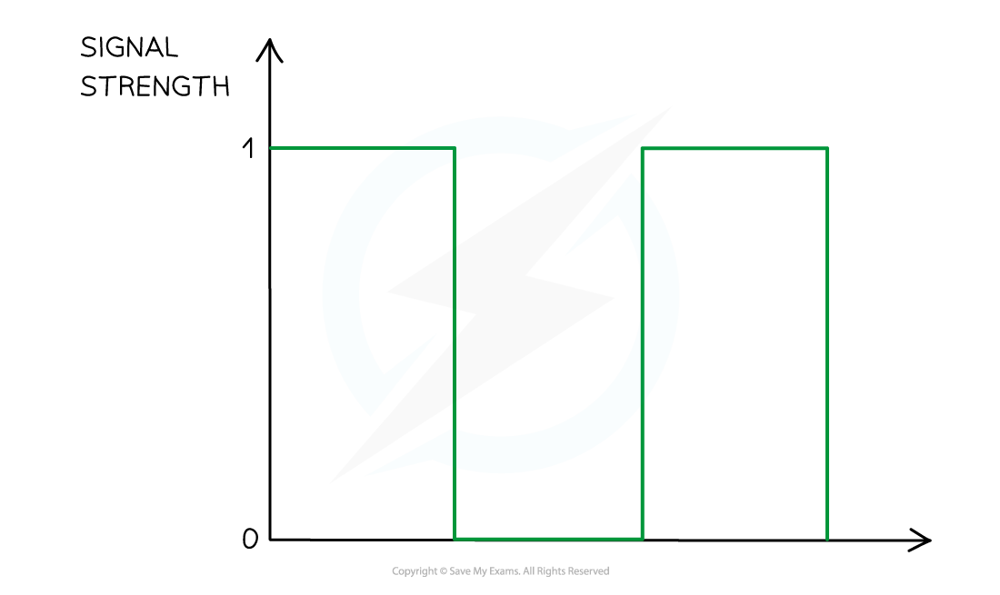
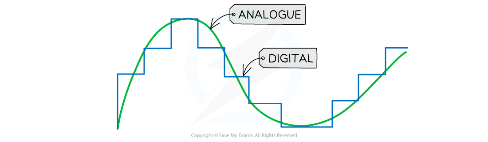

# Digital & Analogue Signals

## Digital & analogue signals

> **Spec point** — `spcpt_yD2xKybR7NYJbjwh` · Know the difference between a digital and analogue signal

## Digital & analogue signals

### Extended Tier Only

- There are two types of signals:

  - analogue
  - digital

- **Analogue signals vary continuously** - they can take any value

*An analogue signal is continuously varying, taking any value*

- **A digital signal can only take one of two (discrete) states**

  - These are usually referred to as:
  
    - **1**s and **0**s
    - **high**s and **low**s
    - **on**s and **off**s

*A digital signal can only take one of two values – 0 or 1*

## Transmission of sound

> **Spec point** — `spcpt_HHdrgnSw9bbnsdBf` · Know that a sound can be transmitted as a digital or analogue signal

## Transmission of sound

### Extended Tier Only

- Sound waves can be transmitted as a **digital** or **analogue** signal

- Signals for speech or music are made up of varying frequencies

  - To make out the information clearly, the signal needs to be transmitted with as little interference as possible

- The signal undergoes **digital sampling**
- It is converted **both before transmission** and **after being received**

  - Before transmission: the signal is converted from **analogue** to **digital**
  - After being received: the signal is converted back from **digital** to **analogue**

## Benefits of digital signalling

> **Spec point** — `spcpt_2Wf54wWxwdr4ZMtt` · nan

## Benefits of digital signalling

### Extended Tier Only

*Digitally sampling an analogue signal*

- The key **advantages** of data transmission in **digital** form compared to analogue are:

  - The signal can be ***regenerated*** so there is minimal ***noise***
  - Due to accurate signal regeneration, the **range** of digital signals is **larger** than the range of analogue signals (they can **cover larger distances**)
  - Digital signals enable an **increased rate of data transmission **compared to analogue
  - Extra data can be added so that the signal can be checked for errors

> **Exam Hint**
> Remember that digital sampling is when you convert an analogue signal into a digital signal by recording sound at set time intervals.
