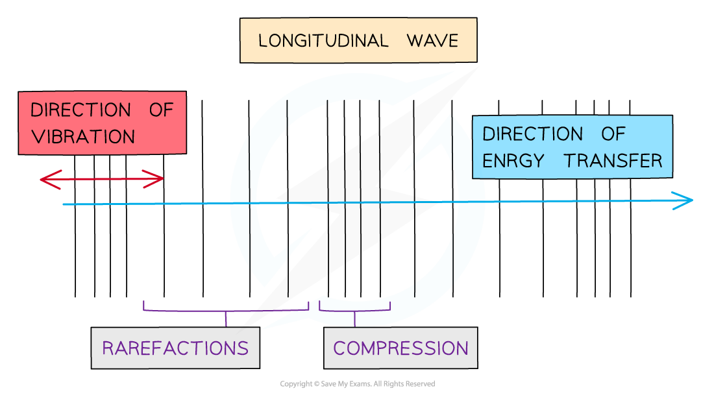
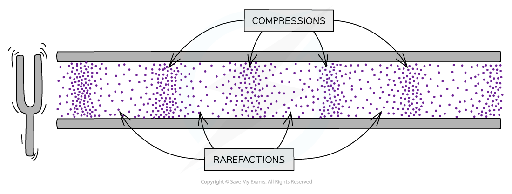
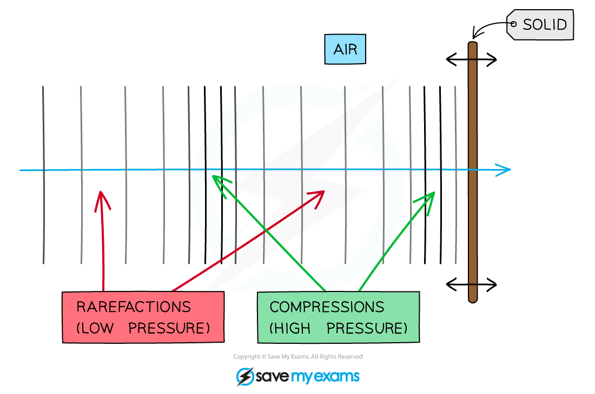

# Sound Waves

## Describing sound

> **Spec point** — `spcpt_nPb5JVCzcQttpmds` · Describe the production of sound by vibrating sources
Describe the longitudinal nature of sound waves
Know that a medium is needed to transmit sound waves

## Describing sound

- Sound waves are produced by **vibrating** sources
- Sound waves are [longitudinal](https://www.savemyexams.com/igcse/physics/cie/23/revision-notes/3-waves/3-1-general-properties-of-waves/3-1-3-transverse-and-longitudinal-waves/?_ai=internal-linking)

  - So a **medium** is needed to transmit sound waves
  - This means if there are no particles, such as in a **vacuum**, then the sound can’t travel through it

- When a sound wave comes into contact with a solid, the longitudinal wave vibrations are **transferred** to the solid

  - For example, sound waves can cause a drinking glass to vibrate
  - If the glass vibrates too much the movement causes the glass to shatter

### Representing longitudinal waves

- Longitudinal waves are usually drawn as several lines to show that the wave is moving **parallel** to the direction of energy transfer

  - Drawing the lines closer together represents the **compressions**
  - Drawing the lines further apart represents the **rarefactions**

#### Representing a longitudinal wave with compression and rarefaction

*Longitudinal waves are represented as sets of lines with rarefactions and compressions*

## Compression & rarefaction

> **Spec point** — `spcpt_HpPnWNQ6yMMZGWwq` · Describe compression and rarefaction

## Compression & rarefaction

### Extended Tier Only

- Longitudinal waves consist of compressions and **rarefactions**:

  - A **compression** is a region of higher density i.e. a place where the particles are close together
  - A **rarefaction** is a region of lower density i.e. a place where the particles are spread further apart

*Sound is a longitudinal wave consisting of compressions and rarefactions - these are areas where the pressure of the air in the pipe varies with the wave*

- These compressions and rarefactions cause changes in pressure, which vary in time with the wave

  - Therefore, sound is a type of **pressure wave**

- When the waves hit a solid, the variations in pressure cause the surface of the solid to **vibrate** in sync with the sound wave

*When sound waves hit a solid, the fluctuating pressure causes the solid to vibrate*

> **Exam Hint**
> When describing compressions and rarefactions, make sure to use the correct terms. You must explicitly state that it is the **particles** (or molecules/atoms) of the medium that are closer together or further apart, not the wave.
