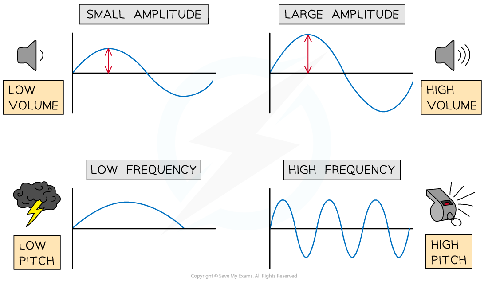
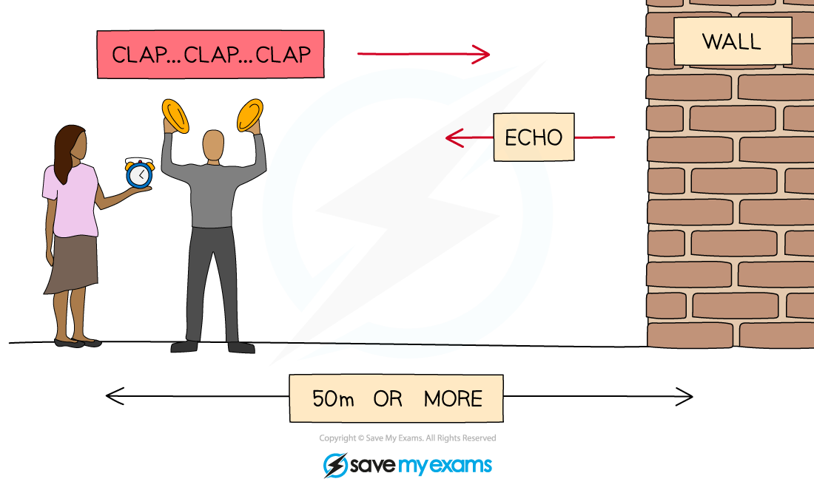

# Effects of Sound Waves

## Pitch & loudness

> **Spec point** — `spcpt_R2TSHYWGWfSKZpTg` · Describe how changes in amplitude and frequency affect the loudness and pitch of sound waves

## Pitch & loudness

- Changes in **frequency** and **amplitude** affect the **pitch** and **loudness** of sound waves

- The ***frequency*** of a sound wave is related to its **pitch**

  - Sounds with a **high** pitch have a **high** frequency (or short wavelength)
  - Sounds with a **low** pitch have a **low** frequency (or long wavelength)
- The ***amplitude*** of a sound wave is related to its **loudness**

  - Sounds with a **large** amplitude have a **greater** loudness
  - Sounds with a **small** amplitude have a **decreased** loudness

*Pitch and loudness of sound*

## Echoes

> **Spec point** — `spcpt_KH9YNpH3mnxcnpNG` · Describe an echo as the reflection of sound waves

## Echoes

- Sound waves **reflect** off hard surfaces

  - The reflection of a sound wave is called an **echo**

*A clap sound is reflected off a wall. When the reflected sound is heard, this is the echo*

- The distance to the surface where the echo reflects can be calculated using the equation:

$\mathrm{distance}=\frac{1}{2}\times\mathrm{speed}\times\mathrm{time}$

- Where:

  - distance = half the total distance travelled by the sound wave, measured in metres (m)
  - speed = [speed of sound in air](https://www.savemyexams.com/igcse/physics/cie/23/revision-notes/3-waves/3-4-sound/3-4-2-measuring-the-speed-of-sound/?_ai=internal-linking), measured in metres per second (330 – 350 m/s)
  - time = total time for sound wave to travel to the surface and back, measured in seconds (s)
