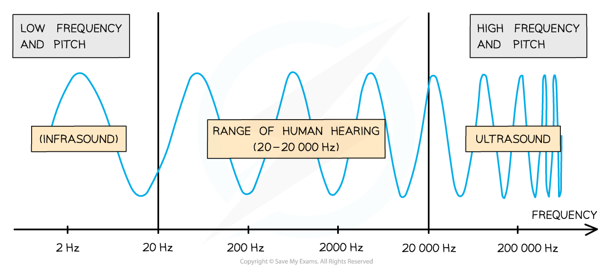
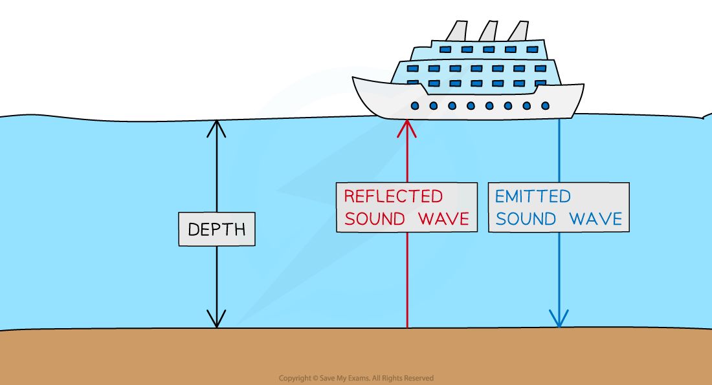
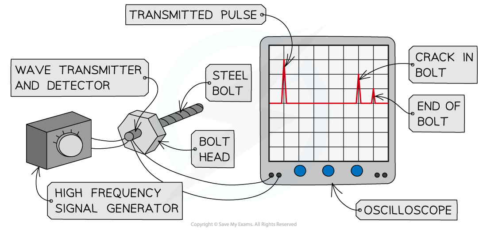
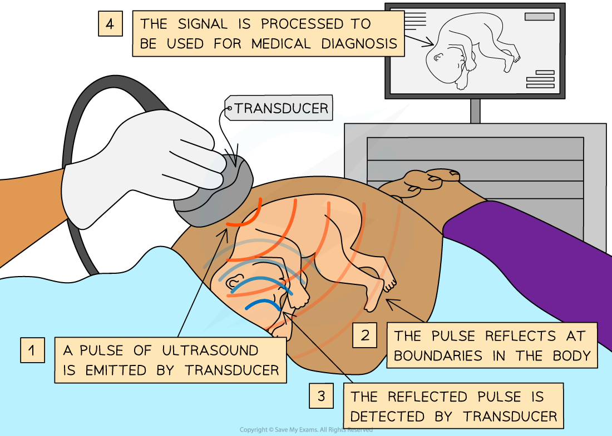
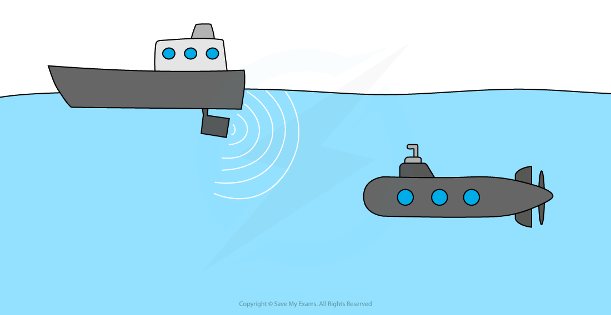

# Ultrasound

## Ultrasound

> **Spec point** — `spcpt_SKQgXb6xdgGPjmsf` · State the approximate range of frequencies audible to humans as 20 Hz to 20 000 Hz
Define ultrasound as sound with a frequency higher than 20 kHz

## Ultrasound

- The approximate range of frequencies audible to humans is 20 Hz to 20 000 Hz

  - The human hearing range decreases with age

*Humans can hear sounds between 20 and 20 000 Hz*

- **Ultrasound** is defined as:

**Sound with a frequency higher than 20 kHz**

## Uses of ultrasound

> **Spec point** — `spcpt_qyZgzSq3jX7p64rd` · Describe the uses of ultrasound in:
 -  non-destructive testing of materials, 
 - medical scanning of soft tissue and 
 - sonar including calculation of depth or distance from time and wave speed

## Uses of ultrasound

### Extended Tier Only

- Ultrasound is used in:

  - non-destructive **testing of materials**
  - **medical scanning** of soft tissue
  - **sonar** to calculate the depth or distance from time and wave speed

### Measuring the depth of a boundary

- When ultrasound signals reach a **boundary** between two media, some of the waves are **partially reflected**

  - The remainder of the waves are **transmitted** through the material
- Ultrasound transducers:

  - **emit** and **receive** ultrasound
  - **display** the received signal on an **oscilloscope screen**
- The depth of the boundary can be determined using:

  - **time taken** between the ultrasound being emitted and received
  - knowing the **speed** of the ultrasound through the material

*The depth of a boundary is measured using the difference between emitted and received ultrasound pulses*

- The depth of the boundary is calculated using the equation:

$\mathrm{depth}=\frac{1}{2}\times\mathrm{speed}\times\mathrm{time}$

- Where:

  - depth = half the total distance travelled by the ultrasound, measured in metres (m)
  - speed = speed of the ultrasound in the medium, measured in metres per second (m/s)
  - time = total time from ultrasound emission to receipt, measured in seconds (s)

### Ultrasound in material testing

- In industry, ultrasound can be used to:

  - check for cracks inside metal objects
  - generate images from beneath surfaces

- Ultrasound waves that reach a **crack** in an object, such as a metal bar, are reflected back from the crack earlier than the waves that continue to be absorbed through the object

  - The reflected waves are displayed as pulses on an oscilloscope trace
- This allows engineers to **assess** the structure of an object

#### Oscilloscope display for material imperfection testing

*Ultrasound is partially reflected at boundaries, so in a bolt with no internal cracks, there should only be two pulses (at the start and end of the bolt)*

### Ultrasound in medicine

- In medicine, ultrasound can be used:

  - to construct images of a **foetus** in the womb
  - to generate 2D images of **organs** and other internal structures (as long as they are **not** surrounded by bone)
  - as a medical **treatment** such as removing kidney stones

- The ultrasound waves are reflected back to the transducer by **boundaries** between tissues in the path of the beam

  - Examples of boundaries are between fluid and soft tissue or tissue and bone

- By taking a series of ultrasound measurements, sweeping across an area, the time measurements may be used to build up an **image**
- Unlike many other medical imaging techniques, ultrasound is **non-invasive** and is believed to be **harmless**

#### Ultrasound image of a foetus in the womb

*Ultrasound can be used to construct an image of a foetus in the womb*

### Sonar

- Echo sounding can be used to measure **depth** or to **detect objects underwater**

  - A sound wave can be transmitted from the surface of the water
  - The sound wave is reflected off the bottom of the ocean

- The time it takes for the sound wave to return is used to calculate the depth of the water
- The **distance** the wave travels is **twice the depth** of the ocean

  - This is the distance to the ocean floor plus the distance for the wave to return

#### Echo sounding

*Echo sounding is used to determine water depth*

> **Worked Example**
> 
> 
> In the diagram above, a very high-frequency sound wave is used to check for internal cracks in a large steel bolt. The oscilloscope trace shows that the bolt does have an internal crack. Each division on the oscilloscope represents a time of 0.000002 s. The speed of sound through steel is 6000 m/s.
> 
> Calculate the distance, in cm, from the head of the bolt to the internal crack.
> 
> [4]
> 
> **Answer:**
> 
> **Step 1: List the known quantities**
> 
> - Speed of ultrasound, $v=6000m/s$
> - Time taken between emission and detection, $t=5\times0.000002=0.00001s$ **[1 mark]**
> 
> **Step 2: Write down the equation relating speed, distance and time**
> 
> $\mathrm{distance}=\mathrm{speed}\times\mathrm{time}$
> 
> **Step 3: Calculate the total distance travelled by the sound wave**
> 
> $\mathrm{total} \mathrm{distance}=6000\times0.00001=0.06m$ **[1 mark]**
> 
> **Step 4: Calculate the distance travelled by the sound wave to the crack**
> 
> $\mathrm{distance} \mathrm{to} \mathrm{the} \mathrm{crack}=\frac{0.06}{2}=0.03m$ **[1 mark]**
> 
> **Step 5: Convert the distance to cm**
> 
> $\mathrm{distance} \mathrm{to} \mathrm{the} \mathrm{crack}=3\mathrm{cm}$ **[1 mark]**
