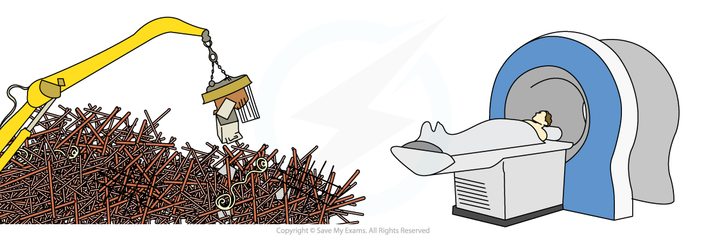

# Magnetism

## Magnetism

> **Spec point** — `spcpt_BP68dFRYDBt83DnY` · Describe the forces between magnetic poles and between magnets and magnetic materials, including the use of the terms:
 -  north pole (N pole), 
 - south pole (S pole), 
 - attraction and repulsion, 
 - magnetised and unmagnetised

## Magnetism

### Forces between magnetic poles

- The ends of a magnet are called **poles**
- Magnets have two poles: a **north** and a **south**
- Magnetic forces are **strongest** at the poles

#### North and south poles of a magnet

*Poles of a magnet*

- When two magnets are held close together, there will be a force between the magnets

  - **Like poles repel** (push each other apart)
  
    - A north pole will repel a north pole
    - A south pole will repel a south pole
  - **Opposite poles attract** (are pulled towards each other)
  
    - A north pole will be attracted to a south pole

#### Magnet attraction and repulsion

*Opposite poles attract and like poles repel*

- The attraction or repulsion between two magnetic poles is an example of a** non-contact force**

> **Exam Hint**
> In your exam, you need to be able to predict the interaction that will occur between magnets when given their physical arrangement.

## Uses of magnets

> **Spec point** — `spcpt_yFxY2jNfVwYrfCMh` · Describe the uses of permanent magnets and electromagnets

## Uses of magnets

### Uses of permanent magnets

- Uses of permanent magnets include:

  - **Compasses:** for thousands of years humans have used compasses for navigation, since the needle always points north
  - **School lab experiments:** the magnets used in school science demonstrations are permanent magnets
  - **Toys:** toy trains and trucks often have magnets which attach the carriages or trailers to the engine or cab
  - **Fridge magnets:** these are made either of flexible magnetic material or by sticking a magnet to the back of something

#### Some uses of magnets

*Compasses and toy trains are two examples of the use of permanent magnets*

### Uses of electromagnets

- [Electromagnets](https://www.savemyexams.com/igcse/physics/cie/23/revision-notes/4-electricity-and-magnetism/4-4-electromagnetic-effects/4-4-4-magnetic-effect-of-a-current/?_ai=internal-linking) have many uses including:

  - **MRI scanners:** in hospitals, an MRI scanner is a large, cylindrical machine using powerful electromagnets to produce diagnostic images of the organs of the body
  - **Speakers and earphones:** the loudspeakers, microphones and earphones used in phones and laptops use electromagnets to sense or send soundwaves
  - **Recycling:** because steel is a magnetic material it can be easily separated from other metals and materials using electromagnets
  
    - Once recovered the steel is re-used and recycled, reducing mining for iron ore and processing ore into steel
  - **Mag-Lev trains:** the ability of Mag-Lev trains to hover above the rails is due to them being repelled by large electromagnets on the train and track
  
    - This reduces friction and allows speeds of nearly 640 km/h

#### Some uses of electromagnets

*Picking and sorting scrap metal and an MRI scanner are two examples of the uses of electromagnets*
